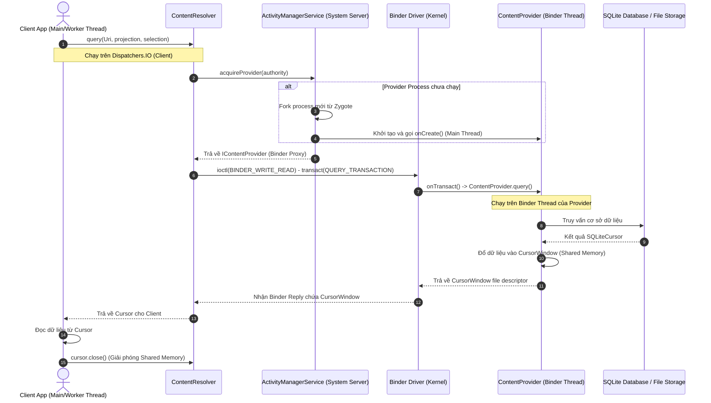
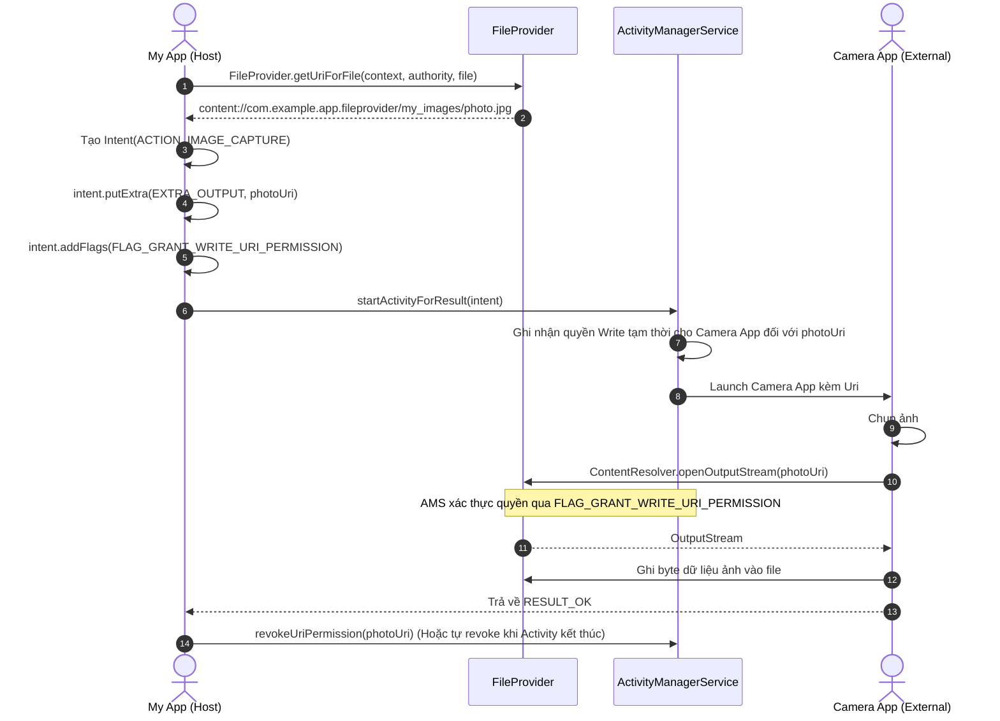

# ContentProvider và FileProvider - Cơ chế chia sẻ dữ liệu & IPC

## 1. Tổng quan (What & Why)

### 1.1 ContentProvider là gì?
`ContentProvider` là một trong bốn thành phần cốt lõi (Core Components) của Android (`Activity`, `Service`, `BroadcastReceiver`, `ContentProvider`). Về bản chất, nó đóng vai trò là một **chuẩn giao diện (CRUD interface) trừu tượng hóa** cho việc truy cập và chia sẻ dữ liệu có cấu trúc giữa các tiến trình khác nhau (Inter-Process Communication - IPC) hoặc giữa các tầng trong cùng một ứng dụng.

Dữ liệu do `ContentProvider` quản lý thường được biểu diễn dưới dạng các bảng hai chiều (tương tự như một hệ cơ sở dữ liệu quan hệ RDBMS), trong đó mỗi hàng là một bản ghi (record) và mỗi cột là một trường dữ liệu (column/attribute) với kiểu dữ liệu xác định.

### 1.2 Tại sao cần ContentProvider?
1. **Bảo mật và Phân quyền mức IPC (Inter-Process Security):** 
   - Trong Linux kernel của Android, mỗi ứng dụng chạy dưới một UID (User ID) riêng biệt trong sandbox cô lập. Một tiến trình không thể trực tiếp đọc/ghi file hay SQLite database của một tiến trình khác.
   - `ContentProvider` đóng vai trò là một "cổng kiểm soát" (Gatekeeper), đứng giữa dữ liệu nhạy cảm và thế giới bên ngoài. Nó cho phép áp dụng các quyền truy cập chi tiết: quyền đọc riêng (`readPermission`), quyền ghi riêng (`writePermission`), hoặc cấp quyền tạm thời theo từng URI (`grantUriPermissions`).
2. **Trừu tượng hóa nguồn dữ liệu (Data Abstraction):**
   - Phía Client không cần biết dữ liệu được lưu trong SQLite, Room, SharedPreferences, Network cache hay file nhị phân. Client chỉ tương tác qua `ContentResolver` bằng một địa chỉ thống nhất: **Content URI**.
3. **Tích hợp sâu với Android Framework:**
   - Hệ điều hành Android sử dụng `ContentProvider` làm kiến trúc nền tảng cho các kho dữ liệu dùng chung của hệ thống: `ContactsContract`, `CalendarContract`, `MediaStore` (ảnh, video, audio), `Telephony` (SMS/MMS), và `Settings`.
4. **Chia sẻ tệp an toàn (Safe File Sharing với FileProvider):**
   - Kể từ Android 7.0 (API 24), việc chia sẻ tệp bằng scheme `file://` bị chặn hoàn toàn (`FileUriExposedException`). `FileProvider` (một lớp con đặc thù của `ContentProvider`) trở thành cơ chế chuẩn duy nhất để sinh ra các `content://` URI với quyền truy cập tạm thời được cấp có kiểm soát.

---

## 2. Cơ chế hoạt động bên trong (Internal Mechanism)

### 2.1 ContentResolver: Client-side Facade
Client không bao giờ tương tác trực tiếp với một instance của `ContentProvider`. Thay vào đó, Client sử dụng `ContentResolver` (lấy qua `context.contentResolver`).

```
Client App                     Android Framework                     Provider App
┌──────────────┐               ┌────────────────┐               ┌─────────────────┐
│ Content-     │  query(Uri)   │ Activity-      │ getProvider() │ ContentProvider │
│ Resolver     │──────────────►│ ManagerService │──────────────►│ (Binder Stub)   │
└──────────────┘               └────────────────┘               └─────────────────┘
       │                                                                 ▲
       │                  Binder IPC: IContentProvider.query()           │
       └─────────────────────────────────────────────────────────────────┘
```

- **Facade Pattern:** `ContentResolver` che giấu toàn bộ sự phức tạp của Binder IPC.
- **Resolution Process:**
  1. Client gọi `contentResolver.query(uri, ...)`.
  2. `ContentResolver` bóc tách `authority` từ URI và hỏi `ActivityManagerService` (AMS) xem provider nào sở hữu authority đó.
  3. Nếu process chứa Provider chưa chạy, AMS sẽ khởi động process đó.
  4. AMS trả về cho Client một Binder Proxy (`IContentProvider`).
  5. `ContentResolver` thực hiện Binder IPC call trực tiếp tới Provider thông qua proxy này.

### 2.2 Cấu trúc Content URI
Mỗi tài nguyên trong `ContentProvider` được định danh duy nhất bởi một URI tuân theo cú pháp:

```
  content://com.example.app.provider/users/42
  └──┬───┘  └──────────┬───────────┘ └──┬─┘ └┬┘
   Scheme          Authority           Path  ID
```

- **Scheme (`content://`):** Bắt buộc phải là `content://`, báo cho hệ thống biết đây là tài nguyên được phục vụ bởi một `ContentProvider`.
- **Authority:** Tên định danh duy nhất cho Provider trong toàn bộ hệ thống Android (thường đặt dạng package name: `<package_name>.provider`). Được khai báo trong `AndroidManifest.xml`.
- **Path:** Xác định tập hợp dữ liệu cụ thể (ví dụ: `users`, `products`, `orders`).
- **ID:** (Tùy chọn) Khóa chính của một bản ghi cụ thể (ví dụ: `42`).

### 2.3 Cơ chế phân giải URI với `UriMatcher`
Bên trong `ContentProvider`, phương thức xử lý cần phân biệt nhanh chóng URI trỏ tới toàn bộ bảng (directory/collection) hay trỏ tới một bản ghi duy nhất (item). Android cung cấp `UriMatcher` sử dụng thuật toán Radix Tree/Trie để khớp mẫu URI hiệu quả:

```kotlin
class UserProvider : ContentProvider() {

    companion object {
        private const val AUTHORITY = "com.example.app.provider"
        private const val CODE_USERS = 100
        private const val CODE_USER_ID = 101

        private val uriMatcher = UriMatcher(UriMatcher.NO_MATCH).apply {
            // content://com.example.app.provider/users
            addURI(AUTHORITY, "users", CODE_USERS)
            // content://com.example.app.provider/users/#
            addURI(AUTHORITY, "users/#", CODE_USER_ID)
        }
    }
}
```

### 2.4 MIME Types: Directory vs Item
Hàm `getType(uri: Uri)` của `ContentProvider` trả về MIME type tiêu chuẩn của dữ liệu:
- **Tập hợp nhiều bản ghi (Directory):** Bắt đầu bằng tiền tố `vnd.android.cursor.dir/`
  - Ví dụ: `vnd.android.cursor.dir/vnd.com.example.users`
- **Một bản ghi đơn lẻ (Item):** Bắt đầu bằng tiền tố `vnd.android.cursor.item/`
  - Ví dụ: `vnd.android.cursor.item/vnd.com.example.users`

Hệ thống dùng MIME type này để kiểm tra tương thích trong `Intent.setType()`, `IntentFilter`, và chia sẻ qua clipboard.

### 2.5 Concurrency & Threading Model
Đây là một điểm các Senior Engineer **phải nắm rõ**:
- **Khởi tạo (`onCreate()`):** Chạy trên **Main Thread (UI Thread)** của tiến trình lưu trữ Provider. Nó được gọi khi process khởi động, **TRƯỚC CẢ** phương thức `Application.onCreate()`. Do đó, tuyệt đối không được thực hiện I/O nặng trong `onCreate()` của Provider vì sẽ gây block app startup.
- **Các hàm CRUD (`query`, `insert`, `update`, `delete`, `call`):** Được gọi thông qua Binder IPC, do đó chúng chạy trên **Binder Thread Pool** (mỗi tiến trình có một pool khoảng 16 threads). Các hàm này là **thread-safe** bắt buộc: nếu Provider dùng SQLite (vốn hỗ trợ thread-concurrency hạn chế), lập trình viên phải bảo đảm tính toàn vẹn thông qua synchronization hoặc relies on SQLite WAL mode.
- **Phía Client:** `contentResolver.query(...)` là một **synchronous blocking call**. Nếu gọi trên Main Thread của Client, nó sẽ block UI và gây **ANR (Application Not Responding)** nếu Provider bị chậm hoặc đang chờ lock SQLite. Phía Client luôn phải bọc call này trong Coroutines (`Dispatchers.IO`) hoặc background worker.

### 2.6 Cursor và Cơ chế IPC Memory Mapping (`CursorWindow`)
Dữ liệu từ `query()` được truyền qua IPC dưới dạng một `Cursor`. Nhưng làm sao truyền hàng ngàn dòng dữ liệu nặng giữa hai process độc lập?
- Android sử dụng **`CursorWindow`**: Một vùng bộ nhớ chia sẻ ẩn (anonymous shared memory - `ashmem`) được ánh xạ (memory mapped) giữa Provider Process và Client Process.
- **Giới hạn kích thước:** Kích thước mặc định của một `CursorWindow` thường là **2MB** (trước Android 9 là 1MB).
- **Rủi ro vỡ bộ nhớ IPC:** Nếu một dòng đơn lẻ chứa BLOB hoặc chuỗi ký tự quá lớn (> 2MB), query sẽ quăng ngoại lệ `CursorWindowAllocationException` hoặc `RowTooBigException`.
- **Đóng Cursor:** `Cursor` giữ con trỏ tới vùng shared memory và SQLite native statement. Nếu không đóng bằng `cursor.close()` hoặc Kotlin `use { }`, ứng dụng sẽ rò rỉ bộ nhớ native (`CursorWindow` leak) dẫn đến crash tiến trình.

### 2.7 Batch Operations: `applyBatch()` và Atomic Transaction
Khi cần thực hiện nhiều thao tác ghi dữ liệu cùng lúc, việc gọi từng lần `insert()` / `update()` sẽ gây ra hàng loạt lần context switch qua Binder IPC và SQLite lock overhead.
- Giải pháp: Sử dụng `ContentResolver.applyBatch(authority, ArrayList<ContentProviderOperation>)`.
- Provider sẽ thực thi toàn bộ danh sách operation trong **một SQLite transaction duy nhất** (`beginTransaction() ... setTransactionSuccessful() ... endTransaction()`).
- Giảm thiểu tối đa số lần Binder IPC round-trip từ N lần xuống còn **1 lần**.

---

## 3. Luồng hoạt động (Flow Diagram)

### 3.1 Luồng truy vấn dữ liệu từ ContentResolver qua Binder IPC



### 3.2 Luồng cấp quyền URI an toàn với FileProvider và Camera Intent



---

## 4. Real-world Use Case

### 4.1 Cấu hình FileProvider chia sẻ ảnh an toàn (Camera / Share Sheet)

**Bước 1: Khai báo FileProvider trong `AndroidManifest.xml`**

```xml
<manifest xmlns:android="http://schemas.android.com/apk/res/android">
    <application>
        <provider
            android:name="androidx.core.content.FileProvider"
            android:authorities="${applicationId}.fileprovider"
            android:exported="false"
            android:grantUriPermissions="true">
            <meta-data
                android:name="android.support.FILE_PROVIDER_PATHS"
                android:resource="@xml/file_paths" />
        </provider>
    </application>
</manifest>
```

**Bước 2: Định nghĩa các đường dẫn an toàn trong `res/xml/file_paths.xml`**

```xml
<?xml version="1.0" encoding="utf-8"?>
<paths xmlns:android="http://schemas.android.com/apk/res/android">
    <!-- Map với Context.getCacheDir(): /data/user/0/pkg/cache/shared/ -->
    <cache-path name="shared_cache" path="shared/" />
    
    <!-- Map với Context.getFilesDir(): /data/user/0/pkg/files/images/ -->
    <files-path name="user_images" path="images/" />
    
    <!-- Map với Context.getExternalFilesDir(null) -->
    <external-files-path name="ext_images" path="Pictures/" />
</paths>
```

**Bước 3: Tạo Content URI và cấp quyền cho Camera Intent trong Kotlin**

```kotlin
import android.content.Context
import android.content.Intent
import android.net.Uri
import android.provider.MediaStore
import androidx.core.content.FileProvider
import java.io.File

class CameraCaptureHelper(private val context: Context) {

    fun createCaptureIntent(targetFile: File): Pair<Intent, Uri> {
        val authority = "${context.packageName}.fileprovider"
        
        // Sinh content:// URI đại diện cho targetFile
        val contentUri: Uri = FileProvider.getUriForFile(context, authority, targetFile)

        val intent = Intent(MediaStore.ACTION_IMAGE_CAPTURE).apply {
            putExtra(MediaStore.EXTRA_OUTPUT, contentUri)
            // Cực kỳ quan trọng: Cấp quyền ghi tạm thời cho Activity đích
            addFlags(Intent.FLAG_GRANT_WRITE_URI_PERMISSION)
            addFlags(Intent.FLAG_GRANT_READ_URI_PERMISSION)
        }

        return Pair(intent, contentUri)
    }
}
```

### 4.2 Truy vấn MediaStore an toàn với Coroutines (Scoped Storage)

```kotlin
import android.content.ContentUris
import android.content.Context
import android.net.Uri
import android.os.Build
import android.provider.MediaStore
import kotlinx.coroutines.Dispatchers
import kotlinx.coroutines.withContext

data class MediaAudioItem(
    val id: Long,
    val uri: Uri,
    val title: String,
    val durationMs: Long,
    val sizeBytes: Long
)

class MediaRepository(private val context: Context) {

    suspend fun queryAudios(): List<MediaAudioItem> = withContext(Dispatchers.IO) {
        val audioList = mutableListOf<MediaAudioItem>()

        val collectionUri: Uri = if (Build.VERSION.SDK_INT >= Build.VERSION_CODES.Q) {
            MediaStore.Audio.Media.getContentUri(MediaStore.VOLUME_EXTERNAL)
        } else {
            MediaStore.Audio.Media.EXTERNAL_CONTENT_URI
        }

        val projection = arrayOf(
            MediaStore.Audio.Media._ID,
            MediaStore.Audio.Media.TITLE,
            MediaStore.Audio.Media.DURATION,
            MediaStore.Audio.Media.SIZE
        )

        val selection = "${MediaStore.Audio.Media.DURATION} >= ?"
        val selectionArgs = arrayOf("10000") // Lọc audio >= 10 giây
        val sortOrder = "${MediaStore.Audio.Media.DATE_ADDED} DESC"

        // Luôn sử dụng use{} để tự động giải phóng CursorWindow Shared Memory
        context.contentResolver.query(
            collectionUri,
            projection,
            selection,
            selectionArgs,
            sortOrder
        )?.use { cursor ->
            val idColumn = cursor.getColumnIndexOrThrow(MediaStore.Audio.Media._ID)
            val titleColumn = cursor.getColumnIndexOrThrow(MediaStore.Audio.Media.TITLE)
            val durationColumn = cursor.getColumnIndexOrThrow(MediaStore.Audio.Media.DURATION)
            val sizeColumn = cursor.getColumnIndexOrThrow(MediaStore.Audio.Media.SIZE)

            while (cursor.moveToNext()) {
                val id = cursor.getLong(idColumn)
                val title = cursor.getString(titleColumn) ?: "Unknown"
                val duration = cursor.getLong(durationColumn)
                val size = cursor.getLong(sizeColumn)

                val contentUri = ContentUris.withAppendedId(
                    MediaStore.Audio.Media.EXTERNAL_CONTENT_URI,
                    id
                )

                audioList.add(MediaAudioItem(id, contentUri, title, duration, size))
            }
        }

        return@withContext audioList
    }
}
```

### 4.3 Thực thi Transaction đồng loạt với `applyBatch()`

```kotlin
import android.content.ContentProviderOperation
import android.content.Context
import android.net.Uri

fun insertUsersBatch(context: Context, users: List<Pair<String, String>>) {
    val authority = "com.example.app.provider"
    val uri = Uri.parse("content://$authority/users")
    
    val operations = ArrayList<ContentProviderOperation>()

    for ((name, email) in users) {
        operations.add(
            ContentProviderOperation.newInsert(uri)
                .withValue("name", name)
                .withValue("email", email)
                .build()
        )
    }

    try {
        // Gom toàn bộ N phép ghi vào 1 IPC duy nhất và 1 SQLite Transaction
        val results = context.contentResolver.applyBatch(authority, operations)
        println("Successfully applied ${results.size} batch operations")
    } catch (e: Exception) {
        // Nếu 1 operation fail, toàn bộ transaction bị rollback
        e.printStackTrace()
    }
}
```

---

## 5. Anti-Patterns & Pitfalls

### 5.1 Lỗ hổng bảo mật: `android:exported="true"` không kiểm soát
> [!CAUTION]
> Trước Android 4.2 (API 17), `android:exported` có giá trị mặc định là `true` nếu bạn khai báo provider! Từ API 17 trở đi mặc định là `false`. Tuy nhiên nếu bạn đặt `exported="true"` để chia sẻ dữ liệu mà không định nghĩa permissions bảo vệ, bất kỳ app độc hại nào cài trên máy cũng có thể trích xuất hoặc phá hủy database của bạn.

```xml
<!-- ANTI-PATTERN: Để lộ toàn bộ database cho mọi ứng dụng trên máy -->
<provider
    android:name=".UserDataProvider"
    android:authorities="com.example.app.userdata"
    android:exported="true" /> <!-- NGUY HIỂM: Không có permission bảo vệ -->
```

**Cách khắc phục:**
1. Nếu chỉ dùng nội bộ app: luôn đặt `android:exported="false"`.
2. Nếu chia sẻ với app của cùng nhà phát triển: đặt quyền bảo vệ bằng `signature` permission:
```xml
<permission
    android:name="com.example.app.READ_USER_DATA"
    android:protectionLevel="signature" />

<provider
    android:name=".UserDataProvider"
    android:authorities="com.example.app.userdata"
    android:exported="true"
    android:readPermission="com.example.app.READ_USER_DATA" />
```

### 5.2 SQL Injection trong ContentProvider
Một lỗi kinh điển khi implement `ContentProvider`: ghép chuỗi trực tiếp trong `selection` thay vì sử dụng parameter binding (`selectionArgs`).

```kotlin
// ANTI-PATTERN: Dễ bị SQL Injection
override fun query(
    uri: Uri, projection: Array<String>?, selection: String?,
    selectionArgs: Array<String>?, sortOrder: String?
): Cursor? {
    // Hacker có thể truyền selection = "1=1; DROP TABLE users;--"
    val rawSql = "SELECT * FROM users WHERE $selection"
    return db.rawQuery(rawSql, null)
}

// BEST PRACTICE: Bắt buộc truyền selection và selectionArgs riêng biệt vào SQLiteQueryBuilder
override fun query(
    uri: Uri, projection: Array<String>?, selection: String?,
    selectionArgs: Array<String>?, sortOrder: String?
): Cursor? {
    val builder = SQLiteQueryBuilder()
    builder.tables = "users"
    return builder.query(db, projection, selection, selectionArgs, null, null, sortOrder)
}
```

### 5.3 Rò rỉ tài nguyên do không đóng Cursor
```kotlin
// ANTI-PATTERN: Nếu xảy ra Exception ở giữa, cursor không bao giờ được close()
val cursor = context.contentResolver.query(uri, null, null, null, null)
val name = cursor?.getString(0) // CursorWindow leak!

// BEST PRACTICE: Sử dụng use() extension function
context.contentResolver.query(uri, null, null, null, null)?.use { cursor ->
    if (cursor.moveToFirst()) {
        val name = cursor.getString(0)
    }
}
```

### 5.4 Lạm dụng ContentProvider để Initialize SDK (Startup Overhead)
Nhiều thư viện (như Firebase, WorkManager trước đây) sử dụng một `ContentProvider` rỗng chỉ để tự động lấy `Context` và khởi tạo SDK mà không bắt lập trình viên gọi `init(context)`.
- **Hậu quả:** Tất cả `ContentProvider` đều được khởi tạo trên **Main Thread** trước `Application.onCreate()`. Việc có hàng chục library-providers làm chậm trễ đáng kể thời gian khởi động app (**Cold Start time**).
- **Giải pháp hiện đại:** Chuyển sang sử dụng **Jetpack App Startup** (`androidx.startup:startup-runtime`) để gom tất cả initialization logic vào một Provider duy nhất và hỗ trợ khởi tạo bất đồng bộ (lazy/async initialization).

---

## 6. Trade-offs & So sánh

### 6.1 ContentProvider vs Room / SharedPreferences trong App nội bộ

| Tiêu chí | ContentProvider | Room / SQLite trực tiếp | SharedPreferences / DataStore |
| :--- | :--- | :--- | :--- |
| **Mục đích thiết kế** | Chia sẻ dữ liệu liên tiến trình (IPC) | Lưu trữ dữ liệu cấu trúc nội bộ | Lưu trữ Key-Value cặp nhỏ |
| **Hiệu năng truy vấn** | Chậm hơn (Overhead IPC + Binder + CursorWindow) | Rất nhanh (Truy cập bộ nhớ trong cùng process) | Nhanh (In-memory cache) |
| **Độ phức tạp code** | Rất cao (Cần Provider, Resolver, UriMatcher, URI parsing) | Thấp / Vừa (Type-safe qua Room DAO) | Cực kỳ đơn giản |
| **Hỗ trợ Typesafe & Reactive** | Thô sơ (Chỉ có raw Cursor + `ContentObserver`) | Cực tốt (`Flow<List<T>>`, RxJava, Suspend functions) | Tốt (`Flow<Preferences>`) |
| **Bảo mật IPC** | Hỗ trợ phân quyền mạnh mẽ (Signature, URI grant) | Không hỗ trợ chia sẻ ngoài Sandbox | Không hỗ trợ chia sẻ an toàn |
| **Khuyên dùng** | **Chỉ dùng khi chia sẻ dữ liệu ra app khác** | **Dùng cho 99% tác vụ lưu trữ nội bộ** | Dùng cho cấu hình, token, setting nhỏ |

---

## 7. Senior-level Insights

### 7.1 Startup Timing & Cold-start Impact
Thứ tự khởi tạo component khi cold start một process Android:
1. `Process.start()` -> Zygote fork process mới.
2. `ActivityThread.main()` -> Khởi tạo `Looper.prepareMainLooper()`.
3. `ActivityThread.attach()` -> Gửi Binder call tới AMS (`attachApplication`).
4. AMS gọi ngược lại app qua `ApplicationThread.bindApplication()`.
5. Tạo `Application` instance và gọi `Application.attachBaseContext()`.
6. **Gọi `ContentProvider.onCreate()` cho TẤT CẢ các providers được khai báo trong manifest!**
7. **Gọi `Application.onCreate()`!**
8. Khởi tạo Activity đầu tiên và gọi `Activity.onCreate()`.

> [!IMPORTANT]
> Vì `ContentProvider.onCreate()` chạy ở bước 6 (trước cả `Application.onCreate()`), mọi logic blocking (chờ network, parse JSON lớn, DB migration) đặt trong Provider sẽ trực tiếp cộng dồn vào thời gian xuất hiện frame đầu tiên (Time To Initial Display - TTID) của ứng dụng.

### 7.2 CursorWindow Exhaustion & Scoped Storage Migration
- Khi truy vấn nhiều cột dạng text dài, `CursorWindow` (2MB) có thể chỉ chứa được vài chục bản ghi. Khi Client duyệt qua `cursor.moveToNext()`, nếu vượt khỏi cửa sổ hiện tại, một IPC Binder request mới sẽ được kích hoạt ngầm dưới nền để nạp cửa sổ tiếp theo từ Provider. Điều này gây hiện tượng **UI lag/jank** nếu loop trên main thread.
- **Kinh nghiệm:** Luôn chỉ định rõ danh sách cột tối thiểu cần dùng trong `projection`, tuyệt đối tránh truyền `null` (tương đương `SELECT *`).
- **Từ Android 10 (Scoped Storage):** Không thể dùng các đường dẫn raw file path (`/storage/emulated/0/...`) để truy cập media. Mọi tương tác bắt buộc phải thông qua `MediaStore` (ContentProvider) và mở stream qua `contentResolver.openInputStream(uri)` hoặc `openFileDescriptor(uri, "r")`.

---

## 8. Câu hỏi phỏng vấn (với gợi ý trả lời)

### Q1: Tại sao từ Android 7.0 (API 24) không thể dùng `file://` URI trong Intent và phải thay bằng `FileProvider`?
**Gợi ý trả lời:**
- Trước API 24, app chia sẻ file bằng `Uri.fromFile(file)` sinh ra `file:///path/to/file`.
- Vấn đề: Để app nhận có thể đọc được file này, file đó phải nằm trên thẻ nhớ ngoài (External Storage) hoặc được cấp quyền đọc toàn cục thế giới (`MODE_WORLD_READABLE` - một lỗ hổng bảo mật cực lớn). Nếu file nằm trong Internal Storage (`/data/user/0/...`), app nhận không có UID của app gửi nên sẽ bị Linux Kernel chặn với lỗi `Permission Denied`.
- Từ Android 7.0, hệ thống kích hoạt `StrictPolicy` cấm để lộ `file://` URI ra bên ngoài và quăng `FileUriExposedException`.
- `FileProvider` giải quyết triệt để vấn đề này bằng cách gói file thành `content://` URI, ẩn giấu đường dẫn thực tế trên ổ cứng và cho phép cấp quyền đọc/ghi tạm thời an toàn thông qua cờ `FLAG_GRANT_READ_URI_PERMISSION`.

### Q2: `ContentProvider.onCreate()` chạy trên thread nào? Có rủi ro gì đối với hiệu năng app?
**Gợi ý trả lời:**
- Chạy trên **Main Thread (UI Thread)** của tiến trình sở hữu Provider.
- Rủi ro: Được kích hoạt tự động trước cả `Application.onCreate()`. Nếu Provider thực hiện tác vụ I/O nặng (mở DB phức tạp, đọc disk, init SDK mạng), nó sẽ làm tăng đáng kể thời gian khởi động ứng dụng (Cold Start time) và có thể gây ANR ngay lúc mở app.

### Q3: Các hàm `query()`, `insert()`, `update()`, `delete()` trong `ContentProvider` chạy trên thread nào? Cần lưu ý gì về thread-safety?
**Gợi ý trả lời:**
- Các hàm này chạy trên **Binder Thread Pool** của tiến trình chứa Provider, chứ không chạy trên Main Thread của Provider và cũng không chạy trên Main Thread của Client.
- Lưu ý: Do Binder Thread Pool có thể xử lý đồng thời nhiều IPC calls từ các tiến trình khác nhau, mã nguồn bên trong các hàm CRUD của `ContentProvider` bắt buộc phải là **Thread-safe**. Nếu truy cập SQLite, cần đảm bảo SQLiteOpenHelper được đồng bộ hóa hoặc bật chế độ Write-Ahead Logging (WAL).

### Q4: `ContentResolver.applyBatch()` hoạt động như thế nào và tại sao nó lại tối ưu hơn gọi `insert()` nhiều lần?
**Gợi ý trả lời:**
- Khi gọi `insert()` $N$ lần, hệ thống phải thực hiện $N$ lần Binder IPC round-trip (chuyển ngữ cảnh giữa hai tiến trình Client và Provider), đồng thời SQLite thực hiện $N$ transaction riêng rẽ (mỗi lần đều phải ghi journal vào disk).
- `applyBatch()` gửi toàn bộ danh sách `ContentProviderOperation` qua Binder IPC trong **một lần duy nhất**. Phía Provider bọc toàn bộ các thao tác này trong một block transaction duy nhất (`db.beginTransaction()`). Nhờ đó giảm thiểu tối đa Binder IPC overhead và tăng tốc độ ghi đĩa lên gấp hàng chục lần, đồng thời đảm bảo tính nguyên tử (Atomicity - All or Nothing).

### Q5: Giải thích giới hạn của `CursorWindow`? Khi nào xảy ra `CursorWindowAllocationException`?
**Gợi ý trả lời:**
- `CursorWindow` là vùng bộ nhớ chia sẻ (Shared Memory) dùng để truyền dữ liệu bảng giữa Provider và Client qua Binder IPC. Kích thước mặc định của nó là 2MB (hoặc 1MB trên các bản Android cũ).
- Ngoại lệ xảy ra khi:
  1. Một bản ghi đơn lẻ chứa dữ liệu (chuỗi văn bản hoặc BLOB như ảnh avatar) có kích thước vượt quá dung lượng tối đa của một `CursorWindow`.
  2. Ứng dụng bị cạn kiệt bộ nhớ file descriptor / shared memory do mở quá nhiều Cursor mà không gọi `cursor.close()`.

### Q6: Làm thế nào để bảo vệ một `ContentProvider` khi chia sẻ ra ngoài nhưng chỉ muốn một số ứng dụng cụ thể có thể truy cập?
**Gợi ý trả lời:**
- Có 3 cấp độ bảo vệ chính:
  1. **Signature Permission:** Định nghĩa một `<permission android:protectionLevel="signature">`. Chỉ những ứng dụng được ký cùng một Signing Certificate (KeyStore) với ứng dụng của bạn mới được cấp quyền này.
  2. **Runtime Verification:** Bên trong các hàm CRUD của Provider, gọi `Binder.getCallingUid()` và kiểm tra danh sách package name tương ứng thông qua `PackageManager.getPackagesForUid()` hoặc xác minh chữ ký chứng chỉ số của app đang gọi.
  3. **Temporary URI Grants:** Đặt `exported="false"`, nhưng cho phép `android:grantUriPermissions="true"`. Sau đó dùng `Context.grantUriPermission()` hoặc cờ `FLAG_GRANT_READ_URI_PERMISSION` để chia sẻ từng URI cụ thể cho một intent đích xác định.

### Q7: Tại sao trong ứng dụng đơn lẻ (nội bộ), Google khuyên dùng Room/Repository thay vì tạo `ContentProvider`?
**Gợi ý trả lời:**
- `ContentProvider` được thiết kế phục vụ IPC giữa các tiến trình khác nhau. Khi sử dụng nội bộ trong một tiến trình, nó mang lại overhead không đáng có: serialization dữ liệu vào `CursorWindow`, bóc tách URI, mất đi khả năng kiểm tra kiểu dữ liệu tĩnh tại compile-time (Type-safety).
- Room Database cung cấp Type-safe queries, hỗ trợ Compile-time verification của câu lệnh SQL, tích hợp trực tiếp với Kotlin Coroutines & Flow, và không có overhead của Binder/CursorWindow.

---

## 9. Tài liệu tham khảo
- [Android Developers - Content Provider Basics](https://developer.android.com/guide/topics/providers/content-provider-basics)
- [Android Developers - Setting up FileProvider](https://developer.android.com/reference/androidx/core/content/FileProvider)
- [Android Developers - Scoped Storage and MediaStore](https://developer.android.com/training/data-storage/shared/media)
- [AOSP - ContentProvider.java Source Code](https://cs.android.com/android/platform/superproject/+/master:frameworks/base/core/java/android/content/ContentProvider.java)
- [AOSP - CursorWindow.cpp Source Code](https://cs.android.com/android/platform/superproject/+/master:frameworks/base/libs/androidfw/CursorWindow.cpp)
