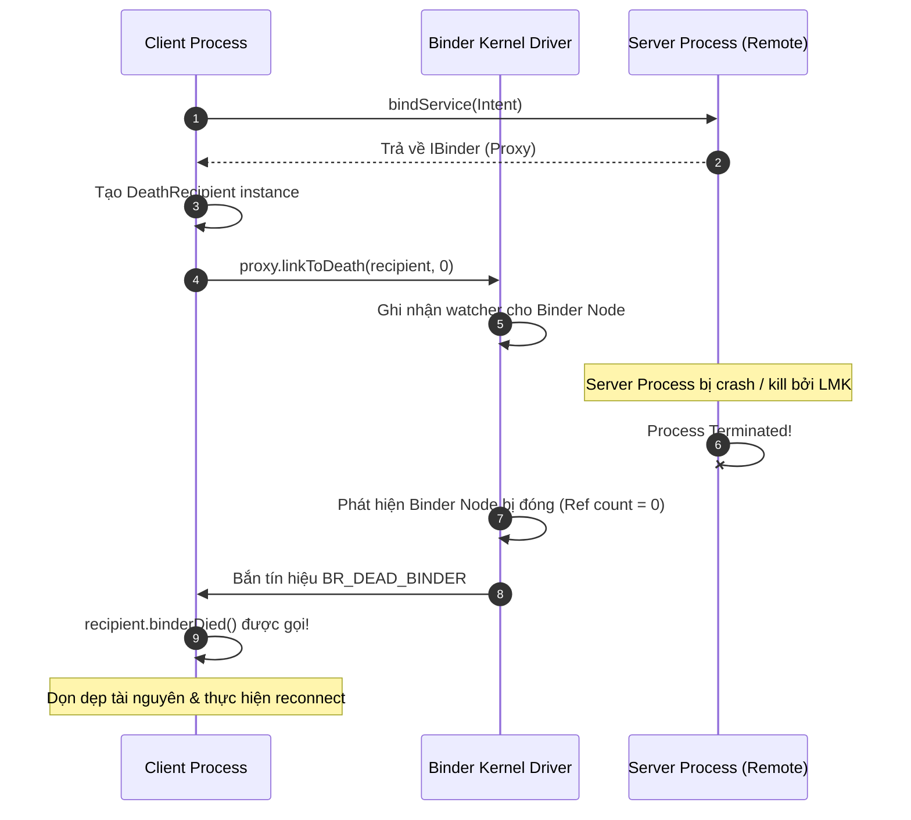

# Binder IPC - Cơ chế giao tiếp liên tiến trình cốt lõi của Android

## 1. Tổng quan (What & Why)

### 1.1 Binder là gì?
**Binder** là cơ chế giao tiếp liên tiến trình (Inter-Process Communication - IPC) và gọi thủ tục từ xa (Remote Procedure Call - RPC) nền tảng của hệ điều hành Android. Hầu như toàn bộ kiến trúc Android OS được xây dựng xoay quanh Binder: từ việc tương tác với các System Services (`ActivityManagerService`, `WindowManagerService`, `PackageManagerService`), tương tác phần cứng qua HAL (Hardware Abstraction Layer), cho tới các thành phần ứng dụng như `Bound Service` và `ContentProvider`.

Về mặt kỹ thuật, Binder là một hệ thống lai (hybrid system) bao gồm:
1. **Linux Kernel Driver (`/dev/binder`):** Trọng tài điều phối IPC ở tầng nhân Linux.
2. **Native C++ Framework (`libbinder`):** Các lớp cơ sở `ProcessState`, `IPCThreadState`, `BpBinder`, `BBinder`.
3. **Java Framework (`android.os.Binder`):** Lớp trừu tượng bậc cao dành cho ứng dụng Android (`IBinder`, `Binder`, `Parcel`).

### 1.2 Tại sao Android chọn Binder thay vì Socket, Pipe hay POSIX Shared Memory?
Hệ điều hành Linux truyền thống cung cấp rất nhiều cơ chế IPC (Pipes, FIFOs, Sockets, POSIX Message Queues, Shared Memory). Tuy nhiên, Android đã quyết định xây dựng Binder (dựa trên OpenBinder của BeOS) vì 3 lý do sống còn:

| Tiêu chí | Linux Sockets / Pipes | POSIX Shared Memory | Binder IPC (Android) |
| :--- | :--- | :--- | :--- |
| **Hiệu năng & Số lần Copy** | Kém (**2 lần copy**: User A → Kernel → User B) | Tốt nhất (**0 lần copy**) | Rất cao (**1 lần copy** nhờ cơ chế `mmap`) |
| **Bảo mật & Identity** | Kém (Phải tự parse header, dễ bị giả mạo UID) | Kém (Không có cơ chế kiểm soát truy cập đồng bộ) | **Tuyệt đối** (Kernel tự động gắn thẻ UID/PID của caller) |
| **Mô hình lập trình** | Byte-stream thô sơ, phải tự serialize/deserialize | Phải tự xử lý đồng bộ hóa khóa (Mutex, Semaphore) | **Hỗ trợ RPC hướng đối tượng** (Proxy/Stub, Parcelable, AIDL) |
| **Quản lý vòng đời** | Phức tạp khi process đột ngột bị kill | Dễ rò rỉ vùng nhớ dùng chung | **Hỗ trợ `DeathRecipient`** (phát hiện process chết lập tức) |

---

## 2. Cơ chế hoạt động bên trong (Internal Mechanism)

### 2.1 Kiến trúc cốt lõi: 1-Copy IPC qua `mmap()`
Tại sao Binder chỉ cần **1 lần copy dữ liệu**? Đây là câu hỏi kinh điển của mọi buổi phỏng vấn Android Senior:

```
[Client Process - User Space]        [Binder Driver - Kernel]        [Server Process - User Space]
┌───────────────────────────┐        ┌───────────────────────┐        ┌───────────────────────────┐
│ Client Buffer             │        │                       │        │ Server Buffer (Read-only) │
│ (Dữ liệu gốc của caller)  │        │                       │        │                           │
└─────────────┬─────────────┘        └───────────┬───────────┘        └─────────────▲─────────────┘
              │                                  │                                  │
              │  copy_from_user()                │          mmap() Virtual Mapping  │
              └─────────────────────────────────►│◄─────────────────────────────────┘
                                         (Chỉ copy 1 lần từ
                                        Client vào Shared Page)
```

1. Khi một tiến trình Server khởi động và sẵn sàng nhận Binder call, nó thực hiện gọi hàm `mmap()` thông qua file descriptor mở tới `/dev/binder`.
2. Binder Kernel Driver cấp phát một vùng nhớ vật lý (Physical Memory Pages) và ánh xạ nó đồng thời vào hai không gian:
   - Kernel Address Space.
   - User Address Space của Server Process (ở chế độ **Read-only** để Server không tự sửa đổi dữ liệu kernel).
3. Khi Client muốn gửi dữ liệu sang Server:
   - Client ghi dữ liệu vào một `Parcel` ở User Space của Client.
   - Binder Driver dùng hàm `copy_from_user()` để sao chép dữ liệu từ User Space của Client vào vùng nhớ Kernel Buffer đã được ánh xạ với Server.
   - Do vùng nhớ này **đã được map trực tiếp** vào Address Space của Server, Server có thể đọc trực tiếp dữ liệu ngay lập tức mà **không cần thêm một lần `copy_to_user()` nào nữa**!
4. **Kết quả:** Quá trình IPC giảm từ 2 lần copy (chuẩn Socket/Pipe) xuống còn **chỉ 1 lần copy duy nhất**.

### 2.2 Mô hình Proxy - Stub Pattern
Kiến trúc Binder RPC hoạt động dựa trên mô hình Proxy - Stub:

- **IBinder (`android.os.IBinder`):** Giao diện cơ sở định nghĩa phương thức `transact()`.
- **Proxy (Client Side - `BpBinder` ở C++ / Proxy class ở Java):**
  - Đóng vai trò là đại diện cục bộ của Server ở phía Client.
  - Khi Client gọi hàm `calculate(a, b)`, Proxy sẽ đóng gói tên hàm (Transaction Code) và tham số vào một `Parcel` gọi là `data`.
  - Proxy gọi hàm `mRemote.transact(TRANSACTION_CALCULATE, data, reply, flags)` để đẩy request vào Kernel Driver.
- **Binder Driver (`/dev/binder`):**
  - Chuyển ngữ cảnh (Context Switch) từ Client sang Server.
  - Tự động bổ sung thông tin UID và PID của Client vào transaction record.
- **Stub (Server Side - `BBinder` ở C++ / Stub class ở Java):**
  - Là lớp trừu tượng mà Server kế thừa.
  - Lắng nghe transaction từ Driver và triển khai hàm `onTransact(code, data, reply, flags)`.
  - Đọc tham số từ `Parcel data`, gọi hàm thực thi nội bộ `calculate(a, b)`, và ghi kết quả trả về vào `Parcel reply`.

### 2.3 Parcel: Serialization container tối ưu
Tại sao Android không sử dụng `java.io.Serializable` cho Binder IPC?
- **Nhược điểm của `Serializable`:** Sử dụng Java Reflection để duyệt qua các field của class, tạo ra vô số intermediate objects rác trong quá trình tuần tự hóa, kích hoạt Garbage Collector (GC) liên tục gây giật lag khung hình.
- **Ưu điểm của `Parcel`:** 
  - `Parcel` là một cấu trúc dữ liệu liên tục (contiguous memory buffer) được triển khai bằng C++ native memory.
  - Việc đọc/ghi dữ liệu được thực hiện tuần tự bằng các lệnh byte copy trực tiếp không qua Reflection: `writeInt()`, `writeString()`, `writeParcelable()`.
  - Lập trình viên tự tay viết code serialize/deserialize (hoặc dùng `@Parcelize`), loại bỏ hoàn toàn chi phí Reflection tại runtime.
  - Được thiết kế chuyên biệt để truyền qua Binder Driver (thậm chí có thể ghi cả Binder Object Reference hoặc File Descriptors vào Parcel qua `writeStrongBinder()` và `writeFileDescriptor()`).

### 2.4 Binder Thread Pool
Mỗi ứng dụng Android khi khởi tạo đều gọi `ProcessState::self()->startThreadPool()`.
- Mặc định, mỗi tiến trình có một Binder Thread Pool với kích thước tối đa là **16 threads** (được định danh là `binder:PID_X`, ví dụ `binder:1824_1`).
- Khi một Binder call từ Client đến, Binder Driver sẽ tìm một thread rảnh rỗi trong pool của Server để xử lý hàm `onTransact()`.
- **Lưu ý:** UI Thread (Main Thread) của một app **KHÔNG** thuộc Binder Thread Pool.

### 2.5 Synchronous vs Asynchronous (`oneway`) Calls
- **Synchronous Call (Mặc định):**
  - Khi Client gọi hàm của Proxy, thread của Client sẽ bị **block hoàn toàn** (ngủ ở trạng thái `TASK_INTERRUPTIBLE` trong kernel) cho đến khi Server xử lý xong và Binder Driver trả kết quả `reply`.
  - Nếu Server bị treo hoặc xử lý quá chậm mà Client gọi trên Main Thread → **Gây ANR ngay lập tức**!
- **Asynchronous Call (`oneway` trong AIDL):**
  - Sử dụng từ khóa `oneway void methodName(...)`.
  - Client đẩy dữ liệu vào Binder buffer và hàm trả về ngay lập tức (**Non-blocking**).
  - Không có giá trị trả về (`void`), không quăng remote exceptions.
  - Các cuộc gọi `oneway` tới cùng một Binder Object được Binder Driver đảm bảo thực thi **tuần tự theo đúng thứ tự gửi (FIFO)**.

### 2.6 Giới hạn kích thước Transaction Buffer: 1MB Limit
> [!IMPORTANT]
> Toàn bộ tiến trình (process) chỉ được cấp phát một Transaction Buffer chung có kích thước tối đa xấp xỉ **1MB** (thực tế từ 1024KB đến 1040KB tùy phiên bản AOSP) cho TẤT CẢ các Binder transactions đang diễn ra đồng thời.

- Giới hạn này dùng chung cho:
  - Intent extras (`startActivity`, `sendBroadcast`).
  - Bundle lưu trạng thái (`onSaveInstanceState`).
  - AIDL method arguments.
- Nếu gửi dữ liệu (ví dụ: ảnh Bitmap, danh sách hàng ngàn item) vượt quá dung lượng buffer khả dụng, hệ thống sẽ quăng ngoại lệ **`android.os.TransactionTooLargeException`**.
- **Quy tắc vàng:** Chỉ nên truyền các primitive IDs hoặc URIs qua Binder. Dữ liệu nhạy cảm về kích thước (> 100KB - 200KB) phải được lưu vào file cục bộ và truyền qua `FileDescriptor` hoặc `ContentProvider`.

### 2.7 Cơ chế phát hiện tiến trình chết: `DeathRecipient`
Khi hai tiến trình chạy độc lập, nếu Server Process bị crash hoặc bị hệ thống kill (Low Memory Killer - LMK), Client nếu không biết sẽ tiếp tục giữ một con trỏ tham chiếu "ma" (stale proxy) và gây rò rỉ tài nguyên.
- Binder cung cấp interface `IBinder.DeathRecipient`:
  - Client đăng ký callback: `binderProxy.linkToDeath(deathRecipient, 0)`.
  - Khi Server Process chết, Binder Kernel Driver phát hiện kết nối socket/file descriptor bị đứt và gửi tín hiệu cảnh báo.
  - Phương thức `deathRecipient.binderDied()` được gọi trên một Binder thread ở phía Client.
  - Client có thể lập tức cập nhật UI, dọn dẹp state hoặc khởi động lại kết nối.

### 2.8 Security Identity: `getCallingUid()` và `getCallingPid()`
Khác với giao tiếp qua Network Socket (nơi IP/Port có thể bị can thiệp), trong Binder IPC:
- Kernel Driver **tự động xác định** và đóng dấu UID (User ID) cùng PID (Process ID) của tiến trình caller vào gói tin IPC.
- Tại Server, lập trình viên gọi:
  ```kotlin
  val callerUid = Binder.getCallingUid()
  val callerPid = Binder.getCallingPid()
  ```
- Đây là giá trị được bảo đảm ở tầng nhân Linux, Client **hoàn toàn không thể giả mạo** (spoofing). Server dùng UID này để đối chiếu với `PackageManager` nhằm kiểm tra quyền hạn (Permissions) của ứng dụng gọi tới.

---

## 3. Luồng hoạt động (Flow Diagram)

### 3.1 Kiến trúc tổng thể Binder IPC

```mermaid
flowchart TD
    subgraph ClientProcess["Client Process (User Space)"]
        ClientLogic["Client Business Logic"]
        ProxyClass["AIDL Generated Proxy (BpBinder)"]
        ParcelData["Parcel (Serialization)"]
    end

    subgraph KernelSpace["Kernel Space (/dev/binder Driver)"]
        BinderDriver["Binder Kernel Driver"]
        KernelBuffer["Kernel Shared Memory Page"]
    end

    subgraph ServerProcess["Server Process (User Space)"]
        mmapPage["Mapped Buffer (Read-Only via mmap)"]
        StubClass["AIDL Generated Stub (BBinder)"]
        ThreadPool["Binder Thread Pool (Max 16 Threads)"]
        ServerImpl["Server Implementation Logic"]
    end

    ClientLogic -->|1. Call calculate(a,b)| ProxyClass
    ProxyClass -->|2. Marshal into Parcel| ParcelData
    ParcelData -->|3. ioctl BINDER_WRITE_READ| BinderDriver
    BinderDriver -->|4. copy_from_user (1-copy)| KernelBuffer
    KernelBuffer -.->|mmap() zero-copy direct access| mmapPage
    BinderDriver -->|5. Wake up available thread| ThreadPool
    ThreadPool -->|6. onTransact()| StubClass
    mmapPage --> StubClass
    StubClass -->|7. Unmarshal & execute| ServerImpl
    ServerImpl -->|8. Return result| StubClass
    StubClass -->|9. Reply transaction| BinderDriver
    BinderDriver -->|10. Resume Client Thread| ProxyClass
    ProxyClass -->|11. Return to caller| ClientLogic
```

### 3.2 Luồng đăng ký và kích hoạt `DeathRecipient`



---

## 4. Real-world Use Case

Triển khai một kiến trúc IPC thực tế sử dụng AIDL giữa hai Process: App Client và Background Download/Music Server Service.

### 4.1 Định nghĩa AIDL Interface: `IDownloadService.aidl`

```aidl
// IDownloadService.aidl
package com.example.ipc;

import com.example.ipc.IDownloadCallback;

interface IDownloadService {
    // Synchronous call: Client bị block chờ kết quả
    int getActiveDownloadCount();

    // Asynchronous call (oneway): Non-blocking, trả về ngay lập tức
    oneway void startDownload(String url, String destinationPath);

    // Đăng ký callback 2 chiều qua Binder
    void registerCallback(IDownloadCallback callback);
    void unregisterCallback(IDownloadCallback callback);
}
```

```aidl
// IDownloadCallback.aidl
package com.example.ipc;

interface IDownloadCallback {
    // Callback từ Server ngược về Client
    oneway void onProgressUpdate(String url, int progress);
    oneway void onComplete(String url);
}
```

### 4.2 Server Implementation (Stub, Security Check & RemoteCallbackList)

```kotlin
// RemoteDownloadService.kt
package com.example.ipc

import android.app.Service
import android.content.Intent
import android.content.pm.PackageManager
import android.os.Binder
import android.os.IBinder
import android.os.RemoteCallbackList
import android.util.Log

class RemoteDownloadService : Service() {

    private val TAG = "RemoteDownloadService"

    // Quản lý danh sách callback liên tiến trình an toàn, tự động xử lý khi Client chết
    private val callbackList = RemoteCallbackList<IDownloadCallback>()

    // Triển khai Stub được tự động sinh bởi AIDL
    private val binderImpl = object : IDownloadService.Stub() {

        override fun getActiveDownloadCount(): Int {
            enforceCallingPermission()
            return 3 // Giả lập đang có 3 task tải
        }

        override fun startDownload(url: String?, destinationPath: String?) {
            enforceCallingPermission()
            Log.d(TAG, "Starting download: $url on Binder Thread: ${Thread.currentThread().name}")
            // Giả lập tiến độ và thông báo ngược lại Client
            notifyProgress(url ?: "", 50)
        }

        override fun registerCallback(callback: IDownloadCallback?) {
            enforceCallingPermission()
            if (callback != null) {
                callbackList.register(callback)
            }
        }

        override fun unregisterCallback(callback: IDownloadCallback?) {
            enforceCallingPermission()
            if (callback != null) {
                callbackList.unregister(callback)
            }
        }

        // Kiểm tra bảo mật danh tính caller ở tầng Kernel
        private fun enforceCallingPermission() {
            val callingUid = Binder.getCallingUid()
            val callingPid = Binder.getCallingPid()

            // Kiểm tra xem Caller có quyền đặc biệt không
            val permissionCheck = checkCallingOrSelfPermission("com.example.ipc.PERMISSION_DOWNLOAD")
            if (permissionCheck != PackageManager.PERMISSION_GRANTED) {
                throw SecurityException("UID $callingUid (PID $callingPid) không có quyền sử dụng IPC Service!")
            }
        }
    }

    private fun notifyProgress(url: String, progress: Int) {
        val count = callbackList.beginBroadcast()
        try {
            for (i in 0 until count) {
                // Gọi ngược về Client (oneway call)
                callbackList.getBroadcastItem(i).onProgressUpdate(url, progress)
            }
        } finally {
            callbackList.finishBroadcast()
        }
    }

    override fun onBind(intent: Intent?): IBinder {
        return binderImpl
    }
}
```

### 4.3 Client Implementation (Proxy, Connection, DeathRecipient)

```kotlin
// DownloadManagerClient.kt
package com.example.ipc

import android.content.ComponentName
import android.content.Context
import android.content.Intent
import android.content.ServiceConnection
import android.os.IBinder
import android.util.Log
import kotlinx.coroutines.Dispatchers
import kotlinx.coroutines.withContext

class DownloadManagerClient(private val context: Context) {

    private val TAG = "DownloadManagerClient"
    private var downloadService: IDownloadService? = null
    private var isBound = false

    // Khởi tạo DeathRecipient để lắng nghe sự cố Remote Process chết
    private val deathRecipient = object : IBinder.DeathRecipient {
        override fun binderDied() {
            Log.e(TAG, "Remote Download Service đã bị chết hoặc bị LMK kill!")
            // Dọn dẹp stale proxy
            downloadService?.asBinder()?.unlinkToDeath(this, 0)
            downloadService = null
            isBound = false

            // Thực hiện thử kết nối lại (Reconnect strategy)
            bindRemoteService()
        }
    }

    private val callback = object : IDownloadCallback.Stub() {
        override fun onProgressUpdate(url: String?, progress: Int) {
            Log.d(TAG, "Download progress: $url -> $progress% (Chạy trên Binder Thread của Client)")
        }

        override fun onComplete(url: String?) {
            Log.d(TAG, "Download hoàn thành: $url")
        }
    }

    private val serviceConnection = object : ServiceConnection {
        override fun onServiceConnected(name: ComponentName?, service: IBinder?) {
            Log.d(TAG, "Service đã kết nối.")
            // Lấy Proxy class từ IBinder
            downloadService = IDownloadService.Stub.asInterface(service)

            // Đăng ký DeathRecipient ngay khi kết nối thành công
            service?.linkToDeath(deathRecipient, 0)

            // Đăng ký callback lắng nghe
            downloadService?.registerCallback(callback)
            isBound = true
        }

        override fun onServiceDisconnected(name: ComponentName?) {
            Log.w(TAG, "Mất kết nối với Service (Thường do crash).")
            downloadService = null
            isBound = false
        }
    }

    fun bindRemoteService() {
        val intent = Intent("com.example.ipc.ACTION_DOWNLOAD_SERVICE").apply {
            setPackage("com.example.ipc")
        }
        context.bindService(intent, serviceConnection, Context.BIND_AUTO_CREATE)
    }

    // Luôn bọc hàm đồng bộ của Binder trong Background Thread
    suspend fun fetchDownloadCount(): Int = withContext(Dispatchers.IO) {
        return@withContext downloadService?.activeDownloadCount ?: 0
    }

    fun triggerDownload(url: String, path: String) {
        // oneway call nên gọi an toàn không block Main Thread
        downloadService?.startDownload(url, path)
    }

    fun unbind() {
        if (isBound) {
            downloadService?.unregisterCallback(callback)
            downloadService?.asBinder()?.unlinkToDeath(deathRecipient, 0)
            context.unbindService(serviceConnection)
            isBound = false
        }
    }
}
```

---

## 5. Anti-Patterns & Pitfalls

### 5.1 Thực thi Synchronous Binder Call trên UI Thread
```kotlin
// ANTI-PATTERN: Gọi đồng bộ qua Binder ngay trên UI Thread
override fun onCreate(savedInstanceState: Bundle?) {
    super.onCreate(savedInstanceState)
    // NGUY HIỂM: Nếu remote service đang bận xử lý DB, hàm này sẽ block UI 5+ giây -> ANR
    val count = myRemoteService.fetchHeavyDataFromDB() 
    textView.text = "Count: $count"
}

// BEST PRACTICE: Luôn chuyển sang Dispatchers.IO đối với synchronous IPC calls
lifecycleScope.launch {
    val count = withContext(Dispatchers.IO) {
        myRemoteService.fetchHeavyDataFromDB()
    }
    textView.text = "Count: $count"
}
```

### 5.2 Rò rỉ Transaction Buffer (`TransactionTooLargeException`)
Nhiều lập trình viên truyền trực tiếp ảnh bitmap hoặc danh sách bản ghi lớn qua `Intent.putExtra()` hoặc AIDL parameters:

```kotlin
// ANTI-PATTERN: Đẩy Bitmap độ phân giải cao vào Intent
val intent = Intent(this, DetailActivity::class.java).apply {
    putExtra("image_avatar", fullResolutionBitmap) // CRASH: TransactionTooLargeException!
}
startActivity(intent)
```

**Nguyên nhân:** Toàn bộ transaction buffer của một app chỉ có ~1MB. Khi có nhiều request đồng thời hoặc một ảnh vài MB, hệ thống crash lập tức.  
**Cách xử lý:** 
- Lưu Bitmap ra internal storage hoặc bộ nhớ đệm cache (`cacheDir`).
- Chỉ truyền đường dẫn `Uri` hoặc file path qua Intent.

### 5.3 Binder Thread Pool Starvation (Cạn kiệt Thread)
Mỗi process chỉ có tối đa 16 Binder threads. Nếu các hàm `onTransact()` của Server thực hiện các thao tác blocking kéo dài (như chờ HTTP Request hoặc Database Lock mà không dùng cơ chế bất đồng bộ):
- Tất cả 16 threads sẽ bị chiếm dụng hoàn toàn.
- Các Binder call tiếp theo từ hệ thống hoặc các client khác sẽ bị **xếp hàng chờ vô tận (stalled)**.
- Dẫn đến hệ thống tưởng Service bị treo và kích hoạt ANR hoặc watchdog kill.

### 5.4 Quên đăng ký `DeathRecipient` hoặc không dọn dẹp Binder Callbacks
Khi Client kết nối tới Bound Service nhưng Server process bị crash:
- Nếu Client không lắng nghe `DeathRecipient`, Client sẽ tiếp tục gọi các hàm trên proxy hỏng và nhận về ngoại lệ `DeadObjectException`.
- Ngược lại, ở phía Server: Nếu Client đăng ký callback nhưng Client bị crash mà Server không dùng `RemoteCallbackList`, Server sẽ giữ tham chiếu chết mãi mãi trong bộ nhớ, dẫn đến `DeadObjectException` khi duyệt danh sách broadcast.

---

## 6. Trade-offs & So sánh

### 6.1 So sánh các cơ chế truyền dữ liệu trong Android

| Tiêu chí | Binder IPC (AIDL / Bound Service) | Messenger | ContentProvider | Unix Domain Sockets |
| :--- | :--- | :--- | :--- | :--- |
| **Mô hình lập trình** | Đa luồng (Multi-threaded), hỗ trợ RPC | Đơn luồng (Single-threaded qua Handler) | Hướng dữ liệu bảng (CRUD / Cursor) | Truyền luồng byte (Stream of bytes) |
| **Độ phức tạp** | Cao (Cần định nghĩa AIDL, thread-safety) | Thấp (Dùng Message và Handler) | Trung bình (Dùng ContentResolver) | Rất cao (Tự parse protocol) |
| **Độ trễ (Latency)** | Rất thấp (1-copy `mmap`) | Thấp | Trung bình (Thêm overhead CursorWindow) | Cao hơn (2-copy) |
| **Xử lý đồng thời** | Cao (Tự động chạy trên Thread Pool 16 threads) | Thấp (Tuần tự xử lý từng Message) | Trung bình (Thread pool của Provider) | Tùy biến |
| **Phù hợp khi** | **Giao tiếp RPC phức tạp, high-performance, đa luồng** | **Tác vụ đơn giản, không cần xử lý concurrent RPC** | **Chia sẻ file hoặc dữ liệu database giữa các app** | **Stream video/audio thô giữa native C++ daemons** |

---

## 7. Senior-level Insights

### 7.1 Cơ chế Kế thừa độ ưu tiên (Priority Inheritance)
Một vấn đề nan giải trong các hệ điều hành đa nhiệm là hiện tượng **Đảo ngược độ ưu tiên (Priority Inversion)**:
- Giả sử Client là Main Thread của một ứng dụng đang tương tác với người dùng (độ ưu tiên rất cao - `THREAD_PRIORITY_FOREGROUND`).
- Client gọi một Synchronous Binder call tới một Service chạy ngầm dưới background (thread ở Server có độ ưu tiên thấp - `THREAD_PRIORITY_BACKGROUND`).
- Nếu Server chạy chậm chạp vì CPU không cấp thời gian cho thread có độ ưu tiên thấp, thì Main Thread của Client (vốn ưu tiên cao) sẽ bị kéo chậm theo, gây tụt frame hoặc đứng máy.
- **Giải pháp của Android Binder:** Binder Kernel Driver tự động triển khai **Priority Inheritance**. Khi Client gọi IPC tới Server, Binder Driver tạm thời nâng độ ưu tiên của Binder Worker Thread bên phía Server lên **ngang bằng** với độ ưu tiên của thread gọi phía Client. Sau khi hoàn tất transaction, độ ưu tiên của Server thread mới được hạ về mức ban đầu.

### 7.2 Phân biệt `Binder.clearCallingIdentity()` và `restoreCallingIdentity()`
Trong mã nguồn AOSP System Services (như `ActivityManagerService`), bạn sẽ thấy hai hàm này xuất hiện liên tục:

```kotlin
val token = Binder.clearCallingIdentity()
try {
    // Đoạn code thực thi với quyền hạn cao của chính System Server (UID 1000)
    internalSystemOperation()
} finally {
    // Bắt buộc khôi phục lại danh tính ban đầu của Caller
    Binder.restoreCallingIdentity(token)
}
```

- **Tại sao cần dùng?** Khi Server nhận request từ Client, `Binder.getCallingUid()` sẽ là UID của Client (ví dụ: UID 10234). Nếu Server cần thay mặt Client thực hiện một tác vụ nội bộ của hệ thống mà bản thân Client không có permission, Server phải gọi `clearCallingIdentity()`. Lệnh này xóa UID của caller trên thread hiện tại và thay thế bằng UID của chính Server (ví dụ UID 1000 - SYSTEM).
- **Rủi ro:** Nếu không khôi phục trong khối `finally`, thread đó sẽ giữ mãi quyền root/system, tạo ra lỗ hổng leo thang đặc quyền (Privilege Escalation) cực kỳ nghiêm trọng.

---

## 8. Câu hỏi phỏng vấn (với gợi ý trả lời)

### Q1: Tại sao Binder IPC chỉ mất 1 lần sao chép bộ nhớ (1-copy) thay vì 2 lần như Socket hay Pipe?
**Gợi ý trả lời:**
- Các cơ chế IPC truyền thống như Pipe/Socket thực hiện copy 2 lần: Lần 1 copy dữ liệu từ User Space của Client vào Kernel Space Buffer (`copy_from_user`), lần 2 copy từ Kernel Space Buffer vào User Space của Server (`copy_to_user`).
- Binder tối ưu hóa bằng cách kết hợp hàm `mmap()` ở tầng nhân Linux. Khi Server khởi động, nó ánh xạ một trang nhớ vật lý dùng chung (shared memory page) vào cả Kernel Space và User Space của Server (ở chế độ Read-only).
- Khi Client gửi dữ liệu, Binder Driver chỉ cần thực hiện 1 lần copy duy nhất từ User Space của Client vào vùng nhớ Kernel Buffer đó. Vì vùng nhớ đó đã được ánh xạ với User Space của Server, Server có thể đọc trực tiếp dữ liệu mà không cần thêm lần copy thứ hai.

### Q2: Tại sao Android giới hạn dung lượng Binder Transaction Buffer ở mức ~1MB?
**Gợi ý trả lời:**
- Binder được thiết kế chuyên biệt cho việc truyền lệnh điều khiển, trạng thái (RPC) và metadata dung lượng nhỏ với độ trễ thấp và tần suất cao, không phải công cụ để stream dữ liệu nhạy cảm về dung lượng (bulk data).
- Buffer này được cấp phát từ bộ nhớ nhân vật lý hạn chế của thiết bị di động. Nếu không có giới hạn chặt chẽ (1MB chung cho mỗi tiến trình), một vài ứng dụng viết ẩu có thể đẩy hàng chục megabyte dữ liệu vào Binder, làm cạn kiệt tài nguyên bộ nhớ nhân (Kernel Memory Depletion) và kéo sập toàn bộ hệ điều hành.

### Q3: Điều gì xảy ra nếu bạn gọi một phương thức Binder đồng bộ trên UI Thread?
**Gợi ý trả lời:**
- Cuộc gọi sẽ chặn (block) hoàn toàn UI Thread của Client ở trạng thái ngủ cho đến khi Server xử lý xong và gửi reply trở lại.
- Nếu Server Process đang bận xử lý logic nặng, đang đợi lock I/O/Database, hoặc bị Low Memory Killer can thiệp, UI Thread của Client sẽ bị đóng băng. Nếu tình trạng kéo dài quá 5 giây mà có tương tác người dùng (touch input), hệ thống sẽ lập tức bắn hộp thoại **ANR (Application Not Responding)**.
- Do đó, mọi synchronous Binder call luôn phải được chuyển sang background thread (ví dụ dùng `Dispatchers.IO` trong Coroutines).

### Q4: Từ khóa `oneway` trong AIDL có ý nghĩa gì và nó thay đổi hành vi Binder IPC như thế nào?
**Gợi ý trả lời:**
- `oneway` biến một phương thức AIDL thành cuộc gọi bất đồng bộ (**Asynchronous / Non-blocking**).
- Phía Client: Hàm đẩy transaction vào Binder Driver và lập tức return ngay mà không cần đợi Server xử lý hay gửi phản hồi.
- Ràng buộc: Phương thức `oneway` bắt buộc phải trả về kiểu `void`, không được có tham số `out`/`inout`, và không thể ném ra remote exceptions.
- Đảm bảo của Binder Driver: Các cuộc gọi `oneway` gửi tới cùng một remote object luôn được Server thực thi tuần tự theo đúng thứ tự gửi (FIFO order).

### Q5: `DeathRecipient` là gì và tại sao nó tối quan trọng trong kiến trúc đa tiến trình (Multi-process)?
**Gợi ý trả lời:**
- `DeathRecipient` là một interface callback cho phép Client lắng nghe sự kiện một remote Binder object bị "chết" (khi tiến trình Server bị crash, bị kill bởi OS do thiếu RAM hoặc người dùng Force Stop).
- Nếu không sử dụng `DeathRecipient`, Client sẽ tiếp tục giữ một con trỏ Binder Proxy hỏng. Các lần gọi tiếp theo sẽ quăng `DeadObjectException`, đồng thời Client không thể cập nhật trạng thái UI hoặc thực hiện cơ chế tự động kết nối lại (auto-reconnect).

### Q6: Làm thế nào Server xác minh danh tính của Client gọi đến để bảo vệ dữ liệu?
**Gợi ý trả lời:**
- Server sử dụng `Binder.getCallingUid()` và `Binder.getCallingPid()`.
- Đây là hai thuộc tính được Binder Kernel Driver tự động đính kèm vào transaction ở tầng nhân Linux, Client ở User Space hoàn toàn không thể giả mạo hay thay đổi giá trị này.
- Phía Server có thể đối chiếu `callingUid` với `PackageManager.getPackagesForUid()` để kiểm tra xem Client có sở hữu Signature phù hợp hoặc các quyền hạn (Permissions) bắt buộc hay không trước khi thực thi yêu cầu.

### Q7: Phân biệt `Parcel` và `Serializable`. Tại sao `Parcelable` lại vượt trội về mặt hiệu năng trong Android?
**Gợi ý trả lời:**
- `Serializable` là giải pháp tiêu chuẩn của Java, sử dụng Reflection để tự động đọc cấu trúc class tại runtime. Quá trình này rất chậm, tiêu tốn nhiều CPU và sinh ra rất nhiều đối tượng rác tạm thời, kích hoạt GC liên tục.
- `Parcelable` là giải pháp tùy biến của Android dựa trên `Parcel`. `Parcel` ghi dữ liệu trực tiếp vào một mảng byte liên tục trong native memory thông qua mã C++ tối ưu. Toàn bộ logic serialize/deserialize được viết tường minh (explicitly) bởi lập trình viên hoặc plugin compiler (`@Parcelize`), loại bỏ hoàn toàn chi phí Reflection.

---

## 9. Tài liệu tham khảo
- [Android Developers - AIDL Overview](https://developer.android.com/guide/components/aidl)
- [Android Developers - Bound Services](https://developer.android.com/guide/components/bound-services)
- [AOSP - Binder Kernel Driver Source Code](https://cs.android.com/android/kernel/superproject/+/common-android-mainline:drivers/android/binder.c)
- [AOSP - libbinder Implementation](https://cs.android.com/android/platform/superproject/+/master:frameworks/native/libs/binder/)
- [Android Open Source Project - Deep dive into Android IPC/Binder](https://source.android.com)
