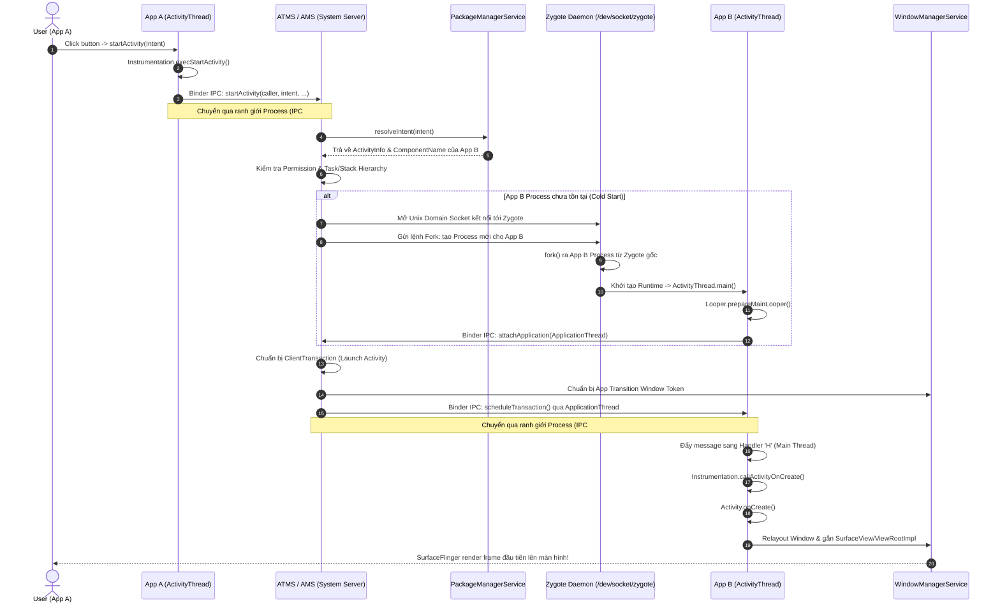
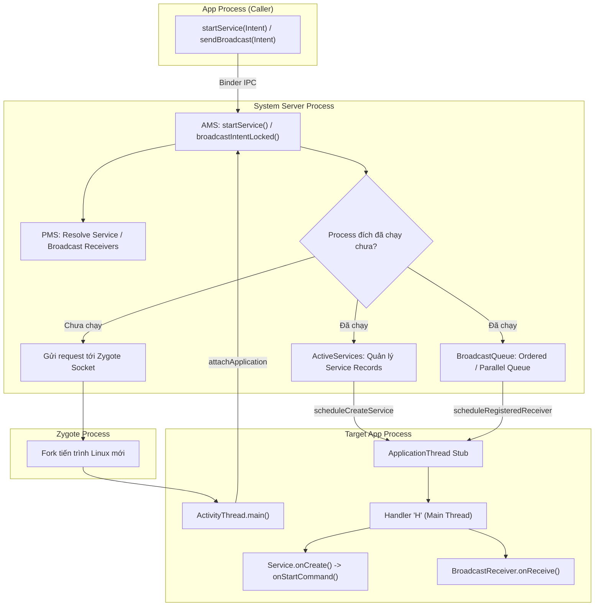

# ActivityManagerService và System Services - Trái tim điều phối Android OS

## 1. Tổng quan (What & Why)

### 1.1 System Server Process là gì?
Trong hệ điều hành Android, sau khi nhân Linux hoàn tất quá trình khởi động (Boot phase), tiến trình khởi tạo gốc `init` sẽ sinh ra tiến trình **Zygote**. Zygote là "mẹ" của mọi tiến trình ứng dụng Java/Kotlin trên máy. 
Tiến trình đầu tiên và quan trọng nhất được Zygote tạo ra (`fork`) chính là **`system_server` (System Server Process)**.

`system_server` là một tiến trình độc lập, đặc quyền cao (chạy dưới UID `system` - 1000), đóng vai trò là "bộ não trung tâm" của toàn bộ hệ điều hành. Nó lưu trữ và vận hành hơn 80 dịch vụ hệ thống cốt lõi (**System Services**), bao gồm:
- **`ActivityManagerService` (AMS) / `ActivityTaskManagerService` (ATMS):** Quản lý vòng đời component và task.
- **`PackageManagerService` (PMS):** Quản lý cài đặt APK, resolve intent, manifest và permissions.
- **`WindowManagerService` (WMS):** Quản lý các cửa sổ giao diện, hiển thị, layer z-order.
- Hàng loạt service khác: `PowerManagerService`, `ConnectivityManagerService`, `NotificationManagerService`, `AlarmManagerService`, `DisplayManagerService`...

### 1.2 Tại sao Android cần System Server?
1. **Thiết lập Ranh giới Bảo mật (Security Boundary):**
   - Ứng dụng của bạn và các ứng dụng khác đều là những tiến trình "không đáng tin cậy" (untrusted code) chạy trong Sandbox riêng biệt. Chúng không được phép tự do tương tác hay thao túng tài nguyên máy của nhau.
   - Mọi tương tác khởi động (`startActivity`, `startService`, `sendBroadcast`) đều phải đi qua `system_server` để được kiểm tra thẩm quyền (Permission Enforcement) trước khi phân phối.
2. **Quản lý Tài nguyên Tập trung (Central Resource Coordinator):**
   - Chỉ có một thực thể duy nhất biết được toàn bộ thiết bị đang có bao nhiêu RAM trống, ứng dụng nào đang nằm trên màn hình chính, ứng dụng nào chạy ngầm để tính toán điểm số sinh tử `oom_adj` (Out Of Memory Adjust Score) cho Low Memory Killer (LMK).
3. **Phân tách Trách nhiệm & Độ tin cậy (Fault Isolation):**
   - Nếu một ứng dụng người dùng bị crash do `NullPointerException`, chỉ duy nhất tiến trình của ứng dụng đó bị tiêu hủy. Bản thân Android OS và các ứng dụng khác vẫn hoạt động bình thường nhờ được cô lập khỏi app crash đó.

---

## 2. Cơ chế hoạt động bên trong (Internal Mechanism)

### 2.1 Các Core System Services quan trọng nhất

#### A. ActivityManagerService (AMS) & ActivityTaskManagerService (ATMS)
- **Trước Android 10:** AMS chịu trách nhiệm cho hầu hết mọi thứ: quản lý Activity lifecycle, Task stack, Service, BroadcastReceiver, ContentProvider, và điều phối Process priority.
- **Từ Android 10 (API 29+):** Google thực hiện tái cấu trúc lớn (Modularization), tách AMS thành 2 service riêng biệt:
  - **`ActivityTaskManagerService` (ATMS):** Chuyên trách quản lý Activity, Task, ActivityStack, Window Hierarchy, và các trạng thái hiển thị đa màn hình (Multi-display/Foldable).
  - **`ActivityManagerService` (AMS):** Tiếp tục quản lý phần còn lại: Vòng đời của Service, BroadcastReceiver, ContentProvider, quản lý tiến trình (`ProcessRecord`), bộ nhớ, và tính toán điểm `oom_adj`.

#### B. PackageManagerService (PMS)
- Phân tích cú pháp tệp `AndroidManifest.xml` của tất cả các app khi cài đặt để xây dựng cơ sở dữ liệu về Activities, Services, Receivers, Providers, Permissions.
- Đóng vai trò là công cụ "Resolution": Khi app gọi `Intent(ACTION_VIEW, uri)`, PMS sẽ tra cứu xem component nào có khả năng xử lý Intent đó.
- Quản lý trạng thái Runtime Permissions và phân quyền người dùng.

#### C. WindowManagerService (WMS)
- Quản lý các cửa sổ (`Window`) hiển thị trên màn hình. Mỗi Window được cấp một Surface thông qua `SurfaceFlinger`.
- Xử lý thứ tự xếp lớp (Z-ordering), hoạt ảnh chuyển cảnh (Window transitions), và phối hợp với `InputManagerService` để định tuyến sự kiện chạm (Touch Events) đến đúng cửa sổ trên cùng.

### 2.2 Kiến trúc phía App Process: `ActivityThread` và `Instrumentation`

Bên trong mỗi App Process của người dùng không có hàm `main()` do lập trình viên tự viết. Thay vào đó, framework cung cấp:

```
App Process (PID: xxxx)
┌─────────────────────────────────────────────────────────────────┐
│ ActivityThread (Entry point: public static void main())         │
│  ├── Looper.prepareMainLooper() / Looper.loop() (UI Thread Loop)│
│  ├── H (Internal Handler - Xử lý messages từ Binder)            │
│  │                                                              │
│  ├── ApplicationThread (Binder Stub: IApplicationThread)        │
│  │   └── Nhận lệnh từ AMS/ATMS -> Đẩy Message vào Handler 'H'   │
│  │                                                              │
│  └── Instrumentation                                            │
│      └── Bridge thực thi: callActivityOnCreate(), v.v.          │
└─────────────────────────────────────────────────────────────────┘
```

- **`ActivityThread`:** Lớp quản lý vòng đời chính chạy trên Main Thread của App. Chứa hàm `main()` do JVM/ART kích hoạt khi process được fork.
- **`ApplicationThread` (Private inner class của `ActivityThread`):**
  - Kế thừa từ `IApplicationThread.Stub` (Binder IPC Stub).
  - Là chiếc "ăng-ten" tiếp nhận mọi chỉ thị từ System Server (ví dụ: `scheduleTransaction()`, `scheduleCreateService()`).
  - Khi nhận lệnh từ System Server, nó không thực thi ngay trên Binder Thread mà đóng gói thành Message gửi vào Handler nội bộ tên là **`H`** của `ActivityThread` để chuyển quyền điều khiển sang **Main Thread (UI Thread)**.
- **`Instrumentation`:**
  - Đóng vai trò là "cầu nối kiểm soát" giữa `ActivityThread` và các component.
  - Khi `ActivityThread` muốn gọi lifecycle của một Activity, nó ủy quyền qua `mInstrumentation.callActivityOnCreate(activity, ...)`.
  - Đây chính là nơi framework và các công cụ kiểm thử (UIAutomator, Espresso) gắn các hook để giám sát hoặc can thiệp vào vòng đời của ứng dụng.

### 2.3 Mindset Senior: Process Boundary & Role Distribution
> [!NOTE]
> Để làm chủ các câu hỏi phỏng vấn kiến trúc Android bậc Senior, bạn **không cần thuộc lòng từng tên hàm cụ thể trong hàng triệu dòng code AOSP**. Điều cốt lõi là bạn phải vẽ được **ranh giới tiến trình (Process Boundaries)** và nêu bật được **vai trò của 3 tiến trình nền tảng**:
> 1. **Caller App Process:** Nơi người dùng phát tín hiệu (ví dụ: click button gọi `startActivity`).
> 2. **System Server Process (AMS/ATMS/PMS/WMS):** Trọng tài trung tâm kiểm tra quyền, quản lý state và điều phối.
> 3. **Target App Process:** Nơi component thực sự được khởi tạo và chạy giao diện.
> 4. **Zygote Process:** Thực thể đẻ nhánh OS, chuyên fork các tiến trình mới khi cần thiết.

---

## 3. Luồng hoạt động (Flow Diagram)

### 3.1 Luồng `startActivity()` đa tiến trình (Từ App A mở App B)



### 3.2 Luồng `startService()` và `sendBroadcast()`



---

## 4. Real-world Use Case

### 4.1 Tương tác an toàn với các System Services trong ứng dụng

Trong kiến trúc ứng dụng thực tế, việc lấy và gọi System Services thông qua `Context.getSystemService()` là tác vụ thường nhật. Một Senior Engineer cần biết cách wrap chúng để xử lý các vấn đề: Service không khả dụng trên một số thiết bị, crash do thiếu quyền, hoặc memory leak do giữ `Context` sai.

```kotlin
import android.app.ActivityManager
import android.content.Context
import android.net.ConnectivityManager
import android.net.NetworkCapabilities
import android.os.PowerManager
import androidx.core.content.ContextCompat

class SystemServicesHelper(context: Context) {

    // Luôn giữ applicationContext để tránh rò rỉ Activity Context
    private val appContext = context.applicationContext

    // 1. Quản lý thông tin bộ nhớ thông qua ActivityManager
    fun getAvailableMemoryMB(): Long {
        val activityManager = ContextCompat.getSystemService(
            appContext, 
            ActivityManager::class.java
        ) ?: return -1L

        val memoryInfo = ActivityManager.MemoryInfo()
        activityManager.getMemoryInfo(memoryInfo)
        
        // memoryInfo.lowMemory báo hiệu thiết bị đang thiếu RAM nghiêm trọng
        return memoryInfo.availMem / (1024 * 1024)
    }

    // 2. Kiểm tra kết nối mạng qua ConnectivityManager
    fun isNetworkConnected(): Boolean {
        val connectivityManager = ContextCompat.getSystemService(
            appContext, 
            ConnectivityManager::class.java
        ) ?: return false

        val activeNetwork = connectivityManager.activeNetwork ?: return false
        val capabilities = connectivityManager.getNetworkCapabilities(activeNetwork) ?: return false

        return capabilities.hasCapability(NetworkCapabilities.NET_CAPABILITY_INTERNET) &&
                capabilities.hasCapability(NetworkCapabilities.NET_CAPABILITY_VALIDATED)
    }

    // 3. Kiểm tra chế độ tiết kiệm pin qua PowerManager
    fun isDeviceInPowerSaveMode(): Boolean {
        val powerManager = ContextCompat.getSystemService(
            appContext, 
            PowerManager::class.java
        ) ?: return false

        return powerManager.isPowerSaveMode
    }
}
```

---

## 5. Anti-Patterns & Pitfalls

### 5.1 Rò rỉ Memory do giữ Activity Context khi lấy System Services
Một số System Services (ví dụ: `LayoutInflater`, `WindowManager`) cần gắn với giao diện của Activity cụ thể. Tuy nhiên, các service cấp hệ thống khác như `LocationManager`, `ConnectivityManager`, `AudioService` là những Singletons toàn cục được cache ở tầng framework.
- **Lỗi:** Nếu bạn truyền `Activity` context vào một singleton repository rồi gọi `activityContext.getSystemService(...)`, framework có thể giữ tham chiếu tới Activity đó trong static cache, dẫn đến **Activity Memory Leak** vĩnh viễn.
- **Khắc phục:** Luôn sử dụng `context.applicationContext.getSystemService(...)` cho các dịch vụ không gắn liền với UI Window.

### 5.2 Gây ANR do tính toán đồng bộ kết quả IPC System Service
Mọi phương thức gọi tới System Services (như `pms.getInstalledPackages()`, `am.getRunningAppProcesses()`, `cm.getActiveNetworkInfo()`) đều là **Synchronous Binder Calls** chạy sang tiến trình `system_server`.
- Nếu thiết bị đang bị nghẽn I/O, `system_server` bị quá tải hoặc lock tranh chấp trong AMS, hàm gọi từ app của bạn trên Main Thread sẽ bị treo.
- **Kinh nghiệm:** Nếu cần truy vấn các danh sách ứng dụng lớn từ `PackageManager` hoặc các tác vụ nặng từ System Services, hãy luôn đưa chúng vào background thread (`Dispatchers.IO`).

### 5.3 Lạm dụng Implicit Broadcast gây quá tải System Server
Trước Android 8.0, việc đăng ký Implicit Broadcast Receiver trong manifest (như `CONNECTIVITY_CHANGE`, `BATTERY_CHANGED`) khiến hàng trăm app cùng thức dậy một lúc khi sự kiện xảy ra.
- Hàng trăm IPC calls đổ về AMS làm tràn hàng đợi `BroadcastQueue`, dẫn đến hiện tượng nghẽn mạng toàn hệ thống.
- Google đã chặn hầu hết Implicit Broadcasts từ Android 8.0 (API 26) để bảo vệ `system_server`.

---

## 6. Trade-offs & So sánh

### 6.1 Bảng phân công trách nhiệm các thành phần hệ thống

| Thành phần | Tiến trình hoạt động | Vai trò chính | Tác nhân tương tác |
| :--- | :--- | :--- | :--- |
| **`Zygote`** | `zygote` (Native / ART) | Tiền tải (Preload) hệ thống class/resource và fork app process mới | System Server (qua Unix Domain Socket) |
| **`system_server`** | `system_server` (UID 1000) | Lưu trữ các System Services, quản lý state và enforce quyền bảo mật | Mọi app trên máy (qua Binder IPC) |
| **`ATMS`** | Bên trong `system_server` | Quản lý Activity lifecycle, Task stacks, Multi-window display | `ActivityThread` qua Binder |
| **`AMS`** | Bên trong `system_server` | Quản lý Services, Broadcasts, Providers, Process priority (`oom_adj`) | `ActivityThread`, Low Memory Killer (LMK) |
| **`ActivityThread`**| App Process riêng biệt | Điểm khởi đầu của app (`main()`), quản lý UI Loop và nhận lệnh từ AMS | `system_server` qua `ApplicationThread` |
| **`Instrumentation`**| App Process riêng biệt | Cầu nối thực thi trực tiếp các lifecycle methods của Component | `ActivityThread` và UI Test frameworks |

---

## 7. Senior-level Insights

### 7.1 Cơ chế tính điểm Process Priority & `oom_adj` Score
Khi bộ nhớ RAM vật lý của thiết bị sụt giảm đến các mốc báo động, daemon **Low Memory Killer (LMK)** ở tầng Linux Kernel sẽ căn cứ vào chỉ số **`oom_score_adj`** (giá trị từ `-1000` đến `+1000`) do `ActivityManagerService` tính toán và ghi vào file `/proc/[pid]/oom_score_adj` để quyết định tiêu diệt (kill) tiến trình nào trước.

AMS liên tục cập nhật điểm số này dựa trên trạng thái tương tác của người dùng:

| Phân loại Process | Trạng thái Component | oom_score_adj | Nguy cơ bị Kill |
| :--- | :--- | :--- | :--- |
| **System** | `system_server`, các native daemons cốt lõi | `-1000` đến `-900` | Không bao giờ bị kill |
| **Foreground Process** | Activity đang hiển thị trên cùng (`onResume`), Foreground Service, hoặc ContentProvider đang phục vụ | `0` | Thấp nhất (Chỉ bị kill khi RAM cạn kiệt đến mức nguy cấp) |
| **Visible Process** | Activity bị che một phần (`onPause`), hoặc Service bound bởi foreground app | `100` | Rất thấp |
| **Service Process** | Background Service đang chạy độc lập (`Started Service`) | `500` | Trung bình (Bị kill khi mở app nặng như Camera/Game) |
| **Cached / Empty Process**| Hoàn toàn không còn component active nào, Activity đã ở `onStop()`, giữ lại chỉ để mở nhanh sau này | `900` đến `999` | **Bị kill đầu tiên theo cơ chế LRU (Least Recently Used)** |

### 7.2 Cơ chế Phát hiện ANR của ActivityManagerService
AMS giám sát ứng dụng của bạn để bắn hộp thoại ANR (Application Not Responding) như thế nào?
AMS sử dụng cơ chế **"Đặt bom hẹn giờ" (Timeout Timers)** thông qua message queues nội bộ:
1. **Input Dispatching Timeout (5 giây):** Khi người dùng chạm màn hình hoặc bấm phím, nếu sau 5 giây ứng dụng không xử lý xong sự kiện chạm đó, WMS/AMS sẽ kích hoạt ANR.
2. **BroadcastReceiver Timeout (10 giây cho Foreground, 60 giây cho Background):** Khi dispatch một broadcast, AMS đặt một handler message hẹn giờ. Nếu `onReceive()` không hoàn thành trước khi timer nổ, ANR được kích hoạt.
3. **Service Timeout (20 giây cho Foreground, 200 giây cho Background):** Khi AMS gửi lệnh tạo hoặc start service qua `scheduleCreateService()`, timer 20 giây bắt đầu đếm ngược. Nếu Service không báo cáo hoàn tất qua `serviceDoneExecuting()`, AMS báo ANR.

### 7.3 Tối ưu hóa App Cold-Start từ góc nhìn Hệ thống
Hiểu được luồng từ Zygote đến AMS giúp giải thích tại sao cold start lại tốn thời gian:
- **Thời gian Zygote Fork & Init Runtime:** Hệ điều hành phải phân nhánh tiến trình Linux, tạo ART runtime instance và nạp heap memory.
- **Thời gian IPC Roundtrips:** Phải mất nhiều vòng Binder IPC giữa App và AMS (`attachApplication`, `bindApplication`, `scheduleTransaction`).
- **Khởi tạo Providers:** AMS tự động gọi `onCreate()` của tất cả các `ContentProvider` trước `Application.onCreate()`.
- **Bài học cho Senior:** Muốn giảm TTID (Time To Initial Display), giảm tối đa số lượng `ContentProvider`, đẩy logic khởi tạo ra background thread sau khi frame đầu tiên được vẽ, và tận dụng tính năng App Startup.

---

## 8. Câu hỏi phỏng vấn (với gợi ý trả lời)

### Q1: Quá trình từ lúc người dùng chạm vào Icon ứng dụng ở màn hình Launcher đến khi `Activity.onCreate()` được gọi diễn ra như thế nào?
**Gợi ý trả lời:**
1. Launcher gọi `startActivity(intent)` gửi yêu cầu qua Binder IPC tới `ATMS` trong `system_server`.
2. `ATMS` phối hợp với `PackageManagerService` để phân giải Intent, kiểm tra quyền và xác định target Activity.
3. `ATMS` kiểm tra xem process của ứng dụng đích đã chạy hay chưa. Nếu chưa (Cold Start), `ATMS` gửi một socket command tới `Zygote`.
4. `Zygote` nhận lệnh và gọi hàm `fork()` để tạo ra một tiến trình Linux mới cho ứng dụng.
5. Trong tiến trình mới, `ActivityThread.main()` được kích hoạt, khởi tạo `Looper.prepareMainLooper()` và `Looper.loop()`.
6. Tiến trình mới gửi Binder call ngược lại cho AMS thông qua `attachApplication()`.
7. AMS nhận diện và gửi lệnh `bindApplication` (khởi tạo `Application` và gọi `ContentProvider.onCreate()`).
8. Sau đó, ATMS gửi `ClientTransaction` yêu cầu khởi chạy Activity qua interface `IApplicationThread`.
9. `ActivityThread` nhận message, đẩy vào Handler `H` của Main Thread, ủy quyền cho `Instrumentation.callActivityOnCreate()`, và cuối cùng gọi tới `Activity.onCreate()`.

### Q2: `ActivityManagerService` (AMS) và `ActivityTaskManagerService` (ATMS) khác nhau như thế nào từ Android 10?
**Gợi ý trả lời:**
- Trước Android 10, AMS là một "God Class" đồ sộ ôm đồm toàn bộ trách nhiệm về Activity, Task, Service, Broadcast, Provider và Process.
- Từ Android 10, để tối ưu mã nguồn và hỗ trợ các thiết bị đa màn hình (Foldable, Car display), Google đã tách riêng **ATMS**.
- **ATMS** quản lý các khái niệm liên quan đến Activity UI: Task, Stack, Display, Window Hierarchy và Activity Lifecycle.
- **AMS** tập trung vào phần còn lại của hệ thống: Vòng đời của Service, BroadcastReceiver, ContentProvider, quản lý tiến trình (`ProcessRecord`), bộ nhớ và phân cấp `oom_adj`.

### Q3: `ActivityThread` là gì? Có phải nó là một Thread bình thường trong Java không?
**Gợi ý trả lời:**
- Mặc dù tên là `ActivityThread`, nhưng thực chất đây **không phải là một lớp kế thừa từ `java.lang.Thread`**.
- Nó là lớp điều phối trung tâm (entry point class) của toàn bộ tiến trình ứng dụng Android, chứa hàm `public static void main(String[] args)`.
- Hàm `main()` này khởi tạo `Looper.prepareMainLooper()` để biến thread hiện tại thành UI Thread (Main Thread) vĩnh cửu của ứng dụng.
- Bên trong `ActivityThread` chứa `ApplicationThread` (Binder Stub) để nhận chỉ thị từ `system_server` và Handler `H` để đưa các công việc đó vào hàng đợi message queue của Main Thread.

### Q4: Vai trò của `Instrumentation` trong vòng đời ứng dụng Android là gì?
**Gợi ý trả lời:**
- `Instrumentation` đóng vai trò là "cầu nối kiểm soát và giám sát" giữa hệ thống framework (`ActivityThread`) và các component của ứng dụng.
- Thay vì gọi trực tiếp `activity.onCreate()`, `ActivityThread` luôn gọi qua `mInstrumentation.callActivityOnCreate(activity, ...)`.
- Điều này cho phép hệ thống hoặc các framework kiểm thử (như Espresso, Robolectric) chèn logic giám sát, can thiệp vào vòng đời, đo lường thời gian thực thi, hoặc tạo mock context mà không cần sửa đổi mã nguồn gốc của Activity.

### Q5: Cơ chế tính điểm `oom_adj` của AMS ảnh hưởng như thế nào đến khả năng sống sót của một ứng dụng?
**Gợi ý trả lời:**
- `oom_adj` (hoặc `oom_score_adj`) là điểm số ưu tiên do AMS tính toán liên tục cho từng tiến trình dựa trên trạng thái tương tác của người dùng và ghi trực tiếp vào Linux Kernel.
- Điểm số dao động từ -1000 (an toàn tuyệt đối, System) đến +1000 (rất dễ bị kill, Cached/Empty process).
- Ứng dụng có Foreground Activity (`onResume`) có điểm `0`. Nếu người dùng ấn Home, Activity chuyển sang `onStop()`, AMS sẽ hạ độ ưu tiên của tiến trình xuống nhóm Cached Process (điểm ~900).
- Khi hệ thống thiếu RAM, daemon Low Memory Killer (LMK) sẽ duyệt danh sách tiến trình theo thứ tự `oom_score_adj` từ cao xuống thấp và tiêu diệt các tiến trình này để giải phóng bộ nhớ.

### Q6: Tại sao phương thức `getSystemService()` lại có thể gây Memory Leak nếu sử dụng không cẩn thận?
**Gợi ý trả lời:**
- Các dịch vụ hệ thống không phụ thuộc giao diện (như `ConnectivityManager`, `LocationManager`, `PowerManager`) thường được lưu trữ dưới dạng Singleton tĩnh ở cấp độ hệ thống hoặc process.
- Nếu bạn lấy các service này thông qua một `Activity Context` (ví dụ: `activity.getSystemService(...)`), một số implementation ở các phiên bản Android cũ hoặc custom ROMs có thể lưu giữ tham chiếu tới Context đó bên trong service cache nội bộ.
- Hậu quả là khi Activity bị destroy, tham chiếu tĩnh này vẫn giữ Activity lại trong bộ nhớ heap, ngăn không cho GC thu hồi và gây ra memory leak nghiêm trọng.
- Khắc phục: Luôn dùng `context.applicationContext.getSystemService(...)` cho các service không liên quan tới Window/UI.

---

## 9. Tài liệu tham khảo
- [Android Developers - Context.getSystemService()](https://developer.android.com/reference/android/content/Context#getSystemService(java.lang.Class%3CT%3E))
- [Android Developers - App Startup Overview](https://developer.android.com/topic/performance/vitals/launch-time)
- [AOSP - ActivityTaskManagerService Source Code](https://cs.android.com/android/platform/superproject/+/master:frameworks/base/services/core/java/com/android/server/wm/ActivityTaskManagerService.java)
- [AOSP - ActivityThread.java Source Code](https://cs.android.com/android/platform/superproject/+/master:frameworks/base/core/java/android/app/ActivityThread.java)
- [AOSP - SystemServer.java Source Code](https://cs.android.com/android/platform/superproject/+/master:frameworks/base/services/java/com/android/server/SystemServer.java)
