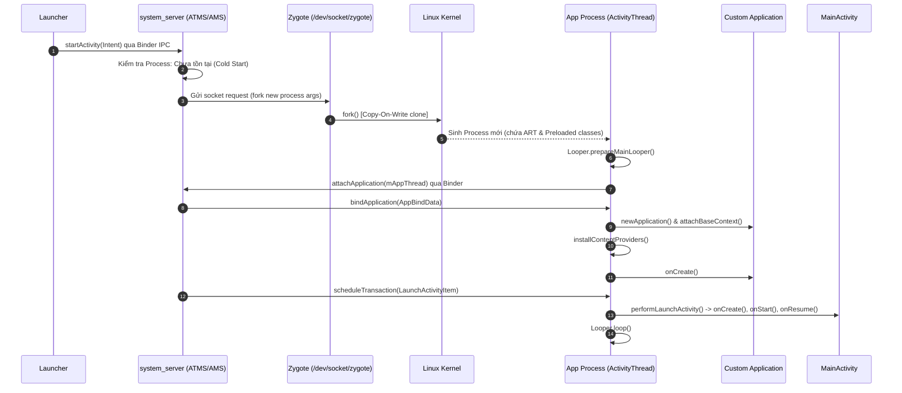
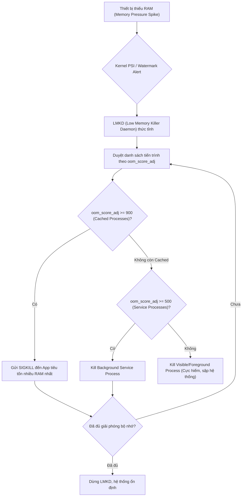

# Process, Application và Zygote

## 1. Tổng quan (What & Why)

Trong hệ điều hành Android, việc hiểu rõ vòng đời tiến trình, cơ chế cấp phát tài nguyên và cách ứng dụng khởi động từ tầng OS là ranh giới phân định rõ nét nhất giữa một Middle Developer và một Senior Android Engineer.

### 1.1. Android Application Process là gì?
Về bản chất, Android được xây dựng trên nhân **Linux Kernel**. Mỗi ứng dụng Android chạy bên trong một **Linux Process** độc lập, được gán một **Linux User ID (UID)** duy nhất tại thời điểm cài đặt. 
- **Application Sandbox:** Cơ chế UID này thiết lập ranh giới bảo mật cấp kernel (Kernel-level sandbox). Process của App A không thể trực tiếp đọc bộ nhớ, ghi dữ liệu hay can thiệp vào Process của App B trừ khi thông qua IPC (Inter-Process Communication) có quyền hạn phù hợp hoặc chia sẻ chung UID (`android:sharedUserId` - hiện đã deprecated).
- Mặc định, tất cả các thành phần (Components: Activity, Service, BroadcastReceiver, ContentProvider) của cùng một ứng dụng sẽ chạy chung trong **một Process duy nhất** và chia sẻ chung một **Main Thread (UI Thread)**.

### 1.2. Application Class & Application Lifecycle
`android.app.Application` là class nền tảng đại diện cho trạng thái toàn cục (global state) của toàn bộ ứng dụng bên trong Process.
- **Khởi tạo:** `Application` là đối tượng đầu tiên được khởi tạo khi process của app được sinh ra, trước bất kỳ Activity, Service hay BroadcastReceiver nào.
- **Singleton tự nhiên:** Application tồn tại xuyên suốt vòng đời của process và chỉ bị huỷ khi process bị hủy.
- **Lifecycle callbacks:**
  - `attachBaseContext(Context base)`: Được gọi ngay khi instance của Application được gán `ContextImpl`, xảy ra trước cả `onCreate()`.
  - `onCreate()`: Điểm nhập cuộc (entry point) để cấu hình app-wide dependencies, tracking, crash reporting.
  - `onLowMemory()`: Được gọi khi toàn bộ hệ thống cạn kiệt bộ nhớ nghiêm trọng (fallback cho API cũ).
  - `onTrimMemory(int level)`: Được giới thiệu từ API 14, cung cấp các gợi ý granular từ hệ thống khi áp lực bộ nhớ (memory pressure) thay đổi.
  - `onTerminate()`: **CẢNH BÁO:** Callback này **KHÔNG BAO GIỜ** được gọi trên thiết bị thật trong môi trường production khi process bị kill bởi hệ thống. Nó chỉ tồn tại trong các môi trường giả lập mô phỏng đặc thù.

### 1.3. Zygote: Tại sao Android cần "Tế bào gốc"?
Nếu Android hoạt động như các hệ điều hành Linux tiêu chuẩn bằng cách gọi `fork()` và `execve()` từ `init` process để tạo process mới:
1. Mỗi process sẽ phải khởi động lại ART (Android Runtime) từ đầu.
2. Nạp lại hàng nghìn class cốt lõi của Android Framework (`Activity`, `View`, `Resources`,... trong `android.jar`).
3. Khởi tạo lại các tài nguyên hệ thống dùng chung (system colors, drawables, theme attributes).

Quá trình này sẽ ngốn từ vài trăm mili-giây đến hàng giây và tiêu tốn hàng chục megabyte RAM cho mỗi app riêng lẻ. Để giải quyết bài toán này, kiến trúc Android giới thiệu **Zygote** (nghĩa là "hợp tử" - tế bào gốc). Zygote khởi động một lần duy nhất lúc boot máy, nạp trước toàn bộ framework và runtime, sau đó chỉ cần phân chia tế bào (`fork()`) để sinh ra app process mới trong vài mili-giây.

---

## 2. Cơ chế hoạt động bên trong (Internal Mechanism)

### 2.1. Zygote & Cơ chế Copy-On-Write (COW)
Zygote là một tiến trình daemon đặc biệt chạy lệnh `app_process`. Quá trình hoạt động của Zygote gồm hai giai đoạn:

1. **Preloading (Giai đoạn chuẩn bị):**
   - Zygote khởi động ART VM.
   - Preload hơn 4,000+ classes của Framework (`/system/etc/preloaded-classes`).
   - Preload các shared resources của hệ thống (`com.android.internal.R`).
   - Mở một local UNIX domain socket tại `/dev/socket/zygote` để lắng nghe yêu cầu sinh tiến trình từ `system_server`.

2. **Forking với Copy-On-Write (COW):**
   - Khi nhận lệnh từ `system_server`, Zygote gọi hàm hệ thống Linux `fork()`.
   - `fork()` tạo ra một bản sao chính xác của Zygote bao gồm cả ART VM và các class đã nạp.
   - **Bản chất của COW:** Kernel không sao chép các trang nhớ vật lý (physical memory pages). Thay vào đó, cả Process cha (Zygote) và Process con (App vừa fork) đều trỏ chung vào các trang nhớ vật lý đó ở chế độ **Read-Only**.
   - Chỉ khi nào App con cố gắng sửa đổi dữ liệu trên một trang nhớ (ghi dữ liệu vào RAM, biến đổi static state), MMU (Memory Management Unit) của vi xử lý mới kích hoạt một ngoại lệ **Page Fault**. Lúc này, OS Kernel mới thực sự cấp phát một trang nhớ vật lý mới và sao chép dữ liệu sang cho riêng App con (gọi là *Dirty Page*).
   - **Lợi ích:** Tiết kiệm khoảng 30MB - 50MB RAM framework dùng chung cho mỗi ứng dụng, đồng thời giảm thời gian khởi tạo process xuống dưới 10ms.

```
       +---------------------------------------------+
       |           Physical RAM (Shared)             |
       |  [ART Runtime] [Framework Classes] [Res]    |
       +---------------------------------------------+
                     ^                     ^
          (Read-Only)|          (Read-Only)|
                     |                     |
             +---------------+     +---------------+
             | Zygote Process|     | App Process   |
             +---------------+     +---------------+
                                           | (Ghi đè - COW)
                                           v
                                   +---------------+
                                   | App Private   |
                                   | Dirty Page    |
                                   +---------------+
```

### 2.2. Chi tiết App Startup Flow (Cold Start)
Khi người dùng chạm vào biểu tượng ứng dụng trên Launcher:

1. **Launcher -> ATMS:** Launcher gọi `startActivity(Intent)` qua Binder IPC đến `ActivityTaskManagerService` (ATMS) trong `system_server`.
2. **ATMS & AMS Kiểm tra Process:** AMS/ATMS kiểm tra xem tiến trình mục tiêu cho Application đã chạy chưa. Nếu chưa, xác định đây là **Cold Start**.
3. **IPC tới Zygote:** AMS mở kết nối Socket tới `/dev/socket/zygote` và gửi danh sách đối số: UID, GID, package name, target SDK,...
4. **Zygote Fork:** Zygote lắng nghe socket, gọi `fork()` sinh ra tiến trình mới cho ứng dụng.
5. **RuntimeInit:** Tiến trình con đóng socket descriptor kế thừa từ Zygote, thiết lập Binder thread pool cho tiến trình con thông qua `RuntimeInit`.
6. **ActivityThread.main():** Điểm nhập cuộc Java/Kotlin của app là `ActivityThread.main()`:
   - Gọi `Looper.prepareMainLooper()`.
   - Khởi tạo instance `ActivityThread`.
   - Gọi `attach(false)` gửi Binder IPC ngược về `AMS` thông qua `IActivityManager.attachApplication(mAppThread)`.
   - Gọi `Looper.loop()` - đưa Main Thread vào vòng lặp sự kiện vô tận.
7. **Bind Application:** AMS nhận được callback `attachApplication`, phản hồi lại bằng cách gọi `mAppThread.bindApplication(...)`.
8. **Khởi tạo Application Component:**
   - Message `BIND_APPLICATION` được đẩy vào Handler của Main Thread (`H`).
   - Tạo đối tượng `LoadedApk`, nạp file DEX/APK.
   - Tạo `ContextImpl` cho Application.
   - Gọi `Instrumentation.newApplication()` -> phản chiếu tạo class `Application` của bạn.
   - Gọi `app.attachBaseContext(context)`.
   - **ContentProviders Initialization:** Hệ thống gọi `ContentProvider.onCreate()` cho tất cả Provider khai báo trong Manifest của app trước `Application.onCreate()`.
   - Gọi `app.onCreate()`.
9. **Launch Activity:**
   - AMS gửi tiếp Binder transaction `EXECUTE_TRANSACTION` chứa `LaunchActivityItem`.
   - `ActivityThread.handleLaunchActivity()` khởi tạo `Activity`, gắn window, decor view, và thực thi chuỗi lifecycle: `onCreate()` -> `onStart()` -> `onResume()`.

### 2.3. Process Importance Hierarchy & Low Memory Killer Daemon (LMKD)
Android không cho phép đóng ứng dụng theo cách thông thường như desktop. Để duy trì khả năng mở lại app tức thì, hệ thống giữ lại process trong RAM chừng nào còn có thể. 

Khi bộ nhớ vật lý giảm xuống dưới mức cảnh báo, **Low Memory Killer Daemon (LMKD)** tương tác với Kernel qua `cgroups` và PSI (Pressure Stall Information) để chọn lọc và bắn tín hiệu `SIGKILL` (signal 9) nhằm thu hồi RAM.

Thứ tự ưu tiên từ an toàn nhất đến dễ bị kill nhất được biểu thị qua điểm **`oom_score_adj`** (từ -1000 đến 1000):

| Thứ hạng | Nhóm Process | `oom_score_adj` | Điều kiện / Trạng thái |
|---|---|---|---|
| 1 | **System Process** | -1000 đến -900 | Kernel, `system_server`, System UI |
| 2 | **Foreground Process** | 0 | Activity đang tương tác (`onResume`), Service chạy foreground kèm Notification, BroadcastReceiver đang chạy `onReceive()`, ContentProvider đang phục vụ client |
| 3 | **Visible Process** | 100 - 200 | Activity đang hiển thị nhưng mất focus (ví dụ bị Dialog che, chế độ Multi-window, Permission Dialog), Service gắn với visible activity |
| 4 | **Service Process** | 500 - 800 | Background Service thông thường đang chạy (ví dụ sync dữ liệu, upload ngầm không có foreground notification) |
| 5 | **Cached Process** | 900 - 1000 | App đã ẩn hoàn toàn (bấm Home/Back), Activity ở trạng thái `onStop()`. Đây là mục tiêu **đầu tiên** bị LMKD tiêu diệt |

### 2.4. Phân biệt: Process vs Task vs Back Stack
Rất nhiều lập trình viên nhầm lẫn giữa 3 khái niệm này:
- **Process (Tiến trình Linux):** Không gian địa chỉ bộ nhớ và môi trường thực thi cấp hệ điều hành. Chứa heap memory, threads, file descriptors.
- **Task (Tác vụ):** Tập hợp các Activities mà người dùng tương tác trong một luồng công việc cụ thể. Đây là khái niệm thuộc tầng **User Experience (UX)** do Android Framework quản lý.
- **Back Stack:** Cấu trúc dữ liệu LIFO (Last In, First Out) bên trong một Task, lưu trữ thứ tự các Activity theo lịch sử điều hướng của người dùng.

> **Mối quan hệ:** Một Task có thể chứa các Activities đến từ **nhiều Process khác nhau** (ví dụ: Task của bạn gọi sang Activity chụp ảnh của Camera app). Ngược lại, một Process có thể phục vụ nhiều Task đồng thời.

---

## 3. Luồng hoạt động (Flow Diagram - dùng mermaid)

### 3.1. Sơ đồ toàn diện Cold Start Flow



### 3.2. Cơ chế Low Memory Killer Daemon (LMKD)



---

## 4. Real-world Use Case

### 4.1. Tối ưu hóa Application Class & Lắng nghe onTrimMemory
Dưới đây là một implementation mẫu của `Application` class đạt chuẩn Senior, xử lý việc khởi tạo thư viện hiệu quả và dọn dẹp bộ nhớ chủ động.

```kotlin
package com.example.core.base

import android.app.Application
import android.content.ComponentCallbacks2
import android.content.Context
import android.os.Build
import android.util.Log
import androidx.annotation.CallSuper
import kotlinx.coroutines.CoroutineScope
import kotlinx.coroutines.Dispatchers
import kotlinx.coroutines.SupervisorJob
import kotlinx.coroutines.launch

class CoreApplication : Application() {

    // App-wide CoroutineScope cho các tác vụ bất đồng bộ không gắn liền với UI
    private val applicationScope = CoroutineScope(SupervisorJob() + Dispatchers.Default)

    override fun attachBaseContext(base: Context) {
        super.attachBaseContext(base)
        // Đây là điểm sớm nhất trong vòng đời của Application
        // Thích hợp cho: MultiDex (nếu API < 21), SplitCompat (Dynamic Feature)
    }

    override fun onCreate() {
        super.onCreate()
        
        // 1. Phân loại tác vụ khởi tạo
        initCriticalComponentsSynchronously()
        initNonCriticalComponentsAsynchronously()
    }

    private fun initCriticalComponentsSynchronously() {
        // Chỉ khởi tạo những thứ BẮT BUỘC phải có trước khi Activity đầu tiên xuất hiện
        // Ví dụ: Crash Reporter (Crashlytics) để bắt crash khởi động
        Log.d(TAG, "Initialized critical crash reporter synchronously")
    }

    private fun initNonCriticalComponentsAsynchronously() {
        // Tránh blocking UI thread ở Cold Start
        applicationScope.launch {
            // Khởi tạo Analytics SDK, DeepLink tracker, Cache Warm-up
            Log.d(TAG, "Initialized SDKs in background thread: ${Thread.currentThread().name}")
        }
    }

    override fun onTrimMemory(level: Int) {
        super.onTrimMemory(level)
        Log.w(TAG, "onTrimMemory received with level: $level")

        when (level) {
            // App đang ở Background (đã ẩn hoàn toàn)
            ComponentCallbacks2.TRIM_MEMORY_UI_HIDDEN -> {
                // Toàn bộ UI đã ẩn đi (người dùng bấm Home hoặc chuyển app)
                // Đây là cơ hội vàng để giải phóng Bitmap cache, UI resources lớn
                ImageLoaderCache.evictMemoryCache()
            }

            // App vẫn đang ở Background và LMKD bắt đầu dọn dẹp
            ComponentCallbacks2.TRIM_MEMORY_BACKGROUND,
            ComponentCallbacks2.TRIM_MEMORY_MODERATE -> {
                // Giải phóng các cache trung gian, drop disposable collections
                DataRepositoryCache.trimExcessMemory()
            }

            ComponentCallbacks2.TRIM_MEMORY_COMPLETE -> {
                // Process của bạn đang nằm ở đầu danh sách bị LMK kill!
                // Giải phóng TẤT CẢ bộ nhớ không cần thiết ngay lập tức
                ImageLoaderCache.clearAll()
                DataRepositoryCache.clearAll()
            }

            // App đang chạy ở Foreground nhưng máy thiếu RAM nghiêm trọng
            ComponentCallbacks2.TRIM_MEMORY_RUNNING_CRITICAL -> {
                // Máy sắp sập bộ nhớ! Giảm chất lượng ảnh, clear in-memory caches
                ImageLoaderCache.trimMemoryHalf()
            }
        }
    }

    override fun onLowMemory() {
        super.onLowMemory()
        // Fallback cho các thiết bị cũ, tương đương TRIM_MEMORY_COMPLETE
        ImageLoaderCache.clearAll()
    }

    companion object {
        private const val TAG = "CoreApplication"
    }
}

// Mock object đại diện cho Image Loader Cache
object ImageLoaderCache {
    fun evictMemoryCache() { /* Evict LRU memory cache */ }
    fun clearAll() { /* Clear 100% memory */ }
    fun trimMemoryHalf() { /* Evict 50% LRU items */ }
}

object DataRepositoryCache {
    fun trimExcessMemory() { /* Drop non-essential caches */ }
    fun clearAll() { /* Reset in-memory states */ }
}
```

---

## 5. Anti-Patterns & Pitfalls

### 5.1. Anti-Pattern: Lưu trữ UI State trong Singleton / Static Variables
Đây là một trong những lỗi gây crash nghiêm trọng nhất trên môi trường production.
```kotlin
// ❌ CỰC KỲ NGUY HIỂM: Lưu trữ trạng thái tạm thời trong Singleton
object UserCheckoutSession {
    var selectedOrder: Order? = null
}

// Trong OrderSummaryActivity
class OrderSummaryActivity : AppCompatActivity() {
    override fun onCreate(savedInstanceState: Bundle?) {
        super.onCreate(savedInstanceState)
        // ❌ Crash NullPointerException nếu xảy ra Process Death!
        val order = UserCheckoutSession.selectedOrder!!
        renderOrder(order)
    }
}
```

#### Vì sao xảy ra Crash? (Kịch bản Process Death):
1. Người dùng đang ở `OrderSummaryActivity`, bấm Home để mở app ngân hàng lấy mã OTP.
2. App bị đưa xuống background -> Hệ thống bị thiếu RAM và LMKD gửi `SIGKILL` tiêu diệt Process của app. **Toàn bộ RAM Heap (gồm Singleton `UserCheckoutSession`) biến mất hoàn toàn**.
3. Người dùng copy xong OTP và quay lại app từ danh sách App Recents.
4. Hệ thống Android tự động khởi tạo lại Process mới qua Zygote, đọc lại Back Stack và **tái tạo trực tiếp `OrderSummaryActivity`**.
5. Lúc này, `UserCheckoutSession` là một đối tượng mới hoàn toàn với `selectedOrder = null`.
6. Lệnh `UserCheckoutSession.selectedOrder!!` ném ra **`NullPointerException`** lập tức!

> **Giải pháp đúng:** Dùng `SavedStateHandle` trong ViewModel, lưu data vào `savedInstanceState` Bundle hoặc persist vào Room Database/DataStore.

### 5.2. Anti-Pattern: Eager Heavy Initialization trong Application.onCreate()
Khởi tạo tất cả SDK (Firebase, Branch, AppsFlyer, Facebook, Realm, Dagger/Hilt graph khổng lồ) tuần tự trên Main Thread trong `Application.onCreate()`.
- **Hậu quả:** Làm tăng trực tiếp Time To Initial Display (TTID). Người dùng phải nhìn màn hình đen/trắng (blank window) lâu hơn, tăng tỷ lệ bounce rate và bị Google Play Console cảnh báo Bad Behavior (Slow startup).
- **Giải pháp:** Sử dụng Android Jetpack `App Startup` để gom nhóm các Provider, áp dụng khởi tạo lười (Lazy initialization), hoặc đẩy các tác vụ không phụ thuộc vào Main Thread sang Coroutines `Dispatchers.Default` / `Dispatchers.IO`.

### 5.3. Anti-Pattern: Trông đợi vào Application.onTerminate()
Nhiều lập trình viên đặt code dọn dẹp file tạm, đóng Database connection hoặc flush telemetry log vào `onTerminate()`.
- **Thực tế:** Trên 100% thiết bị Android thực tế, khi hệ thống tắt app hoặc user vuốt app khỏi màn hình đa nhiệm (Recent Apps), kernel gửi `SIGKILL`. `Application.onTerminate()` **không bao giờ được kích hoạt**.

### 5.4. Pitfall: Multi-Process và sự nhân đôi của Application.onCreate()
Khai báo một component chạy trên process riêng:
```xml
<service
    android:name=".download.DownloadService"
    android:process=":downloader" />
```
- **Cạm bẫy:** Khi `DownloadService` khởi động, Android fork một process mới tên là `com.example.app:downloader`.
- Ngay khi process mới này sinh ra, nó sẽ nạp lại runtime và gọi **`Application.onCreate()` một lần nữa**!
- Nếu trong `Application.onCreate()` bạn khởi tạo database SQLite/Room hoặc mở socket, chúng sẽ bị tạo 2 lần ở 2 process khác nhau, dẫn tới xung đột DB lock hoặc tiêu tốn gấp đôi RAM.
- **Khắc phục:** Kiểm tra tên process hiện tại trước khi khởi tạo component đặc thù:
```kotlin
if (Build.VERSION.SDK_INT >= Build.VERSION_CODES.P) {
    val processName = Application.getProcessName()
    if (processName == packageName) {
        // Chỉ khởi tạo cho main process
    }
}
```

---

## 6. Trade-offs & So sánh

### 6.1. Cold Start vs Warm Start vs Hot Start

| Đặc tính | Cold Start | Warm Start | Hot Start |
|---|---|---|---|
| **Trạng thái Process** | Chưa tồn tại trong RAM | Đã tồn tại trong RAM | Đã tồn tại trong RAM |
| **Zygote Fork** | **Có** (Fork process mới) | **Không** | **Không** |
| **Application Instance** | Tạo mới từ đầu (`onCreate`) | Đã tồn tại | Đã tồn tại |
| **Activity Instance** | Tạo mới từ đầu | Tạo lại (`onCreate` hoặc `onStart`) | Đem từ background lên (`onResume`) |
| **Kịch bản thực tế** | App mở lần đầu sau boot hoặc sau khi bị kill | Bấm Back thoát app, sau đó mở lại | Bấm Home, mở app khác rồi quay lại |
| **Thời gian mục tiêu (Google Benchmark)** | **< 5 giây** (tốt nhất < 1.5s - 2s) | **< 2 giây** | **< 1.5 giây** |

### 6.2. Application Context vs Activity Context

| Tiêu chí | Application Context | Activity Context |
|---|---|---|
| **Vòng đời** | Toàn bộ vòng đời của Process | Theo vòng đời của một Activity |
| **Nguy cơ Memory Leak** | Rất thấp (vì sống suốt process) | **Rất cao** nếu bị giữ bởi Singleton hoặc Background Task |
| **Hiển thị Dialog / UI** | ❌ **Không thể** (Không có Window Token) | ✅ **Có thể** |
| **Inflate Layout** | ⚠️ Được nhưng không nhận đúng Theme/Style | ✅ Nhận đầy đủ Activity Theme/Styles |
| **Start Activity** | Cần thêm flag `FLAG_ACTIVITY_NEW_TASK` | Gọi trực tiếp |
| **Use Case phù hợp** | Khởi tạo Singleton, DB Room, Repositories, WorkManager | Bind UI Views, show Dialog, Toast, navigate Activity |

---

## 7. Senior-level Insights

1. **TransactionTooLargeException & Binder Buffer:**
   Toàn bộ IPC thông qua Binder của một process (bao gồm cả `savedInstanceState` gửi cho `system_server`) dùng chung một memory buffer cố định là **1MB**. Nếu bạn cố gắng nhồi nhét Bitmap hoặc danh sách dữ liệu quá lớn vào Intent hoặc `Bundle`, app sẽ crash ngay lập tức với `TransactionTooLargeException`.

2. **Dùng Perfetto & Systrace để tối ưu Startup:**
   Để xác định chính xác điểm nghẽn trong quá trình khởi động, một Senior Engineer không đoán mò qua `System.currentTimeMillis()`. Hãy dùng `android.os.Trace`:
   ```kotlin
   Trace.beginSection("InitHeavyLibrary")
   HeavyLibrary.init()
   Trace.endSection()
   ```
   Sau đó ghi lại file trace bằng Perfetto trên Android Studio Profiler để trực quan hóa từng thread slice.

3. **Baseline Profiles:**
   Từ Android 7 (API 24), Android sử dụng ART kết hợp giữa JIT (Just-In-Time) và AOT (Ahead-Of-Time) qua Profile-Guided Optimization (PGO). Áp dụng **Baseline Profiles** (thông qua Jetpack Macrobenchmark) cho phép biên dịch sẵn mã bytecode của các critical paths (bao gồm `Application.onCreate` và màn hình đầu tiên) thành mã máy ngay lúc cài đặt từ Google Play, giúp giảm tới 30-40% thời gian Cold Start.

---

## 8. Câu hỏi phỏng vấn (với gợi ý trả lời)

### Q1: Zygote là gì? Tại sao Android không dùng cơ chế fork() + execve() thông thường từ init process mà lại sinh ra Zygote?
> **Gợi ý trả lời:**
> Zygote là tiến trình gốc trong Android dùng để sinh ra tất cả các ứng dụng người dùng. Nếu dùng `fork() + execve()` truyền thống từ `init`:
> 1. Mỗi tiến trình phải khởi tạo ART runtime và nạp lại toàn bộ class của Android Framework từ đầu, khiến thời gian khởi động app mất hàng giây.
> 2. Mỗi app sẽ phải giữ một bản sao riêng của các class framework trong RAM, ngốn hàng chục MB RAM vô ích.
> Zygote giải quyết điều này bằng cách khởi động một lần duy nhất khi boot máy, pre-load sẵn toàn bộ ART, hàng nghìn framework classes và tài nguyên hệ thống. Khi có app mới, Zygote chỉ cần gọi `fork()`. Nhờ cơ chế **Copy-On-Write (COW)** của Linux kernel, bộ nhớ framework được chia sẻ chung dạng Read-Only, giúp khởi động app chỉ mất vài mili-giây và tiết kiệm lượng RAM khổng lồ.

### Q2: Trình bày chi tiết luồng Cold Start từ lúc người dùng chạm vào icon trên Launcher đến khi frame đầu tiên xuất hiện?
> **Gợi ý trả lời:**
> 1. Launcher gửi `startActivity(Intent)` qua Binder IPC tới ATMS/AMS trong `system_server`.
> 2. AMS kiểm tra và thấy process chưa tồn tại, gửi socket request tới `/dev/socket/zygote`.
> 3. Zygote fork tiến trình mới. Tiến trình con gọi `RuntimeInit` và chạy vào `ActivityThread.main()`.
> 4. `ActivityThread.main()` khởi tạo Main Looper (`Looper.prepareMainLooper()`), tạo `ActivityThread` instance và gửi Binder IPC `attachApplication` ngược về AMS.
> 5. AMS gửi lệnh `bindApplication` -> Handler `H` của Main Thread nhận message và thực thi: tạo `LoadedApk`, nạp context, tạo `Application` instance, gọi `attachBaseContext()`, khởi tạo các `ContentProvider` đã đăng ký trong manifest, rồi gọi `Application.onCreate()`.
> 6. AMS gửi `EXECUTE_TRANSACTION` để launch `MainActivity` -> `onCreate()`, `onStart()`, `onResume()`.
> 7. `ViewRootImpl` thực hiện measure, layout, draw thông qua Choreographer và VSYNC pulse để hiển thị frame đầu tiên lên màn hình.

### Q3: Tại sao biến `static` hoặc Singleton lại cực kỳ nguy hiểm khi dùng để lưu giữ State của ứng dụng Android? Kịch bản Process Death diễn ra như thế nào?
> **Gợi ý trả lời:**
> Trong Android, khi người dùng đưa app vào background, hệ thống có thể kill process của app bất cứ lúc nào qua LMKD khi thiếu RAM. Lúc này, toàn bộ vùng nhớ Heap (bao gồm biến `static` và Singleton) bị xóa sạch.
> Khi người dùng quay lại app từ Recents: Hệ thống Android khôi phục lại Activity mà người dùng đang mở trước đó thông qua `savedInstanceState`, nhưng nó tạo một Process mới tinh. Mọi biến `static` hay Singleton lúc này sẽ được khởi tạo lại về giá trị mặc định (`null` hoặc default primitive). Nếu Activity truy cập trực tiếp vào Singleton mà giả định nó vẫn chứa dữ liệu cũ, app sẽ văng lỗi `NullPointerException` hoặc sai lệch logic nghiêm trọng. Do đó, state bắt buộc phải được lưu bằng `SavedStateHandle`, `Bundle`, hoặc persistent storage (Room/DataStore).

### Q4: `Application.onTerminate()` được gọi khi nào? Có nên dùng nó để giải phóng tài nguyên không?
> **Gợi ý trả lời:**
> Không bao giờ dùng `onTerminate()` để dọn dẹp tài nguyên. Trong tài liệu chính thức của Android, callback này chỉ dành cho môi trường giả lập (emulator) khi toàn bộ môi trường app bị tắt một cách nhẹ nhàng. Trên tất cả các thiết bị Android thực tế, khi hệ thống cần kết thúc ứng dụng, nó gửi tín hiệu `SIGKILL` trực tiếp ở mức kernel. Process bị hủy ngay lập tức mà không có bất kỳ callback vòng đời nào của Application được gọi.

### Q5: Phân biệt rõ ràng giữa App Process, Task, và Back Stack?
> **Gợi ý trả lời:**
> - **Process:** Là đơn vị thực thi cấp hệ điều hành Linux, quản lý tài nguyên bộ nhớ (heap), threads và các tiến trình con.
> - **Task:** Là một khái niệm trải nghiệm người dùng (UX) đại diện cho một luồng công việc cụ thể (ví dụ: luồng chụp ảnh, luồng thanh toán).
> - **Back Stack:** Là cấu trúc dữ liệu LIFO chứa các Activity bên trong một Task để quản lý việc điều hướng lui của người dùng.
> Một Task có thể chứa các Activities chạy trên **nhiều Process khác nhau** (ví dụ Activity của App gọi sang Activity của Camera app). Ngược lại, một Process có thể host nhiều Activities thuộc các Task khác nhau.

### Q6: LMKD (Low Memory Killer Daemon) quyết định kill process nào dựa trên cơ chế và chỉ số nào?
> **Gợi ý trả lời:**
> LMKD theo dõi áp lực bộ nhớ thông qua cơ chế PSI (Pressure Stall Information) hoặc vmpressure của Linux Kernel. Khi RAM giảm xuống dưới ngưỡng an toàn, LMKD duyệt danh sách các process dựa trên chỉ số **`oom_score_adj`** (từ -1000 đến 1000).
> Chỉ số này do AMS tính toán liên tục dựa trên trạng thái của các thành phần trong process:
> - Cached Process (app ở background, không visible): điểm 900 - 1000 -> Bị kill đầu tiên.
> - Service Process (chạy background service): điểm 500 - 800.
> - Visible Process (Activity bị che khuất một phần): điểm 100 - 200.
> - Foreground Process (đang tương tác trực tiếp): điểm 0 -> Chỉ bị kill khi hệ thống rơi vào trạng thái cực đoan.
> Trong cùng một nhóm điểm, LMKD ưu tiên kill process nào đang chiếm dụng lượng RAM lớn nhất (RSS/VSS) để thu hồi bộ nhớ nhanh nhất.

---

## 9. Tài liệu tham khảo
- [AOSP - Android Zygote Initialization](https://android.googlesource.com/platform/frameworks/base/+/master/core/java/com/android/internal/os/ZygoteInit.java)
- [Android Developers - App Startup Time](https://developer.android.com/topic/performance/vitals/launch-time)
- [Android Developers - Processes and app lifecycle](https://developer.android.com/guide/components/activities/process-lifecycle)
- [Android Developers - ComponentCallbacks2 & onTrimMemory](https://developer.android.com/reference/android/content/ComponentCallbacks2)
