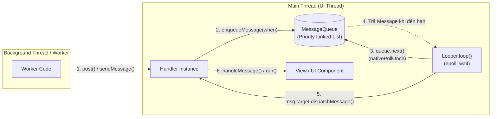
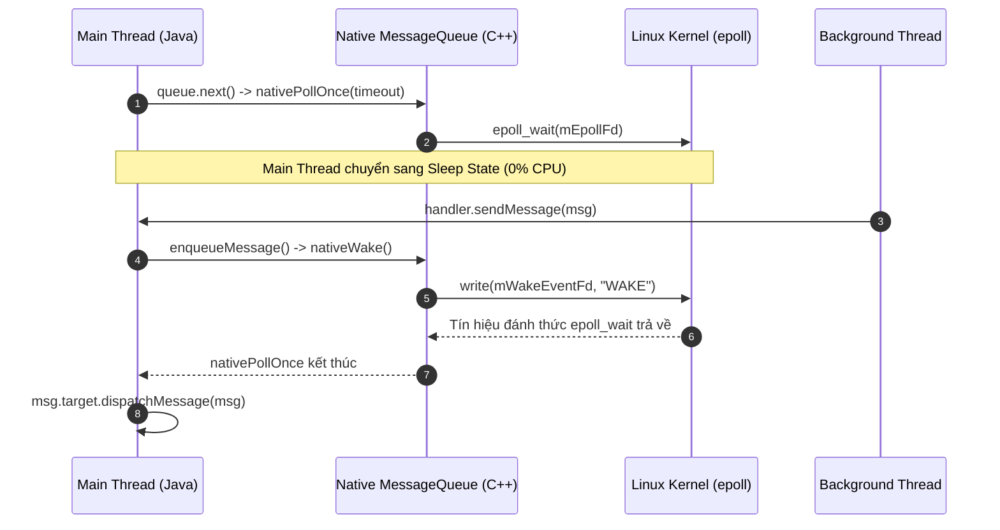

# Main Thread, Looper, MessageQueue và Handler

## 1. Tổng quan (What & Why)

Trong Android, kiến trúc concurrency xoay quanh bộ tứ: **Main Thread**, **Looper**, **MessageQueue**, và **Handler**. Đây là nền tảng cốt lõi điều phối toàn bộ sự kiện giao diện, vòng đời thành phần và cơ chế bất đồng bộ của ứng dụng.

### 1.1. Tại sao View chỉ được cập nhật từ Main Thread?
Nếu một lập trình viên cố gắng chỉnh sửa giao diện từ một background thread:
```kotlin
thread {
    textView.text = "Hello from Background" // ❌ Ném ra CalledFromWrongThreadException!
}
```
Tại sao Android không làm cho View Toolkit trở nên **Thread-Safe** (hỗ trợ đa luồng trực tiếp)?
1. **Chi phí hiệu năng của Thread Synchronization:** Nếu mọi phương thức của cây View (từ `measure()`, `layout()`, `draw()`, tới `invalidate()`) đều được bọc bởi `synchronized` lock:
   - Hệ thống sẽ liên tục gặp hiện tượng **Lock Contention** (tranh chấp khóa).
   - Chi phí acquire/release lock cho hàng nghìn View nodes trên màn hình với tần số quét 60Hz/120Hz (16.6ms hoặc 8.3ms mỗi frame) sẽ làm giảm khung hình nghiêm trọng.
   - Nguy cơ **Deadlock** giữa luồng vẽ và luồng xử lý dữ liệu là cực kỳ cao.
2. **Single-Thread Event Loop Model:** Giống như Swing, iOS UIKit, hay JavaScript V8 engine, Android chọn giải pháp tối ưu nhất: **Single-Threaded UI Toolkit**. Toàn bộ việc dựng hình và cập nhật cây View được ủy quyền cho một luồng duy nhất: **Main Thread (UI Thread)**.
3. **Cơ chế gác cổng (`ViewRootImpl.checkThread`):**
   Trong mã nguồn AOSP của `ViewRootImpl.java`:
   ```java
   void checkThread() {
       if (mThread != Thread.currentThread()) {
           throw new CalledFromWrongThreadException(
               "Only the original thread that created a view hierarchy can touch its views.");
       }
   }
   ```
   Bất cứ khi nào một View yêu cầu vẽ lại (`requestLayout()` hoặc `invalidate()`), nó gọi ngược lên `ViewRootImpl` và hàm kiểm tra thread này sẽ lập tức ném ra ngoại lệ nếu không phải luồng khởi tạo.

### 1.2. Vòng đời của một Thread thông thường vs Main Thread
Một `Thread` chuẩn trong Java/Linux sẽ kết thúc và bị hủy ngay khi phương thức `run()` chạy hết các dòng lệnh. 
Tuy nhiên, Main Thread của Android phải sống mãi để liên tục đón nhận các thao tác vuốt chạm của người dùng, callbacks từ hệ thống, và tín hiệu vẽ khung hình (VSYNC). Để làm được điều này, Android biến Main Thread thành một **Message Loop** thông qua `Looper` và `MessageQueue`.

### 1.3. Khái niệm ANR (Application Not Responding)
Khi Main Thread bị chặn (blocked) hoặc bận xử lý một tác vụ nặng quá lâu, nó không thể xử lý các thông điệp tiếp theo trong `MessageQueue`. Hệ điều hành phát hiện sự chậm trễ này và hiển thị hộp thoại **ANR**.
- **Ngưỡng thời gian kích hoạt ANR:**
  - **Input event dispatch timeout:** Không phản hồi thao tác chạm (touch) hoặc phím bấm (key) sau **5 giây**.
  - **BroadcastReceiver timeout:** `onReceive()` chạy quá **10 giây** (foreground broadcast) hoặc **60 giây** (background broadcast).
  - **Service timeout:** Không phản hồi trong **20 giây** (foreground service) hoặc **200 giây** (background service).
  - **ContentProvider timeout:** Không hoàn tất publish trong **10 giây** lúc startup.

---

## 2. Cơ chế hoạt động bên trong (Internal Mechanism)

### 2.1. Looper: Trái tim của Event Loop
`Looper` là đối tượng chịu trách nhiệm vận hành vòng lặp sự kiện cho một Thread.
- **Mối quan hệ 1 - 1:** Mỗi Thread chỉ có thể sở hữu **tối đa một Looper**, và mỗi Looper quản lý chính xác **một MessageQueue**.
- **Lưu trữ qua `ThreadLocal`:** Android sử dụng `ThreadLocal<Looper>` để đảm bảo tính cô lập:
  ```java
  // Trong Looper.java
  static final ThreadLocal<Looper> sThreadLocal = new ThreadLocal<Looper>();

  public static void prepare() {
      prepare(true);
  }

  private static void prepare(boolean quitAllowed) {
      if (sThreadLocal.get() != null) {
          throw new RuntimeException("Only one Looper may be created per thread");
      }
      sThreadLocal.set(new Looper(quitAllowed));
  }
  ```
- **Vòng lặp vô tận `Looper.loop()`:**
  ```java
  public static void loop() {
      final Looper me = myLooper();
      final MessageQueue queue = me.mQueue;

      for (;;) {
          Message msg = queue.next(); // ⚠️ CÓ THỂ BLOCK Ở ĐÂY NẾU HÀNG ĐỢI RỖNG
          if (msg == null) {
              return; // Chỉ null khi queue đã quit
          }
          msg.target.dispatchMessage(msg);
          msg.recycleUnchecked();
      }
  }
  ```

#### Tại sao `for (;;)` trong Looper không đốt cháy 100% CPU?
Đây là câu hỏi phỏng vấn kinh điển! Lập trình viên thông thường sẽ nghĩ một vòng lặp `for (;;)` liên tục sẽ khiến CPU core chạy hết công suất và làm nóng máy. 
- **Bí mật nằm ở Native Epoll & `nativePollOnce`:**
  Khi `queue.next()` được gọi, nếu hàng đợi không có Message nào hoặc thời gian thực thi của Message tiếp theo chưa tới (`when > now`), nó sẽ gọi xuống tầng C++ qua JNI:
  ```java
  nativePollOnce(ptr, nextPollTimeoutMillis);
  ```
  Tầng native của Android sử dụng hàm hệ thống **`epoll_wait`** của Linux kernel trên một file descriptor (`eventfd`).
  - Lệnh này đưa thread hiện tại vào trạng thái **Sleep / Wait state** ở cấp kernel.
  - CPU lập tức nhả thread này ra để chuyển tài nguyên tính toán cho các tiến trình khác. Mức sử dụng CPU của Main Thread lúc này bằng **0%**.
  - Khi có một message mới được gửi vào hàng đợi từ một background thread khác qua `handler.sendMessage()`, phương thức `nativeWake(ptr)` được kích hoạt. Nó ghi vào `eventfd`, kernel nhận tín hiệu ngắt và đánh thức Main Thread dậy để tiếp tục vòng lặp `for (;;)`.

### 2.2. MessageQueue: Priority Linked List
Mặc dù có tên là `Queue`, `MessageQueue` bên dưới thực chất là một **Danh sách liên kết đơn (Singly-linked list)** được sắp xếp theo thuộc tính thời gian thực thi: **`Message.when`**.
- Message có `when` nhỏ nhất (cần chạy sớm nhất) luôn nằm ở đầu danh sách (`mMessages`).
- Khi bạn gọi `postDelayed(r, 1000)`, Handler tính `when = SystemClock.uptimeMillis() + 1000` và chèn node vào vị trí thích hợp trong danh sách theo thứ tự tăng dần của `when`.

#### Synchronization Barrier (Hàng rào đồng bộ)
Một tính năng nâng cao cực kỳ quan trọng trong `MessageQueue` là **Sync Barrier**:
- Sync Barrier là một `Message` đặc biệt có trường **`target == null`**.
- Khi `Looper` duyệt gặp một Sync Barrier, nó sẽ **tạm hoãn thực thi toàn bộ các tin nhắn đồng bộ thông thường (Synchronous Messages)** phía sau barrier.
- Thay vào đó, nó sẽ lùng sục trong danh sách liên kết để tìm và **chỉ thực thi các Asynchronous Messages**.
- **Ứng dụng thực tế:** Khi cần vẽ lại UI, `ViewRootImpl` gọi `scheduleTraversals()`. Nó kích hoạt một Sync Barrier để chặn các tác vụ thông thường, đồng thời phát một tin nhắn bất đồng bộ gắn với sự kiện VSYNC của phần cứng. Điều này đảm bảo frame kế tiếp luôn được render đúng hạn, tránh hiện tượng giật lag (jank).

### 2.3. Handler: Bộ điều phối & Xử lý tin nhắn
`Handler` đóng vai trò là giao diện trung gian cho lập trình viên để:
1. Đẩy các task/messages vào `MessageQueue` (`sendMessage`, `post`, `postDelayed`).
2. Tiếp nhận và xử lý lại task/messages trên chính Thread sở hữu Looper đó.

#### Message Pool & Cơ chế Object Pooling
Việc liên tục tạo mới các đối tượng `Message` bằng từ khóa `new Message()` sẽ làm tràn bộ nhớ Heap và kích hoạt Garbage Collection (GC) liên tục, gây ra hiện tượng giật khung hình (GC Stuttering). 
Để giải quyết bài toán này, Android thiết kế **Message Pool**:
- `Message` giữ một static linked list các instances rác đã dùng xong với giới hạn `MAX_POOL_SIZE = 50`.
- Khi gọi `Message.obtain()` hoặc `handler.obtainMessage()`, hệ thống lấy lại một instance từ pool và reset state.
- Khi message được dispatch xong trong `Looper.loop()`, nó gọi `msg.recycleUnchecked()` để đưa instance đó trở lại pool.

#### Thứ tự phân phối tin nhắn (`Handler.dispatchMessage`):
```java
public void dispatchMessage(Message msg) {
    // 1. Ưu tiên cao nhất: Callback Runnable gắn trực tiếp trên Message (do handler.post)
    if (msg.callback != null) {
        handleCallback(msg);
        return;
    }
    // 2. Ưu tiên thứ hai: Callback toàn cục truyền qua Handler constructor
    if (mCallback != null) {
        if (mCallback.handleMessage(msg)) {
            return;
        }
    }
    // 3. Ưu tiên cuối cùng: Phương thức handleMessage override trong subclass
    handleMessage(msg);
}
```

### 2.4. Bản chất của Memory Leak với Handler
Một trong những lỗi phổ biến nhất trong các buổi phỏng vấn Android:
```kotlin
class MyActivity : AppCompatActivity() {
    private val mHandler = Handler(Looper.getMainLooper())

    override fun onCreate(savedInstanceState: Bundle?) {
        super.onCreate(savedInstanceState)
        // Gửi một delayed runnable 10 phút sau
        mHandler.postDelayed({
            // Thực hiện công việc
            println("Updating UI for: ${this@MyActivity}")
        }, 10 * 60 * 1000L)
    }
}
```
#### Tại sao đoạn mã trên gây Memory Leak?
1. Một inner class không tĩnh (non-static inner class) hoặc một anonymous runnable luôn ngầm giữ một tham chiếu mạnh (`this$0`) đến đối tượng bao bọc bên ngoài (`MyActivity`).
2. Khi `postDelayed()` được gọi, Runnable được bọc thành một `Message`.
3. Trong `Message`, trường `target` tham chiếu đến chính `mHandler`.
4. `Message` này được chèn vào `MessageQueue` của Main Thread để chờ 10 phút.
5. `MessageQueue` lại thuộc về `Looper.getMainLooper()`, mà Looper này sống vĩnh viễn suốt vòng đời tiến trình (nằm trong `ThreadLocal` của `ActivityThread`).
6. **Chuỗi GC Root:** `Main Thread -> Looper -> MessageQueue -> Message -> Handler -> MyActivity`.
7. Khi người dùng bấm Back để đóng Activity, hệ thống gọi `onDestroy()`. Tuy nhiên, vì vẫn còn chuỗi tham chiếu mạnh từ GC Root, Garbage Collector **không thể thu hồi MyActivity**. 10 phút đó toàn bộ Activity và cây View của nó bị giữ lại trong RAM gây rò rỉ bộ nhớ nghiêm trọng.

---

## 3. Luồng hoạt động (Flow Diagram - dùng mermaid)

### 3.1. Kiến trúc tổng thể Looper - MessageQueue - Handler



### 3.2. Cơ chế Native Epoll (nativePollOnce vs nativeWake)



---

## 4. Real-world Use Case

### 4.1. Safe Handler Pattern với WeakReference và Lifecycle
Implementation mẫu triệt tiêu hoàn toàn nguy cơ Memory Leak khi làm việc với Handler trong UI components:

```kotlin
package com.example.core.concurrency

import android.os.Handler
import android.os.Looper
import android.os.Message
import androidx.appcompat.app.AppCompatActivity
import androidx.lifecycle.DefaultLifecycleObserver
import androidx.lifecycle.LifecycleOwner
import java.lang.ref.WeakReference

/**
 * Static Handler kết hợp WeakReference và tự động cleanup qua LifecycleObserver
 */
class SafeLifecycleHandler(
    activity: AppCompatActivity,
    private val onHandleMessage: (AppCompatActivity, Message) -> Unit
) : Handler(Looper.getMainLooper()), DefaultLifecycleObserver {

    private val activityRef: WeakReference<AppCompatActivity> = WeakReference(activity)

    init {
        // Tự động gắn observer vào lifecycle của Activity
        activity.lifecycle.addObserver(this)
    }

    override fun handleMessage(msg: Message) {
        val activity = activityRef.get()
        if (activity != null && !activity.isFinishing && !activity.isDestroyed) {
            onHandleMessage(activity, msg)
        }
    }

    override fun onDestroy(owner: LifecycleOwner) {
        // Tự động hủy toàn bộ messages đang xếp hàng khi Activity bị destroy
        removeCallbacksAndMessages(null)
        activityRef.clear()
        owner.lifecycle.removeObserver(this)
    }
}
```

### 4.2. Custom Worker Thread với Looper riêng (Tương đương HandlerThread)
Hiểu cách tạo một Background Thread có khả năng xử lý tuần tự (Serial Task Queue):

```kotlin
package com.example.core.concurrency

import android.os.Handler
import android.os.Looper
import android.os.Message

class CustomLooperThread(name: String) : Thread(name) {

    lateinit var workerHandler: Handler
        private set

    private val lock = Object()
    private var isReady = false

    override fun run() {
        // 1. Chuẩn bị Looper cho background thread này
        Looper.prepare()

        synchronized(lock) {
            // 2. Khởi tạo Handler gắn với Looper của background thread
            workerHandler = object : Handler(Looper.myLooper()!!) {
                override fun handleMessage(msg: Message) {
                    println("Processing task ${msg.what} on background: ${Thread.currentThread().name}")
                }
            }
            isReady = true
            lock.notifyAll() // Thông báo cho caller thread rằng Handler đã sẵn sàng
        }

        // 3. Bắt đầu vòng lặp sự kiện (vòng lặp sẽ block ở đây)
        Looper.loop()
    }

    fun waitUntilReady() {
        synchronized(lock) {
            while (!isReady) {
                lock.wait()
            }
        }
    }

    fun quit() {
        // Thoát Looper an toàn
        Looper.myLooper()?.quitSafely()
    }
}
```

### 4.3. HandlerThread trong Thực Tế
Trong thực tế production, thay vì tự viết class trên, hãy dùng `android.os.HandlerThread`:
```kotlin
val handlerThread = HandlerThread("LocationProcessingThread").apply { start() }
val backgroundHandler = Handler(handlerThread.looper)

// Đẩy tác vụ chạy ngầm tuần tự
backgroundHandler.post {
    processHeavyGpsData()
}

// Khi không còn dùng nữa
handlerThread.quitSafely()
```

---

## 5. Anti-Patterns & Pitfalls

### 5.1. Constructor Handler() không tham số đã bị Deprecated
```kotlin
// ❌ Deprecated từ API 30:
val handler = Handler() 
```
- **Lý do:** Khởi tạo này ngầm định lấy `Looper.myLooper()`. Nếu class này vô tình được instantiate trên một thread chưa có Looper, nó ném `RuntimeException`. Hoặc nếu được gọi trong một background thread đã có Looper, nó sẽ bind nhầm vào thread đó thay vì Main Thread.
- **Quy chuẩn:** Phải luôn chỉ định rõ ràng Looper:
  ```kotlin
  val mainHandler = Handler(Looper.getMainLooper())
  ```

### 5.2. Lạm dụng `new Message()` thay vì `obtainMessage()`
```kotlin
// ❌ Cực xấu: Cấp phát đối tượng mới liên tục
val msg = Message()
msg.what = EVENT_DATA_FETCHED
handler.sendMessage(msg)

// ✅ Chuẩn Senior: Tái sử dụng từ Message Pool
val msg = handler.obtainMessage(EVENT_DATA_FETCHED, payload)
handler.sendMessage(msg)
```

### 5.3. Nhầm lẫn giữa `Thread.sleep()` và `Handler.postDelayed()`
- `Thread.sleep(5000)` trên Main Thread sẽ **chặn đứng** Main Thread. Không một frame nào được render, không một touch event nào được xử lý -> Chắc chắn gây ANR sau 5 giây.
- `handler.postDelayed(runnable, 5000)` **không block Main Thread**. Nó chỉ lưu task vào hàng đợi kèm thời gian kích hoạt. Main Thread vẫn tiếp tục render các khung hình khác bình thường cho đến khi 5 giây trôi qua.

---

## 6. Trade-offs & So sánh

### 6.1. Handler vs Kotlin Coroutines vs RxJava

| Tiêu chí | Handler / HandlerThread | Kotlin Coroutines (`Dispatchers.Main`) | RxJava / ReactiveX |
|---|---|---|---|
| **Mức độ trừu tượng** | Cấp thấp (Low-level Platform API) | Cấp cao, hỗ trợ Structured Concurrency | Cấp cao, Reactive Streams |
| **Bản chất thực thi** | Trực tiếp tương tác `MessageQueue` của Android | Dùng `HandlerDispatcher` bên dưới mui xe | Dùng `AndroidSchedulers.mainThread()` bên dưới |
| **Quản lý Vòng đời** | Thủ công (phải tự `removeCallbacksAndMessages`) | Tự động qua `viewModelScope` / `lifecycleScope` | Phải quản lý qua `CompositeDisposable` |
| **Khả năng Composition** | Kém (Callback hell, lồng nhau) | Rất mạnh mẽ (Sequential style code) | Rất mạnh mẽ với hàng trăm toán tử |
| **Phù hợp cho** | Framework SDKs, Custom Engine, Low-level queues | Ứng dụng hiện đại, ViewModel, API, UI async | Ứng dụng lớn phụ thuộc legacy codebase |

### 6.2. Post Runnable vs Send Message

| Đặc tính | `handler.post(Runnable)` | `handler.sendMessage(Message)` |
|---|---|---|
| **Phân bổ bộ nhớ** | Tạo mới một object `Runnable` (nếu không cache) | Tái sử dụng `Message` từ Pool (`obtainMessage`) |
| **Độ tường minh** | Tiện lợi, inline code | Cần định nghĩa hằng số `what`, code tách biệt ở `handleMessage` |
| **Tách biệt Logic** | Đóng gói logic tại nơi phát sinh | Tách rời dữ liệu (data packet) và bộ xử lý logic |
| **Use case** | Cần cập nhật UI nhanh một vài thuộc tính | Hệ thống máy trạng thái (State Machine), Protocol messaging |

---

## 7. Senior-level Insights

### 7.1. Mối quan hệ giữa Kotlin Coroutine Dispatcher và Handler
Khi bạn viết:
```kotlin
withContext(Dispatchers.Main) {
    binding.textView.text = "Updated"
}
```
Under the hood, `kotlinx-coroutines-android` định nghĩa class `HandlerContext`:
```kotlin
internal class HandlerContext(
    private val handler: Handler,
    private val name: String? = null
) : HandlerDispatcher() {
    override fun dispatch(context: CoroutineContext, block: Runnable) {
        if (!handler.post(block)) {
            cancelOnRejection(context, block)
        }
    }
}
```
`Dispatchers.Main` thực chất chính là một `HandlerDispatcher` được wrap quanh `Handler(Looper.getMainLooper())`. Mọi coroutine cần chạy trên Main Thread đều được đóng gói thành `Runnable` và gửi vào `MessageQueue` thông qua `handler.post()`.

### 7.2. Tận dụng IdleHandler để Tối ưu Startup & FPS
`MessageQueue.IdleHandler` là một interface ít người biết nhưng cực kỳ giá trị:
```kotlin
Looper.myQueue().addIdleHandler {
    // Được gọi khi Main Thread ĐÃ XỬ LÝ HẾT message và chuẩn bị rơi vào sleep (idle)
    preloadNonCriticalView()
    // Trả về false để chỉ chạy 1 lần và tự hủy, true để giữ lại
    false
}
```
**Ứng dụng:** Trì hoãn việc khởi tạo các view phụ hoặc tác vụ không cấp thiết cho đến khi màn hình chính đã vẽ xong toàn bộ các frame đầu tiên và hệ thống hoàn toàn rảnh rỗi.

---

## 8. Câu hỏi phỏng vấn (với gợi ý trả lời)

### Q1: Tại sao việc gọi `Looper.loop()` trên Main Thread là một vòng lặp vô tận nhưng không làm ứng dụng bị treo (freeze) hoặc ngốn 100% CPU?
> **Gợi ý trả lời:**
> Vòng lặp `for (;;)` trong `Looper.loop()` liên tục gọi `queue.next()`. Khi không có Message nào cần thực thi hoặc chưa đến thời gian thực thi của message tiếp theo, nó gọi phương thức JNI native `nativePollOnce()`.
> Tầng native của Android sử dụng cơ chế **Linux `epoll_wait`** trên một file descriptor. Lệnh này đưa Main Thread vào trạng thái chờ (Sleep) ở cấp độ Kernel, giải phóng CPU core 100% cho các tiến trình khác. Khi có một message mới được gửi tới thông qua `handler.sendMessage()`, phương thức `nativeWake()` được kích hoạt ghi dữ liệu vào eventfd, báo hiệu cho kernel đánh thức Main Thread dậy để xử lý. Vì vậy, vòng lặp này tiêu tốn 0% CPU khi rảnh rỗi và chỉ thức dậy khi có sự kiện cần xử lý.

### Q2: Tại sao một Handler khai báo ẩn danh bên trong Activity có thể gây rò rỉ bộ nhớ (Memory Leak)? Kể chi tiết chuỗi tham chiếu (GC Root path)?
> **Gợi ý trả lời:**
> Một inner class hoặc Runnable ẩn danh trong Java/Kotlin luôn ngầm giữ một tham chiếu mạnh (`this$0`) đến instance của outer class (`Activity`). 
> Khi chúng ta dùng `handler.postDelayed()` hoặc gửi một message chờ xử lý:
> 1. Message đó được lưu trong `MessageQueue`.
> 2. Trường `Message.target` tham chiếu đến Handler.
> 3. Handler tham chiếu tới Activity thông qua `this$0`.
> 4. `MessageQueue` nằm trong `Looper.getMainLooper()`, mà Looper này được giữ bởi `ThreadLocal` của Main Thread (đóng vai trò là GC Root không bao giờ chết trong suốt vòng đời app).
> Nếu người dùng đóng Activity trước khi Message đến hạn thực thi, GC không thể thu hồi Activity vì vẫn còn chuỗi tham chiếu từ GC Root.

### Q3: Synchronization Barrier trong MessageQueue là gì? Android sử dụng nó trong tình huống nào?
> **Gợi ý trả lời:**
> Synchronization Barrier là một Message đặc biệt có trường `target == null` được chèn vào `MessageQueue`. 
> Khi Looper gặp một Sync Barrier, nó sẽ tạm ngừng dispatch tất cả các Message đồng bộ thông thường (Synchronous Messages) nằm sau barrier đó, và chỉ tìm kiếm để thực thi các Message bất đồng bộ (Asynchronous Messages).
> **Ứng dụng:** Android sử dụng Sync Barrier trong cơ chế dựng hình UI (`ViewRootImpl.scheduleTraversals()`). Hệ thống đặt một Sync Barrier trước khi chờ xung nhịp VSYNC từ phần cứng. Điều này giúp các tác vụ đo lường, bố cục và vẽ layout (vốn được đánh dấu là Asynchronous) vượt lên đầu hàng đợi để thực thi ngay lập tức khi có VSYNC, đảm bảo không bị giật lag khung hình bởi các message thông thường. Sau khi vẽ xong, hệ thống gọi `removeSyncBarrier()`.

### Q4: Trình bày sự khác biệt giữa `Handler.post(Runnable)` và `handler.sendMessage(Message)`? Khi nào nên dùng loại nào?
> **Gợi ý trả lời:**
> - `handler.post(Runnable)`: Đóng gói logic thực thi vào một đối tượng `Runnable`. Bên dưới nó cũng tạo một Message với `msg.callback = runnable`. Thích hợp cho các tác vụ nhỏ, tiện lợi, muốn thực thi một đoạn code bất đồng bộ ngay tại chỗ. Nhược điểm là tạo thêm đối tượng Runnable gây áp lực bộ nhớ nếu gọi liên tục.
> - `handler.sendMessage(Message)`: Gửi một đối tượng dữ liệu (chứa `what`, `arg1`, `arg2`, `obj`) vào queue và xử lý tập trung trong `handleMessage()`. Loại này tận dụng được cơ chế tái sử dụng đối tượng qua `Message.obtain()` (Message Pool) giúp giảm thiểu Garbage Collection. Thích hợp cho kiến trúc phân tách rõ luồng dữ liệu (Data Packet) và luồng xử lý, hoặc các hệ thống nhận diện mã sự kiện (State Machine).

### Q5: Điều gì xảy ra nếu bạn gọi `Looper.prepare()` hai lần trên cùng một Thread?
> **Gợi ý trả lời:**
> Phương thức `Looper.prepare()` kiểm tra xem `sThreadLocal.get()` đã có instance Looper nào chưa. Nếu đã tồn tại, nó sẽ ném ra ngay lập tức một ngoại lệ:
> `RuntimeException: "Only one Looper may be created per thread"`.
> Một thread trong Android chỉ được phép sở hữu tối đa và duy nhất một Looper để đảm bảo tính toàn vẹn của một hàng đợi tin nhắn duy nhất.

### Q6: `ViewRootImpl.checkThread()` hoạt động như thế nào? Có trường hợp nào một View có thể cập nhật từ background thread mà không bị crash không?
> **Gợi ý trả lời:**
> `checkThread()` so sánh `Thread.currentThread()` với thread ban đầu tạo ra `ViewRootImpl` (thường là Main Thread). Nếu khác nhau, nó ném ra `CalledFromWrongThreadException`.
> **Trường hợp ngoại lệ:** Nếu một View được chỉnh sửa từ background thread trước khi `ViewRootImpl` được khởi tạo và liên kết với Window (ví dụ cập nhật view trong `onCreate()` của Activity trước hoặc ngay sau khi gọi `setContentView()` nhưng trước khi `onResume()` và Window Manager attach DecorView), lệnh `checkThread()` chưa được thiết lập nên crash sẽ không xảy ra tại thời điểm đó. Tuy nhiên, đây là anti-pattern và là hành vi không xác định (undefined behavior), tuyệt đối không áp dụng trong thực tế.

---

## 9. Tài liệu tham khảo
- [AOSP - Looper.java Source Code](https://android.googlesource.com/platform/frameworks/base/+/master/core/java/android/os/Looper.java)
- [AOSP - MessageQueue.java Source Code](https://android.googlesource.com/platform/frameworks/base/+/master/core/java/android/os/MessageQueue.java)
- [AOSP - Handler.java Source Code](https://android.googlesource.com/platform/frameworks/base/+/master/core/java/android/os/Handler.java)
- [Android Developers - Keep your app responsive (ANR)](https://developer.android.com/topic/performance/vitals/anr)
- [Android Developers - HandlerThread Documentation](https://developer.android.com/reference/android/os/HandlerThread)
