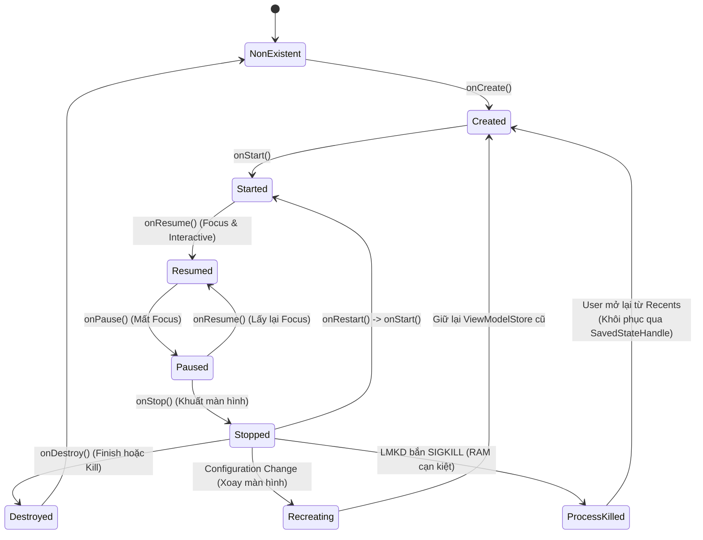
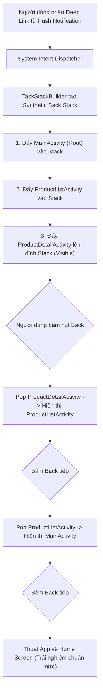

# Activity Lifecycle, Configuration Change, Process Death

## 1. Tổng quan (What & Why)

Vòng đời của `Activity` là khái niệm cơ bản đầu tiên mà bất kỳ lập trình viên Android nào cũng tiếp cận. Tuy nhiên, việc nắm vững cách hệ thống quản lý **State**, xử lý **Configuration Change** (xoay màn hình, thay đổi ngôn ngữ, dark mode), và sống sót qua **Process Death** (hệ thống tiêu diệt tiến trình ngầm) là tiêu chuẩn bắt buộc của một Senior Android Engineer.

### 1.1. Bản chất của Vòng đời Activity (Activity Lifecycle)
Activity không tự quản lý vòng đời của chính nó. Hệ điều hành Android đóng vai trò là nhạc trưởng tối cao, giám sát và điều phối trạng thái của từng Activity dựa trên:
1. Hành vi tương tác của người dùng (chạm, bấm Back, bấm Home, đa nhiệm).
2. Sự cạnh tranh tài nguyên phần cứng (CPU, GPU, RAM) giữa các ứng dụng trên toàn hệ thống.

Một Activity chuyển dịch qua các trạng thái xác định nhằm đảm bảo:
- **Trải nghiệm người dùng mượt mà:** Khôi phục đúng ngữ cảnh người dùng đang dở dang.
- **Tiết kiệm pin & tài nguyên:** Tạm dừng các tác vụ không cần thiết (animation, sensor, GPS) khi màn hình không hiển thị.
- **Ổn định hệ thống:** Cho phép OS giải phóng bộ nhớ khi cần thiết mà không gây mất mát dữ liệu của người dùng.

### 1.2. Các Callback Cốt lõi & Sự dịch chuyển Trạng thái
- **`onCreate()`:** Được gọi khi Activity được khởi tạo lần đầu tiên. Nơi thiết lập giao diện tĩnh (`setContentView`), inject dependencies, và khôi phục trạng thái ban đầu (`savedInstanceState`).
- **`onStart()`:** Activity chuyển sang trạng thái **Visible** (người dùng bắt đầu nhìn thấy trên màn hình) nhưng **chưa tương tác được**.
- **`onResume()`:** Activity tiến vào **Foreground** và có được Window Focus. Đây là trạng thái người dùng tương tác trực tiếp (gõ phím, vuốt chạm).
- **`onPause()`:** Activity **mất Focus** nhưng có thể vẫn còn hiển thị một phần (ví dụ: bị che bởi Permission Dialog, hộp thoại nổi, hoặc đang ở chế độ chia đôi màn hình Multi-Window).
- **`onStop()`:** Activity **không còn hiển thị** đối với người dùng (bị che khuất 100% bởi Activity khác hoặc người dùng đã bấm Home).
- **`onDestroy()`:** Callback cuối cùng trước khi instance của Activity bị hủy hoàn toàn khỏi bộ nhớ Heap.
- **`onRestart()`:** Được gọi khi một Activity đã ở trạng thái `onStop()` chuẩn bị quay trở lại hiển thị trước khi vào `onStart()`.

> **Thay đổi quan trọng về `onSaveInstanceState()` từ Android 9 (API 28):**
> Trước Android P, `onSaveInstanceState()` có thể được gọi trước hoặc sau `onStop()`. Từ Android 9 trở đi, Google chuẩn hóa để `onSaveInstanceState()` **luôn luôn được gọi SAU `onStop()`**, giúp tránh việc lưu trữ trạng thái khi các tác vụ dọn dẹp UI chưa hoàn tất.

---

## 2. Cơ chế hoạt động bên trong (Internal Mechanism)

### 2.1. Thứ tự Callback khi Điều hướng giữa 2 Activity (A -> B)
Khi người dùng đang ở `Activity A` và mở `Activity B`, thứ tự thực thi chính xác của hệ thống là:

```
1. Activity A: onPause()
2. Activity B: onCreate()
3. Activity B: onStart()
4. Activity B: onResume()  <-- B đã hiển thị và tương tác được
5. Activity A: onStop()    <-- Chỉ sau khi B đã onResume thì A mới onStop()
```

> **Senior Insight:** Vì `Activity B` chỉ có thể khởi tạo sau khi `Activity A.onPause()` hoàn thành, **tuyệt đối không thực hiện các tác vụ nặng (như ghi file, database, network) trong `onPause()`**. Nếu `onPause()` chạy chậm, toàn bộ hoạt ảnh chuyển cảnh sang màn hình mới sẽ bị giật và gây trễ cảm nhận cho người dùng. Các thao tác lưu trữ nặng phải đặt ở `onStop()`.

### 2.2. Thứ tự Callback khi Xoay Màn hình (Configuration Change)
Khi xảy ra sự kiện thay đổi cấu hình (ví dụ: xoay ngang điện thoại):

```
1. Activity A (Old): onPause()
2. Activity A (Old): onStop()
3. Activity A (Old): onSaveInstanceState(outState: Bundle)
4. Activity A (Old): onDestroy()
--------------------------------------------------------------- (Hủy instance cũ)
5. Activity A (New): onCreate(savedState: Bundle?)
6. Activity A (New): onStart()
7. Activity A (New): onRestoreInstanceState(savedState: Bundle)
8. Activity A (New): onResume()
```

### 2.3. Configuration Change vs Process Death: Bản chất khác biệt
Hai hiện tượng này thường bị nhầm lẫn vì kết quả cuối cùng trên màn hình trông có vẻ tương tự, nhưng cơ chế dưới tầng OS hoàn toàn khác biệt:

```
+-----------------------------------------------------------------------------------------+
|                                  BẢN CHẤT SỰ KHÁC BIỆT                                 |
+-----------------------------------------------------------------------------------------+
| Đặc điểm                 | Configuration Change             | Process Death             |
+--------------------------+----------------------------------+---------------------------+
| Vòng đời Linux Process   | Process VẪN SỐNG                 | Process BỊ TIÊU DIỆT      |
| Trạng thái Bộ nhớ Heap   | RAM Heap được giữ nguyên         | Toàn bộ Heap bị xóa sạch  |
| ViewModel Instance       | SỐNG SÓT (Survives)              | BỊ HỦY HOÀN TOÀN          |
| Singleton / Static Data  | Giữ nguyên giá trị               | Bị reset về mặc định/null |
| Nơi lưu giữ State        | ViewModel & NonConfigInstances   | SavedStateHandle / Bundle |
| Kênh vận chuyển dữ liệu  | In-memory Reference trong RAM    | Binder IPC tới ATMS/AMS   |
+-----------------------------------------------------------------------------------------+
```

#### Tại sao ViewModel sống qua Configuration Change nhưng CHẾT khi Process Death?
1. **Qua Configuration Change:**
   - Dưới tầng Framework, `ComponentActivity` sử dụng cơ chế `onRetainNonConfigurationInstance()`.
   - Trước khi Activity cũ bị hủy, nó lưu instance của `ViewModelStore` vào một đối tượng tên là `NonConfigurationInstances` nằm trong `ActivityClientRecord`.
   - `ActivityClientRecord` này vẫn nằm an toàn trên bộ nhớ RAM của chính Process của app.
   - Khi Activity mới được tạo lại, phương thức `getLastNonConfigurationInstance()` trả lại `ViewModelStore` cũ. Do đó, các instance của `ViewModel` không hề bị hủy.
2. **Khi Process Death xảy ra:**
   - LMKD bắn tín hiệu `SIGKILL` tiêu diệt toàn bộ Process của app.
   - Toàn bộ vùng nhớ Heap của app (bao gồm `ActivityClientRecord`, `ViewModelStore`, và tất cả `ViewModel` bên trong) biến mất khỏi RAM vật lý.
   - Tuy nhiên, trước khi bị kill (khi app chuyển vào background), `system_server` (ATMS) đã kịp lưu trữ dữ liệu `savedInstanceState` (Bundle) của app thông qua Binder IPC.
   - Khi người dùng quay lại app, một Process mới tinh được fork ra. Hệ thống tái tạo lại Activity và truyền Bundle này vào `onCreate(savedInstanceState)`. Lúc này `ViewModelStore` được khởi tạo lại từ con số 0, toàn bộ `ViewModel` cũ đã chết.

### 2.4. Cơ chế hoạt động của SavedStateHandle
Jetpack Lifecycle giới thiệu `SavedStateHandle` để giải quyết triệt để vấn đề mất dữ liệu khi xảy ra Process Death mà không làm mất đi tính sạch sẽ của kiến trúc MVVM.
- `SavedStateHandle` là một Key-Value map gắn liền với vòng đời của ViewModel.
- Nó hoạt động như một cầu nối hai chiều giữa ViewModel và `SavedStateRegistry` của `ComponentActivity`.
- Khi Activity chuẩn bị lưu trạng thái, `SavedStateRegistry` tự động thu thập toàn bộ dữ liệu từ `SavedStateHandle` và đóng gói vào `outBundle` gửi tới `system_server`.
- Khi app được khôi phục sau Process Death, `SavedStateViewModelFactory` đọc Bundle nhận được từ OS và nạp ngược lại vào `SavedStateHandle` của ViewModel mới.

### 2.5. Task và Back Stack
- **Task:** Là một tập hợp các Activities được người dùng trải nghiệm như một luồng công việc thống nhất (ví dụ: luồng mua hàng, luồng soạn email).
- **Back Stack:** Là một cấu trúc dữ liệu LIFO (Vào sau - Ra trước) bên trong Task.
  - Khi mở Activity mới -> Push lên đỉnh stack.
  - Khi bấm nút Back -> Pop Activity trên đỉnh ra khỏi stack và hủy nó.
  - Khi toàn bộ Activities trong stack bị Pop hết -> Task kết thúc.

### 2.6. Launch Modes & Intent Flags

| Launch Mode | Hành vi tạo Instance | Vị trí Stack | Hành vi khi đã tồn tại trong Stack | Use Case Thực Tế |
|---|---|---|---|---|
| **`standard`** (mặc định) | Luôn luôn tạo mới một instance | Đẩy lên đỉnh của Task gọi nó | Tạo thêm instance mới xếp chồng lên trên | Màn hình chi tiết sản phẩm, danh sách thông thường |
| **`singleTop`** | Chỉ tạo mới nếu nó **không ở đỉnh** | Nếu đã ở đỉnh, tái sử dụng instance đó | Gọi callback `onNewIntent()` thay vì tạo mới | Màn hình Search, Thông báo Notification click |
| **`singleTask`** | Chỉ có **tối đa 1 instance** trong Task | Nằm tại một vị trí trong Task | Pop tất cả các Activity nằm phía trên nó (Clear Top) và gọi `onNewIntent()` | Main Root Dashboard, Home screen của ứng dụng |
| **`singleInstance`** | Độc quyền sống trong **một Task riêng biệt** | Task đó chỉ chứa duy nhất 1 Activity này | Chuyển sang Task đó và gọi `onNewIntent()` | Ứng dụng Bàn phím quay số cuộc gọi (Phone In-Call UI), Launcher |

#### Các Intent Flags phổ biến:
- `FLAG_ACTIVITY_NEW_TASK`: Khởi động Activity trong một Task mới (nếu kết hợp với `taskAffinity`) hoặc chuyển sang Task hiện có chứa affinity đó. Đây là cờ bắt buộc khi start Activity từ `ApplicationContext` hoặc `BroadcastReceiver`.
- `FLAG_ACTIVITY_CLEAR_TOP`: Nếu Activity được gọi đã tồn tại trong Task hiện tại, thay vì tạo mới, nó sẽ đóng tất cả các Activity nằm trên đỉnh của Activity đó.
- `FLAG_ACTIVITY_SINGLE_TOP`: Tương đương với việc khai báo `launchMode="singleTop"` trong AndroidManifest.xml.
- `FLAG_ACTIVITY_CLEAR_TASK`: Luôn đi kèm với `FLAG_ACTIVITY_NEW_TASK`, xóa sạch toàn bộ các Activity đang có trong Task trước khi đưa Activity mới vào (thường dùng cho luồng **Logout** để điều hướng về màn hình Login).

---

## 3. Luồng hoạt động (Flow Diagram - dùng mermaid)

### 3.1. Activity Lifecycle State Machine (Bao gồm Configuration Change & Process Death)



### 3.2. Luồng Deep Link với TaskStackBuilder



---

## 4. Real-world Use Case

### 4.1. ViewModel kết hợp SavedStateHandle sống sót qua Process Death
Dưới đây là một implementation hoàn chỉnh xử lý kịch bản người dùng đang nhập dở đơn hàng thì app bị OS kill do thiếu RAM:

```kotlin
package com.example.core.presentation

import androidx.lifecycle.SavedStateHandle
import androidx.lifecycle.ViewModel
import androidx.lifecycle.viewModelScope
import kotlinx.coroutines.flow.StateFlow
import kotlinx.coroutines.launch

class CheckoutViewModel(
    private val savedStateHandle: SavedStateHandle,
    private val orderRepository: OrderRepository
) : ViewModel() {

    companion object {
        private const val KEY_ORDER_ID = "key_order_id"
        private const val KEY_NOTE = "key_customer_note"
    }

    // Đọc trạng thái từ SavedStateHandle (tự động khôi phục nếu bị Process Death)
    val orderId: StateFlow<String?> = savedStateHandle.getStateFlow(KEY_ORDER_ID, null)
    val customerNote: StateFlow<String> = savedStateHandle.getStateFlow(KEY_NOTE, "")

    fun initializeOrder(id: String) {
        if (savedStateHandle.get<String>(KEY_ORDER_ID) == null) {
            savedStateHandle[KEY_ORDER_ID] = id
        }
    }

    fun updateCustomerNote(note: String) {
        // Tự động đồng bộ vào SavedStateRegistry để hệ thống backup
        savedStateHandle[KEY_NOTE] = note
    }

    fun submitCheckout() {
        val currentOrderId = savedStateHandle.get<String>(KEY_ORDER_ID) ?: return
        val currentNote = savedStateHandle.get<String>(KEY_NOTE).orEmpty()

        viewModelScope.launch {
            orderRepository.confirmOrder(currentOrderId, currentNote)
            // Xóa state sau khi hoàn tất giao dịch
            savedStateHandle.remove<String>(KEY_ORDER_ID)
            savedStateHandle.remove<String>(KEY_NOTE)
        }
    }
}

interface OrderRepository {
    suspend fun confirmOrder(orderId: String, note: String)
}
```

### 4.2. Xử lý Deep Link với Synthetic Back Stack (TaskStackBuilder)
Khi người dùng mở một đường link từ thông báo, chúng ta không thể mở đơn lẻ `DetailActivity` vì khi người dùng bấm nút Back, app sẽ văng thẳng ra Launcher thay vì lùi về trang chủ. Giải pháp là dựng lại lịch sử điều hướng nhân tạo:

```kotlin
package com.example.core.navigation

import android.app.PendingIntent
import android.content.Context
import android.content.Intent
import androidx.core.app.TaskStackBuilder
import com.example.app.ui.HomeActivity
import com.example.app.ui.OrderHistoryActivity
import com.example.app.ui.OrderDetailActivity

object DeepLinkNavigator {

    fun createPendingIntentForOrderDetail(
        context: Context,
        orderId: String
    ): PendingIntent {
        val detailIntent = Intent(context, OrderDetailActivity::class.java).apply {
            putExtra("EXTRA_ORDER_ID", orderId)
        }

        // Dựng một Back Stack tổng hợp
        val pendingIntent = TaskStackBuilder.create(context).run {
            // 1. Thêm Parent Activity vào đáy stack
            addNextIntentWithParentStack(detailIntent)
            // Hoặc add từng Intent theo thứ tự mong muốn:
            // addNextIntent(Intent(context, HomeActivity::class.java))
            // addNextIntent(Intent(context, OrderHistoryActivity::class.java))
            // addNextIntent(detailIntent)
            
            getPendingIntent(
                0,
                PendingIntent.FLAG_UPDATE_CURRENT or PendingIntent.FLAG_IMMUTABLE
            )
        }

        return checkNotNull(pendingIntent)
    }
}
```

---

## 5. Anti-Patterns & Pitfalls

### 5.1. Anti-Pattern: Nhét dữ liệu lớn vào `onSaveInstanceState` (TransactionTooLargeException)
Nhiều lập trình viên lưu trữ danh sách đối tượng lớn, Bitmap, hoặc toàn bộ JSON response vào `outState` Bundle:
```kotlin
override fun onSaveInstanceState(outState: Bundle) {
    super.onSaveInstanceState(outState)
    // ❌ CỰC KỲ NGUY HIỂM: Lưu trữ danh sách 500 items vào Bundle
    outState.putParcelableArrayList("ITEMS", heavyItemList)
}
```
- **Hậu quả:** Toàn bộ Bundle của `onSaveInstanceState` phải được gửi qua **Binder IPC** tới process `system_server`. Kích thước bộ đệm Binder của cả process chỉ vỏn vẹn **1MB** (chia sẻ cho mọi giao dịch IPC). Nếu Bundle vượt quá vài trăm KB, ứng dụng sẽ sập ngay lập tức với lỗi ngoại lệ `TransactionTooLargeException`.
- **Quy tắc:** Chỉ lưu trữ các dữ liệu định danh nhẹ (IDs, input text, current scroll index, filtering flags). Dữ liệu nặng phải được lưu trong Database cục bộ (Room) hoặc Persistent Cache.

### 5.2. Anti-Pattern: Tác vụ nặng trong `onPause()` gây trễ Navigation
- Đặt lệnh đồng bộ hóa Database, mã hóa file hoặc xử lý dữ liệu nặng trong `onPause()`.
- **Hậu quả:** Vì Activity tiếp theo bị chặn không thể chạy `onCreate()` và `onResume()` cho đến khi `onPause()` của Activity hiện tại thực thi xong, người dùng sẽ trải nghiệm cảm giác app bị đơ 1-2 giây mỗi khi bấm chuyển màn hình.

### 5.3. Pitfall: Không xử lý `onNewIntent()` khi dùng `singleTop` hoặc `singleTask`
Khi Activity được tái sử dụng qua các chế độ này, phương thức `onCreate()` **không được gọi lại**. Nếu lập trình viên chỉ đọc tham số khởi tạo trong `onCreate()`, dữ liệu mới từ Intent sẽ hoàn toàn bị bỏ qua:
```kotlin
class SearchActivity : AppCompatActivity() {
    override fun onNewIntent(intent: Intent) {
        super.onNewIntent(intent)
        // ✅ Bắt buộc phải cập nhật intent mới
        setIntent(intent)
        handleSearchQuery(intent)
    }
}
```

---

## 6. Trade-offs & So sánh

### 6.1. onSaveInstanceState vs ViewModel vs Room Database

| Tiêu chí | `onSaveInstanceState` / `SavedStateHandle` | `ViewModel` | `Room` / `DataStore` |
|---|---|---|---|
| **Vị trí lưu trữ** | In-memory RAM trong `system_server` | In-memory RAM của App Process | Ổ đĩa lưu trữ (Flash Storage / Disk) |
| **Sống qua Config Change?** | ✅ Có | ✅ Có | ✅ Có |
| **Sống qua Process Death?** | ✅ Có | ❌ **Không** | ✅ Có |
| **Sống qua Thao tác Tắt App (User Dismiss)?** | ❌ Không | ❌ Không | ✅ **Có** |
| **Tốc độ đọc/ghi** | Rất nhanh (nhưng có chi phí serialize/Binder) | Cực nhanh (Direct RAM Reference) | Chậm hơn (Disk I/O) |
| **Giới hạn dung lượng** | Rất nhỏ (< 50KB khuyến nghị, < 1MB crash) | Toàn bộ dung lượng Heap RAM của app | Không giới hạn (tùy thuộc bộ nhớ máy) |
| **Dữ liệu phù hợp** | User input dở dang, ID, Filter status, Tab index | UI State phức tạp, Cached Lists, Domain models | Thông tin người dùng, Offline cache, Lịch sử |

---

## 7. Senior-level Insights

1. **Kiểm tra Process Death trong môi trường Dev/QA:**
   Để giả lập chính xác kịch bản Process Death trên thiết bị thật mà không cần đợi máy cạn RAM:
   - Bước 1: Mở màn hình cần test, nhập dữ liệu.
   - Bước 2: Bấm nút **Home** để đưa app xuống background.
   - Bước 3: Dùng Terminal chạy lệnh ADB để kill process:
     ```bash
     adb shell am kill <package_name>
     ```
   - Bước 4: Mở lại ứng dụng từ màn hình **Recents**. Nếu app văng lỗi `NullPointerException` hoặc hiển thị màn hình trắng, nghĩa là bạn chưa xử lý Process Death đúng cách!

2. **Cơ chế Don't Keep Activities:**
   Bật tùy chọn *"Don't keep activities"* trong Developer Options chỉ giúp bạn test việc Activity bị destroy khi chuyển màn hình (giả lập việc destroy của Activity), nhưng **không giả lập được Process Death** vì nó không kill process của app (ViewModel vẫn sống sót). Đừng nhầm lẫn giữa hai khái niệm này khi QA kiểm thử.

3. **`singleTask` và Nguy cơ Xóa Sạch Back Stack ngoài ý muốn:**
   Khi gọi một Activity có `singleTask`, mọi Activity nằm trên nó sẽ bị `finish()` không thương tiếc. Nếu bạn áp dụng `singleTask` cho các màn hình nằm sâu trong funnel thanh toán hoặc đăng ký nhiều bước, người dùng sẽ bị mất toàn bộ lịch sử các bước đã thực hiện nếu vô tình chạm vào notification hoặc deep link kích hoạt lại màn hình đó.

---

## 8. Câu hỏi phỏng vấn (với gợi ý trả lời)

### Q1: Trình bày thứ tự gọi các callback của Activity A và Activity B khi người dùng điều hướng từ A sang B? Tại sao thứ tự lại như vậy?
> **Gợi ý trả lời:**
> Thứ tự chính xác là:
> 1. `A.onPause()`
> 2. `B.onCreate()` -> `B.onStart()` -> `B.onResume()`
> 3. `A.onStop()`
> Lý do thiết kế: Android ưu tiên hiển thị giao diện mới cho người dùng càng sớm càng tốt. Activity B phải hoàn tất việc hiển thị (`onResume`) và chiếm quyền kiểm soát màn hình thì Activity A mới được xem là bị che khuất hoàn toàn để chuyển vào trạng thái `onStop()`. Điều này cũng giải thích vì sao không được viết code nặng trong `A.onPause()`, bởi nó sẽ trì hoãn trực tiếp thời điểm `B` được khởi tạo.

### Q2: Sự khác biệt bản chất giữa Configuration Change và Process Death là gì?
> **Gợi ý trả lời:**
> - **Configuration Change:** Linux Process của app vẫn sống nguyên vẹn trên RAM. Chỉ có instance của Activity hiện tại bị hủy và tạo lại để tải tài nguyên mới (layout-land, strings,...). `ViewModelStore` được lưu lại trong RAM thông qua `NonConfigurationInstances`, do đó `ViewModel` hoàn toàn sống sót.
> - **Process Death:** Toàn bộ Linux Process của app bị LMKD tiêu diệt qua tín hiệu `SIGKILL` khi hệ thống thiếu bộ nhớ. Toàn bộ RAM Heap (bao gồm biến Static, Singleton, và cả ViewModel) bị xóa sổ. Dữ liệu chỉ có thể sống sót nếu đã được lưu vào `savedInstanceState` (chuyển sang `system_server` trước đó) và được khôi phục lại qua `SavedStateHandle` hoặc `Bundle`.

### Q3: Tại sao ViewModel lại không thể sống sót qua Process Death?
> **Gợi ý trả lời:**
> ViewModel bản chất chỉ là một đối tượng Java/Kotlin thông thường nằm trên vùng nhớ Heap của Process ứng dụng. Khi Process Death xảy ra, hệ điều hành thu hồi toàn bộ không gian bộ nhớ của tiến trình đó. Vì không có bất kỳ cơ chế tuần tự hóa (serialization) hay lưu trữ nào xuống đĩa tự động cho toàn bộ instance của ViewModel, nên toàn bộ dữ liệu trong ViewModel sẽ bị xóa sạch cùng với sự biến mất của Process.

### Q4: `SavedStateHandle` hoạt động như thế nào và tại sao nó lại ưu việt hơn cách dùng `onSaveInstanceState` truyền thống trong Activity?
> **Gợi ý trả lời:**
> `SavedStateHandle` là một Key-Value store được tích hợp sẵn trong ViewModel thông qua Jetpack SavedState library. Nó kết nối với `SavedStateRegistry` của Activity.
> Tính ưu việt:
> 1. Giúp tách biệt hoàn toàn logic quản lý state ra khỏi tầng View (Activity/Fragment), tuân thủ nguyên lý MVVM.
> 2. Cung cấp API hiện đại như `getStateFlow()` hoặc `getLiveData()` giúp View tự động quan sát dữ liệu khôi phục một cách reactive.
> 3. Tự động khôi phục dữ liệu ngay khi ViewModel được khởi tạo lại sau Process Death mà không cần viết mã bóc tách Bundle phức tạp trong Activity `onCreate()`.

### Q5: Phân biệt các Launch Mode: `standard`, `singleTop`, `singleTask`, và `singleInstance`?
> **Gợi ý trả lời:**
> - `standard`: Luôn tạo mới một instance và đẩy lên đỉnh Task hiện tại.
> - `singleTop`: Nếu một instance của Activity đã nằm ở ngay đỉnh của Task hiện tại, nó sẽ không tạo mới mà tái sử dụng và gọi `onNewIntent()`. Nếu không nằm ở đỉnh, nó hoạt động như standard.
> - `singleTask`: Chỉ có tối đa 1 instance duy nhất trong một Task. Nếu đã tồn tại ở vị trí bất kỳ trong stack, nó sẽ pop toàn bộ các Activity phía trên nó để đưa Activity này lên đỉnh và gọi `onNewIntent()`.
> - `singleInstance`: Tương tự singleTask nhưng Activity này luôn nằm độc quyền trong một Task riêng biệt, không cho phép bất kỳ Activity nào khác cùng chung Task với nó.

### Q6: Kể tên nguyên nhân và cách khắc phục lỗi ngoại lệ `TransactionTooLargeException`?
> **Gợi ý trả lời:**
> `TransactionTooLargeException` xảy ra khi dữ liệu truyền qua Binder IPC vượt quá giới hạn của bộ đệm Binder (kích thước tối đa là 1MB dùng chung cho tất cả các giao dịch IPC đang diễn ra của toàn bộ process). Lỗi này thường gặp khi nhét danh sách dữ liệu quá lớn hoặc hình ảnh Bitmap vào Intent hoặc Bundle của `onSaveInstanceState()`.
> **Cách khắc phục:** 
> - Chỉ lưu các dữ liệu tối giản (IDs, trạng thái cờ, chuỗi tìm kiếm ngắn, index vị trí cuộn) vào Bundle.
> - Các dữ liệu phức tạp hoặc dung lượng lớn phải được lưu trữ trong Database (Room), File cache cục bộ, và chỉ truyền ID để tải lại dữ liệu khi cần.

### Q7: Khi mở một Activity từ một Push Notification hoặc Deep Link, làm thế nào để đảm bảo khi người dùng bấm nút Back, họ được đưa về màn hình chính của ứng dụng thay vì thoát app?
> **Gợi ý trả lời:**
> Sử dụng `TaskStackBuilder` để tạo một **Synthetic Back Stack (Back Stack nhân tạo)**. 
> Bằng cách khai báo thuộc tính `android:parentActivityName` trong `AndroidManifest.xml` hoặc gọi phương thức `TaskStackBuilder.addNextIntentWithParentStack(intent)`, hệ thống sẽ tự động chèn các Activity cha (như `HomeActivity`, `CategoryActivity`) vào bên dưới Activity chi tiết trong stack. Khi người dùng bấm nút Back, các Activity cha sẽ lần lượt xuất hiện theo đúng trật tự trải nghiệm tự nhiên.

### Q8: `onSaveInstanceState()` được gọi vào thời điểm nào? Có đảm bảo chắc chắn luôn được gọi trước khi Activity bị kill không?
> **Gợi ý trả lời:**
> `onSaveInstanceState()` được gọi khi Activity chuyển sang trạng thái Stopped và có khả năng bị hệ thống tiêu diệt trong tương lai (ví dụ khi người dùng bấm Home, chuyển sang app khác, hoặc xoay màn hình). Từ Android 9 (API 28), nó luôn được gọi sau `onStop()`.
> Tuy nhiên, callback này **KHÔNG được gọi** nếu người dùng chủ động đóng Activity (ví dụ bấm nút Back hoặc gọi `finish()`), bởi vì hệ thống hiểu rằng người dùng có chủ đích kết thúc luồng làm việc đó và không có nhu cầu khôi phục lại trạng thái.

---

## 9. Tài liệu tham khảo
- [Android Developers - Understand the Activity Lifecycle](https://developer.android.com/guide/components/activities/activity-lifecycle)
- [Android Developers - Understand Tasks and the Back Stack](https://developer.android.com/guide/components/activities/tasks-and-back-stack)
- [Android Developers - Saved State module for ViewModel](https://developer.android.com/topic/libraries/architecture/viewmodel/viewmodel-savedstate)
- [Android Developers - Parcelables and Bundles size limitations](https://developer.android.com/guide/components/activities/parcelables-and-bundles)
