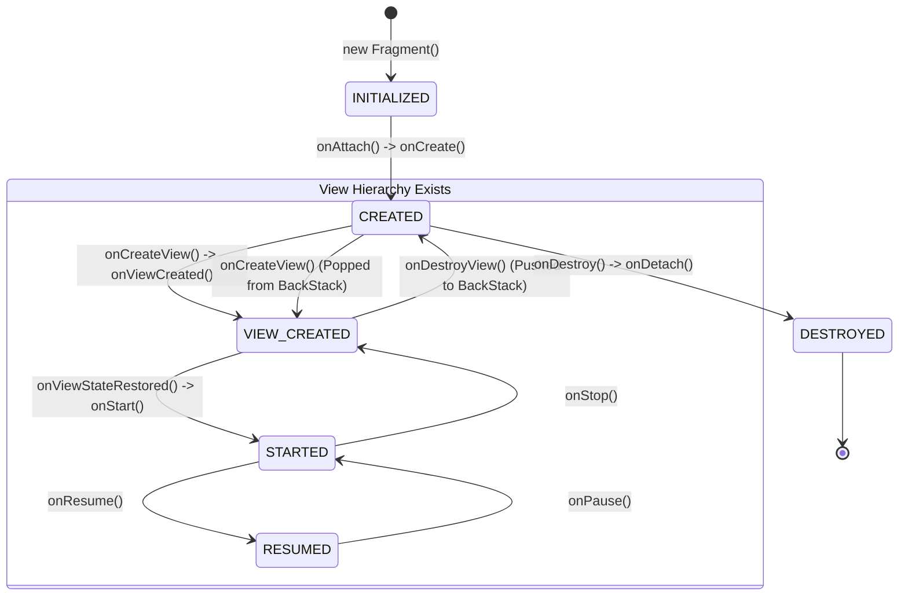
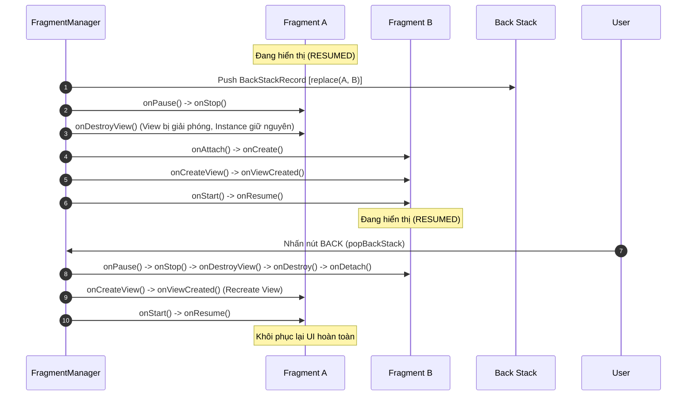

# Fragment Lifecycle, FragmentManager & Back Stack

## 1. Tổng quan (What & Why)

### 1.1 Fragment là gì?
`Fragment` đại diện cho một phần giao diện người dùng (UI) có thể tái sử dụng hoặc một hành vi (behavior) độc lập được gắn vào một `FragmentActivity`. Ra mắt từ Android 3.0 (Honeycomb) để hỗ trợ giao diện đa màn hình (tablet đa cột vs phone đơn cột), Fragment đã phát triển thành hạt nhân của kiến trúc hiện đại **Single-Activity Architecture** được Google khuyến nghị kết hợp cùng Jetpack Navigation.

### 1.2 Tại sao lại cần Fragment?
- **Tính mô-đun hóa (Modularity):** Chia nhỏ giao diện phức tạp thành các khối độc lập có thể tái sử dụng trên nhiều màn hình hoặc luồng người dùng khác nhau.
- **Tối ưu tài nguyên với Single-Activity:** Chuyển đổi giữa các màn hình bằng Fragment transactions nhẹ hơn đáng kể so với việc khởi tạo một Activity mới (tránh overhead khởi tạo Window, Surface, IPC với `ActivityManagerService`).
- **Khả năng linh hoạt của Back Stack:** Cho phép quản lý lịch sử điều hướng nội bộ trong một Activity mà không làm phình to Activity stack của hệ điều hành.
- **Thích ứng màn hình động (Dynamic UI):** Dễ dàng hoán đổi UI tại runtime dựa trên kích thước màn hình, trạng thái gập (foldables), hoặc hướng xoay (landscape/portrait).

### 1.3 Thách thức cốt lõi
Fragment là một trong những component phức tạp và dễ gây lỗi nhất trên Android do:
1. **Sự tách biệt giữa Lifecycle của Fragment Instance và Lifecycle của View**.
2. **Quản lý bất đồng bộ của Fragment Transactions**.
3. **Cơ chế tái tạo sau Process Death** và việc giữ reference gây rò rỉ bộ nhớ (Memory Leak).

---

## 2. Cơ chế hoạt động bên trong (Internal Mechanism)

### 2.1 Vòng đời đầy đủ của Fragment (Fragment Lifecycle)

Fragment có một chuỗi callbacks phản ánh trạng thái của cả bản thân Java/Kotlin instance lẫn View hierarchy mà nó quản lý:

```
[onAttach] ──► [onCreate] ──► [onCreateView] ──► [onViewCreated] ──► [onViewStateRestored]
                                                                            │
┌───────────────────────────────────────────────────────────────────────────┘
▼
[onStart] ──► [onResume] (Active / Interactive)
                  │
[onPause] ◄───────┘
    │
    ▼
[onStop] ──► [onSaveInstanceState]
    │
    ▼
[onDestroyView] ──► [onDestroy] ──► [onDetach]
```

- **`onAttach(context: Context)`:** Fragment được gắn vào Host Activity/Context. Tại đây `requireContext()` bắt đầu trả về giá trị hợp lệ.
- **`onCreate(savedInstanceState: Bundle?)`:** Khởi tạo các non-UI components (Dependency Injection, SavedState, non-view variables). **Chưa có View tại thời điểm này**.
- **`onCreateView(inflater, container, savedInstanceState)`:** Inflate XML layout hoặc tạo View hierarchy. Trả về root `View`.
- **`onViewCreated(view: View, savedInstanceState: Bundle?)`:** View đã được tạo chắc chắn (non-null). Đây là vị trí lý tưởng nhất để bind View, setup RecyclerView adapters, gán click listeners và bắt đầu observe ViewModel.
- **`onViewStateRestored(savedInstanceState: Bundle?)`:** Hệ thống đã khôi phục trạng thái đã lưu vào View hierarchy (ví dụ: text trong EditText có id).
- **`onStart()`:** Fragment hiển thị với người dùng (nhưng chưa tương tác được, tương ứng với Activity `onStart`).
- **`onResume()`:** Fragment ở foreground và người dùng có thể tương tác đầy đủ.
- **`onPause()`:** Fragment mất focus hoặc Activity bị che một phần.
- **`onStop()`:** Fragment không còn hiển thị trên màn hình.
- **`onDestroyView()`:** View hierarchy bị hủy bỏ khỏi window. **Nhưng Fragment instance vẫn có thể còn sống trong Back Stack!**
- **`onDestroy()`:** Fragment instance sắp bị hủy hoàn toàn.
- **`onDetach()`:** Fragment bị gỡ khỏi Host Activity.

---

### 2.2 Sự tồn tại của 2 Lifecycle độc lập: Fragment vs View

Một câu hỏi phỏng vấn kinh điển: **Tại sao Fragment lại có 2 Lifecycle riêng biệt?**

```
┌────────────────────────────────────────────────────────────────────────┐
│                        Fragment Instance Lifecycle                     │
│  (onAttach -> onCreate ───────────────────────────► onDestroy -> onDetach)│
│                                                                        │
│         ┌──────────────────────────────────────────────────┐           │
│         │              View Lifecycle (ViewLifecycleOwner) │           │
│         │  (onCreateView -> onViewCreated                  │           │
│         │        ▲                                         │           │
│         │        │         ... onStart/onResume ...        │           │
│         │        │                     │                   │           │
│         │        │                     ▼                   │           │
│         │        └──[Recreate]── onDestroyView)            │           │
│         └──────────────────────────────────────────────────┘           │
└────────────────────────────────────────────────────────────────────────┘
```

#### Nguyên nhân sâu xa:
Khi bạn thực hiện transaction thay thế một Fragment và đẩy vào Back Stack:
```kotlin
parentFragmentManager.commit {
    replace(R.id.container, FragmentB())
    addToBackStack("to_b")
}
```
1. `FragmentA` bị đưa vào **Back Stack**.
2. Để tiết kiệm RAM cho thiết bị, Android sẽ **phá hủy toàn bộ View hierarchy của `FragmentA`** (`onDestroyView()` được gọi). Toàn bộ cây View nặng nề (Bitmaps, Layout node, Canvas references) bị giải phóng.
3. Tuy nhiên, **Java/Kotlin object của `FragmentA` vẫn được giữ sống trong bộ nhớ** bởi `FragmentManager` để lưu giữ trạng thái, navigation history, và các arguments.
4. Khi người dùng nhấn nút Back, `FragmentA` được pop khỏi Back Stack: `onCreateView()` và `onViewCreated()` được gọi lại để **tạo mới View hierarchy**, trong khi `FragmentA.onCreate()` **không** được gọi lại!

Do đó: **Vòng đời của View ngắn hơn vòng đời của Fragment instance.** Một Fragment instance có thể trải qua nhiều lần tạo và hủy View.

---

### 2.3 ViewLifecycleOwner: Tại sao bắt buộc dùng khi Observe?

Trong Fragment, có 2 đối tượng implement `LifecycleOwner`:
1. `this` (Fragment chính nó): Bắt đầu từ `onCreate()` và kết thúc ở `onDestroy()`.
2. `viewLifecycleOwner`: Bắt đầu từ `onCreateView()` / `onViewCreated()` và kết thúc ở `onDestroyView()`.

#### Hiểm họa khi dùng `this` (Fragment LifecycleOwner):
```kotlin
// ❌ SAI LẦM NGUY HIỂM:
override fun onViewCreated(view: View, savedInstanceState: Bundle?) {
    super.onViewCreated(view, savedInstanceState)
    viewModel.userData.observe(this) { data -> // Sử dụng 'this'
        binding.textView.text = data.name
    }
}
```
1. Lần đầu mở Fragment: View được tạo, gắn Observer 1 vào LiveData/Flow với target lifecycle là `Fragment instance`.
2. Chuyển sang Fragment khác (`addToBackStack`): View của Fragment bị destroy (`onDestroyView`), nhưng Fragment instance vẫn sống.
3. Nhấn Back quay lại: `onViewCreated()` chạy lần 2. Tiếp tục gắn thêm Observer 2 vào LiveData/Flow!
4. **Hậu quả:**
   - **Multiple Observers:** Mỗi lần quay lại back stack, thêm 1 observer. Khi data emit, callback chạy 2x, 3x, 4x lần.
   - **Crash UI:** Observer cũ có thể capture context/view cũ hoặc trigger khi View chưa sẵn sàng.
   - **Rò rỉ bộ nhớ:** LiveData giữ strong reference tới `this` nếu không cẩn thận.

#### Giải pháp chuẩn:
```kotlin
// ✅ CHUẨN XÁC:
override fun onViewCreated(view: View, savedInstanceState: Bundle?) {
    super.onViewCreated(view, savedInstanceState)
    
    viewLifecycleOwner.lifecycleScope.launch {
        viewLifecycleOwner.repeatOnLifecycle(Lifecycle.State.STARTED) {
            viewModel.uiState.collect { state ->
                binding.textView.text = state.name
            }
        }
    }
}
```
Khi `onDestroyView()` được gọi, `viewLifecycleOwner` chuyển sang `DESTROYED`, tự động remove mọi Observer / cancel Flow collection.

---

### 2.4 Rò rỉ bộ nhớ (Memory Leak) với ViewBinding

Một trong những nguồn rò rỉ RAM phổ biến nhất trong Android là **giữ reference tới ViewBinding/View sau `onDestroyView`**:

```kotlin
class UserProfileFragment : Fragment(R.layout.fragment_user_profile) {
    // ❌ RÒ RỈ BỘ NHỚ NẶNG:
    private var binding: FragmentUserProfileBinding? = null
    
    override fun onViewCreated(view: View, savedInstanceState: Bundle?) {
        super.onViewCreated(view, savedInstanceState)
        binding = FragmentUserProfileBinding.bind(view)
    }
    // Quên không null hóa binding trong onDestroyView!
}
```

#### Cơ chế gây Leak:
1. `binding` giữ reference tới Root View của layout.
2. Root View giữ reference tới tất cả các Child Views, và quan trọng nhất: **View giữ reference tới `Context` (tức `FragmentActivity`)**.
3. Khi Fragment bị đưa vào Back Stack, View hierarchy của nó đáng lẽ phải được Garbage Collector thu hồi.
4. Nhưng vì biến `binding` của Fragment instance (vẫn đang nằm trong `FragmentManager`) giữ strong reference tới View, GC không thể dọn dẹp View hierarchy.
5. **Toàn bộ cây View + Context + Bitmaps bị rò rỉ trong heap memory** cho đến khi Fragment bị pop vĩnh viễn khỏi back stack.

#### Cách xử lý triệt để:
```kotlin
class UserProfileFragment : Fragment(R.layout.fragment_user_profile) {
    private var _binding: FragmentUserProfileBinding? = null
    // Chỉ truy cập binding an toàn giữa onCreateView và onDestroyView
    private val binding get() = _binding!!

    override fun onViewCreated(view: View, savedInstanceState: Bundle?) {
        super.onViewCreated(view, savedInstanceState)
        _binding = FragmentUserProfileBinding.bind(view)
        binding.btnSubmit.setOnClickListener { /* ... */ }
    }

    override fun onDestroyView() {
        super.onDestroyView()
        // ✅ BẮT BUỘC: Giải phóng reference để GC dọn dẹp View tree
        _binding = null
    }
}
```

---

### 2.5 FragmentManager, Back Stack & Cơ chế Commit

`FragmentManager` là lớp điều phối chịu trách nhiệm thêm, xóa, thay thế và quản lý Back Stack của các Fragment.

#### Cấu trúc bên trong của một Transaction:
Mỗi khi gọi `parentFragmentManager.beginTransaction()`, một đối tượng `BackStackRecord` được tạo. `BackStackRecord` lưu một danh sách các thao tác nguyên tử (`Op`):
- `OP_ADD`, `OP_REMOVE`, `OP_REPLACE`, `OP_HIDE`, `OP_SHOW`, `OP_ATTACH`, `OP_DETACH`.
Khi gọi `addToBackStack(name)`, toàn bộ chuỗi `Op` này được lưu vào stack để khi `popBackStack()`, FragmentManager sẽ đảo ngược thứ tự các operations (ví dụ: `OP_ADD` thành `OP_REMOVE`).

#### Bảng so sánh các phương thức commit:

| Phương thức | Tính chất | Cho phép sau `onSaveInstanceState`? | Nguy cơ / Đặc điểm |
|---|---|---|---|
| `commit()` | Bất đồng bộ (enqueue vào Main Looper queue) | ❌ Ném `IllegalStateException` | Chuẩn nhất, an toàn, UI update mượt |
| `commitNow()` | Đồng bộ (thực thi ngay lập tức) | ❌ Ném `IllegalStateException` | **Không thể** dùng chung với `addToBackStack()` |
| `commitAllowingStateLoss()` | Bất đồng bộ | ✅ Cho phép | Dữ liệu/State của Fragment có thể bị mất nếu Activity bị kill |
| `commitNowAllowingStateLoss()`| Đồng bộ | ✅ Cho phép | Thực thi ngay, chấp nhận mất state |
| `executePendingTransactions()`| Ép chạy ngay các commit đã xếp hàng | Tùy transaction trước đó | Hữu ích khi cần tính toán layout ngay |

#### Tại sao lại có lỗi `IllegalStateException: Can not perform this action after onSaveInstanceState`?
- **Nguyên nhân:** Khi Activity bị chuyển ra background (nhấn Home, mở app khác), `onSaveInstanceState()` được gọi để đóng băng trạng thái của Activity và các Fragments con thành Bundle.
- Nếu sau thời điểm đó, một async callback (API response, EventBus, WebSocket) gọi `commit()`, Fragment mới thêm vào sẽ không được đưa vào Bundle đã lưu.
- Khi người dùng quay lại và hệ thống khôi phục từ Bundle, trạng thái thực tế của app sẽ bị **State Loss** (mất đồng bộ). Android chủ động ném exception để cảnh báo lập trình viên.
- **Khắc phục đúng cách:** Không nên lạm dụng `commitAllowingStateLoss()`. Thay vào đó, hãy thực hiện navigation dựa trên Lifecycle (ví dụ: chỉ navigate khi Lifecycle ở trạng thái tối thiểu `STARTED` hoặc `RESUMED`).

---

### 2.6 Fragment Transactions: add vs replace vs show/hide

| Tiêu chí | `add()` | `replace()` | `show()` / `hide()` |
|---|---|---|---|
| **Cơ chế** | Thêm View mới đè lên container, giữ nguyên View cũ | Xóa bỏ Fragment cũ khỏi container và thêm Fragment mới | Chỉ đổi cờ `View.VISIBLE` thành `View.GONE` |
| **Lifecycle Fragment cũ** | Không thay đổi (vẫn `RESUMED`) | Chuyển xuống `onDestroyView` (nếu có back stack) hoặc `onDestroy` | Không gọi lifecycle hooks nào! Chỉ trigger `onHiddenChanged(hidden)` |
| **Mức chiếm RAM** | Trung bình (cả 2 cây View cùng tồn tại trong RAM) | Thấp nhất (View cũ bị hủy khi vào back stack) | Cao nhất (Tất cả Views của các tabs đều giữ trong RAM) |
| **Overdraw UI** | Có nguy cơ cao nếu background không trong suốt | Không có overdraw | Không có overdraw vì View bị GONE |
| **Use Case điển hình** | Overlay UI, Floating panels | Chuyển đổi màn hình thông thường (Navigation) | BottomNavigationView tabs (khi muốn giữ nguyên scroll position & view state mà không load lại) |

---

### 2.7 Giao tiếp giữa các Components (Communication Patterns)

```
┌─────────────────────────────────────────────────────────────────┐
│               1. Shared ViewModel (Recommended)                 │
│                                                                 │
│   Fragment A  ──────►   SharedViewModel   ◄──────  Fragment B   │
│   (StateFlow)          (Activity Scoped)          (Collect)     │
└─────────────────────────────────────────────────────────────────┘

┌─────────────────────────────────────────────────────────────────┐
│              2. Fragment Result API (Event Passing)             │
│                                                                 │
│   Fragment A  ───setFragmentResult(key, bundle)───► FragmentManager
│                                                           │
│   Fragment B  ◄──setFragmentResultListener(key)───────────┘     │
└─────────────────────────────────────────────────────────────────┘
```

1. **Shared ViewModel (Scoped to Activity / NavGraph):**
   - Phù hợp nhất cho chia sẻ dữ liệu liên tục, phức tạp hoặc Master-Detail flow.
   - Survive cấu hình thay đổi (Configuration Change).
   - Truy xuất thông qua `activityViewModels()` hoặc NavGraph-scoped ViewModel.

2. **Fragment Result API (`setFragmentResult` / `setFragmentResultListener`):**
   - Thay thế hoàn toàn TargetFragment (đã bị deprecated).
   - Truyền dữ liệu 1 lần (1-time event / callback result, như chọn ngày từ DatePickerFragment).
   - **Tương thích hoàn hảo với Process Death và Lifecycle**: Listener chỉ nhận event khi Fragment đạt trạng thái `STARTED`.

---

### 2.8 Phân cấp FragmentManager: child vs parent

- **`parentFragmentManager`:** Tham chiếu đến FragmentManager quản lý chính Fragment này (nếu Fragment nằm trực tiếp trên Activity thì đây là `supportFragmentManager` của Activity).
- **`childFragmentManager`:** Quản lý các Fragment con lồng bên trong (nested fragments).
  - Bắt buộc dùng `childFragmentManager` cho: `ViewPager2` bên trong Fragment, Dialog / BottomSheet mở từ Fragment, hoặc các dynamic nested tabs.
  - **Cạm bẫy:** Dùng nhầm `parentFragmentManager` trong ViewPager2 sẽ khiến các page fragment có cùng scope với parent, gây leak và lẫn lộn ID/Back Stack.

---

### 2.9 State Restoration & Process Death

Khi hệ thống Android thiếu RAM, nó có thể kill tiến trình của app khi ở background (**Process Death**). Khi user mở lại app:
1. Hệ thống tự động khởi tạo lại Host Activity.
2. `FragmentManager` tự động instantiate lại các Fragment trước đó bằng cách gọi **Default Empty Constructor** thông qua reflection (`FragmentFactory`).
3. Nếu Fragment không có default constructor (hoặc nhận params qua constructor tùy biến), app sẽ **CRASH ngay lập tức với `InstantiationException`**.
4. Dữ liệu arguments được lưu trong `fragment.arguments = Bundle()` sẽ tự động được khôi phục.
5. `SavedStateHandle` trong ViewModel tự động phục hồi các dữ liệu đã lưu.

---

## 3. Luồng hoạt động (Flow Diagram)

### 3.1 Sơ đồ trạng thái Fragment Lifecycle State Machine



### 3.2 Luồng xử lý Back Stack Transaction (`replace` + `addToBackStack`)



---

## 4. Real-world Use Case

Dưới đây là một cấu trúc hoàn chỉnh theo chuẩn Senior Android: Fragment dùng ViewBinding an toàn, coroutine Flow collection đúng lifecycle, giao tiếp bằng Shared ViewModel và Fragment Result API.

### 4.1 Implementation Chuẩn Mực

```kotlin
// 1. Host hoặc Shared ViewModel
class OrderSharedViewModel : ViewModel() {
    private val _selectedAddress = MutableStateFlow<String?>(null)
    val selectedAddress: StateFlow<String?> = _selectedAddress.asStateFlow()

    fun updateAddress(address: String) {
        _selectedAddress.value = address
    }
}

// 2. Main Order Fragment (Consumer)
class OrderSummaryFragment : Fragment(R.layout.fragment_order_summary) {

    // Tránh memory leak bằng _binding pattern
    private var _binding: FragmentOrderSummaryBinding? = null
    private val binding get() = _binding!!

    // Scoped vào Activity để share state giữa các child fragments
    private val sharedViewModel: OrderSharedViewModel by activityViewModels()

    override fun onCreate(savedInstanceState: Bundle?) {
        super.onCreate(savedInstanceState)
        
        // Lắng nghe kết quả 1-time từ AddressPickerFragment
        setFragmentResultListener(REQUEST_KEY_ADDRESS) { _, bundle ->
            val address = bundle.getString(BUNDLE_KEY_ADDRESS).orEmpty()
            sharedViewModel.updateAddress(address)
        }
    }

    override fun onViewCreated(view: View, savedInstanceState: Bundle?) {
        super.onViewCreated(view, savedInstanceState)
        _binding = FragmentOrderSummaryBinding.bind(view)

        setupUI()
        observeState()
    }

    private fun setupUI() {
        binding.btnSelectAddress.setOnClickListener {
            // Mở AddressPickerFragment
            parentFragmentManager.commit {
                replace(R.id.fragment_container, AddressPickerFragment())
                addToBackStack("picker")
            }
        }
    }

    private fun observeState() {
        // ✅ Bắt buộc: viewLifecycleOwner kết hợp repeatOnLifecycle
        viewLifecycleOwner.lifecycleScope.launch {
            viewLifecycleOwner.repeatOnLifecycle(Lifecycle.State.STARTED) {
                sharedViewModel.selectedAddress.collect { address ->
                    binding.tvAddress.text = address ?: "Chưa chọn địa chỉ"
                }
            }
        }
    }

    override fun onDestroyView() {
        super.onDestroyView()
        // ✅ Giải phóng view binding để tránh leak View hierarchy khi vào back stack
        _binding = null
    }

    companion object {
        const val REQUEST_KEY_ADDRESS = "req_address"
        const val BUNDLE_KEY_ADDRESS = "bundle_address"
    }
}

// 3. Child / Picker Fragment (Producer)
class AddressPickerFragment : Fragment(R.layout.fragment_address_picker) {

    private var _binding: FragmentAddressPickerBinding? = null
    private val binding get() = _binding!!

    override fun onViewCreated(view: View, savedInstanceState: Bundle?) {
        super.onViewCreated(view, savedInstanceState)
        _binding = FragmentAddressPickerBinding.bind(view)

        binding.itemAddressHome.setOnClickListener {
            // Trả kết quả về cho caller an toàn qua FragmentResult
            setFragmentResult(
                OrderSummaryFragment.REQUEST_KEY_ADDRESS,
                bundleOf(OrderSummaryFragment.BUNDLE_KEY_ADDRESS to "123 Nam Kỳ Khởi Nghĩa, Q.3, TP.HCM")
            )
            // Quay về màn hình trước
            parentFragmentManager.popBackStack()
        }
    }

    override fun onDestroyView() {
        super.onDestroyView()
        _binding = null
    }
}
```

---

## 5. Anti-Patterns & Pitfalls

### ❌ Anti-pattern 1: Truyền tham số qua Custom Constructor
```kotlin
// ❌ SAI:
class DetailFragment(private val userId: String) : Fragment()

// Khi hệ thống tái tạo lại Fragment sau Process Death:
// FragmentFactory gọi DetailFragment() không tham số -> CRASH InstantiationException!
```
```kotlin
// ✅ ĐÚNG:
class DetailFragment : Fragment() {
    companion object {
        private const val ARG_USER_ID = "arg_user_id"
        fun newInstance(userId: String) = DetailFragment().apply {
            arguments = bundleOf(ARG_USER_ID to userId)
        }
    }
    
    private val userId: String by lazy {
        requireArguments().getString(ARG_USER_ID) ?: throw IllegalArgumentException()
    }
}
// Hoặc tốt hơn: Dùng Navigation Component Safe Args
```

---

### ❌ Anti-pattern 2: Không dọn dẹp ViewBinding trong `onDestroyView`
- **Hậu quả:** Toàn bộ cây view, background Drawable, bitmap và Activity Context bị neo lại trong bộ nhớ heap chừng nào Fragment còn trong Back Stack. Gây OOM trên máy cấu hình yếu.
- **Biện pháp:** Luôn gán `_binding = null` trong `onDestroyView()` hoặc sử dụng Auto-cleared Property Delegate.

---

### ❌ Anti-pattern 3: Sử dụng `lifecycleScope` hoặc `this` để collect Flow trong `onViewCreated`
```kotlin
// ❌ SAI:
lifecycleScope.launch { // Scope gắn với Fragment instance lifecycle
    viewModel.dataFlow.collect { /* ... */ }
}
```
- **Hậu quả:** Khi Fragment vào back stack rồi quay lại, một coroutine mới lại được launch mà coroutine cũ chưa bị cancel (vì Fragment instance chưa bị destroy). Dẫn đến việc collect đồng thời nhiều lần, leak memory và crash UI nếu đụng đến View đã chết.
- **Biện pháp:** Dùng `viewLifecycleOwner.lifecycleScope.launch { viewLifecycleOwner.repeatOnLifecycle(...) }`.

---

### ❌ Anti-pattern 4: Lạm dụng `commitAllowingStateLoss()`
- **Hậu quả:** Developer thường dùng phương thức này để "dập" crash `Can not perform this action after onSaveInstanceState`. Tuy nhiên, nếu user chuyển app sang background ngay lúc transaction chạy, Fragment đó sẽ không bao giờ được lưu vào saved state. Khi user quay lại, UI bị rơi vào trạng thái rỗng hoặc thiếu màn hình.
- **Biện pháp:** Không emit navigation event khi lifecycle không ở `RESUMED` hoặc `STARTED`.

---

### ❌ Anti-pattern 5: Dùng `parentFragmentManager` cho Nested Views (ViewPager2, Child Tabs)
- **Hậu quả:** Tạo ra các ID collision, Back Stack của Activity quản lý các sub-fragment bên trong tab, dẫn đến hành vi bấm Back kỳ quặc (Back ở tab lại pop cả màn hình lớn hoặc ngược lại).
- **Biện pháp:** Luôn truyền `childFragmentManager` vào ViewPager2 Adapter hoặc các nested transactions.

---

## 6. Trade-offs & So sánh

### 6.1 Các phương pháp giao tiếp giữa các Fragments

| Tiêu chí | Shared ViewModel | Fragment Result API | Interface Callback qua Activity |
|---|---|---|---|
| **Scope** | Chung trong Activity hoặc NavGraph | Thông qua FragmentManager | Phụ thuộc Activity |
| **Dạng dữ liệu** | Phức tạp, Continuous State (StateFlow) | Dữ liệu đơn lẻ (1-time result qua Bundle) | Tùy biến methods |
| **Sống sót qua Process Death** | Cần kết hợp `SavedStateHandle` | ✅ Tự động lưu qua Bundle | ❌ Phải tự xử lý thủ công |
| **Mức độ phụ thuộc (Decoupling)**| Cao (Cả 2 chỉ cần biết chung ViewModel) | Rất cao (Chỉ giao tiếp qua `String` key) | Thấp (Tightly coupled với Activity) |
| **Khuyến nghị** | Dùng cho chia sẻ dữ liệu liên tục/phức tạp | Dùng cho picker, dialog trả kết quả | Hạn chế dùng (Legacy) |

---

### 6.2 Manual Transactions vs Navigation Component

| Đặc điểm | Manual Fragment Transactions | Jetpack Navigation Component |
|---|---|---|
| **Độ phức tạp** | Tự code `commit`, `addToBackStack`, handle pop | Cấu hình qua XML / Safe Args plugin |
| **Multiple Back Stacks**| Phức tạp, dễ bug khi làm bottom nav | ✅ Hỗ trợ mặc định (Navigation 2.4+) |
| **Type-safe arguments** | Dễ nhầm string key trong Bundle | ✅ Compile-time safe với `SafeArgs` |
| **Deep Link Handling** | Phải tự parse Intent và dispatch thủ công | ✅ Hỗ trợ tự động chuẩn hóa URL/URI |
| **Transition Animation** | Tự code XML animation / Animator | Cấu hình trực quan trong graph |

---

## 7. Senior-level Insights

### 7.1 `FragmentContainerView` vs `<fragment>` tag vs `FrameLayout`
Trong XML layout, trước đây lập trình viên thường dùng `FrameLayout` hoặc thẻ `<fragment>`. Google đã giới thiệu `FragmentContainerView` (kế thừa từ `FrameLayout`):
1. **Khắc phục lỗi Animation Z-Ordering:** Với `FrameLayout`, khi Fragment A thoát (exit animation) và Fragment B vào (enter animation), Fragment B có thể vẽ đè lên Fragment A dù A đang chạy animation. `FragmentContainerView` ghi đè `drawChild()` để xử lý đúng thứ tự z-index khi animate.
2. **Loại bỏ thẻ `<fragment>`:** Thẻ `<fragment>` cũ tạo ra Fragment ngay trong quá trình XML inflation trước khi FragmentManager được setup đầy đủ, gây khó kiểm soát lifecycle và không hỗ trợ dynamic replacement tốt.

### 7.2 Multiple Back Stacks Internals (AndroidX Navigation 2.4+ / Fragment 1.4+)
Trước AndroidX Fragment 1.4, việc giữ trạng thái độc lập cho từng tab trong `BottomNavigationView` là cơn ác mộng (phải dùng nhiều container hoặc show/hide).
- Fragment 1.4 giới thiệu 2 API nền tảng: `saveBackStack(name)` và `restoreBackStack(name)`.
- Khi user đổi tab: Toàn bộ trạng thái của Back Stack thuộc tab hiện tại (bao gồm cả saved instance state của từng Fragment) được lưu thành một danh sách serialized records và pop ra.
- Khi user chọn lại tab: `restoreBackStack` sẽ deserialize và replay lại transactions, khôi phục nguyên vẹn stack của tab đó.

### 7.3 Debugging & Testing Process Death
Để tái hiện lỗi Process Death trên máy dev nhằm kiểm tra xem Fragment có crash do thiếu empty constructor hay mất dữ liệu không:
```bash
# 1. Mở app và navigate tới Fragment cần test
# 2. Nhấn nút HOME để app chuyển vào background
# 3. Chạy lệnh kill process thông qua adb:
adb shell am kill com.yourcompany.app

# 4. Mở lại app từ Recent Apps launcher
# Nếu app crash -> Thiếu default constructor hoặc chưa handle SavedStateHandle!
```

---

## 8. Câu hỏi phỏng vấn (với gợi ý trả lời)

### Q1: Tại sao Fragment lại có 2 lifecycle riêng biệt (Fragment Lifecycle vs View Lifecycle)?
> **Gợi ý trả lời:**
> Fragment instance đại diện cho business logic và navigation state, trong khi View hierarchy chỉ đại diện cho giao diện trực quan hiển thị trên màn hình. Khi một Fragment bị đẩy vào Back Stack (ví dụ qua `replace` + `addToBackStack`), hệ thống sẽ phá hủy View hierarchy (`onDestroyView`) để tiết kiệm RAM. Nhưng Fragment instance vẫn được giữ sống trong bộ nhớ để duy trì trạng thái navigation. Khi người dùng bấm Back, Fragment instance đó chỉ cần tạo lại View (`onCreateView`/`onViewCreated`) mà không cần khởi tạo lại toàn bộ object. Do đó, View lifecycle có tuổi thọ ngắn hơn Fragment lifecycle.

### Q2: Điều gì xảy ra khi gọi `replace()` có `addToBackStack()` so với không gọi `addToBackStack()`?
> **Gợi ý trả lời:**
> - **Khi có `addToBackStack()`:** Fragment cũ chỉ bị phá hủy View (`onPause -> onStop -> onDestroyView`), instance của nó vẫn nằm lại trong `FragmentManager` và Back Stack. Khi popBackStack, View sẽ được tạo lại.
> - **Khi KHÔNG có `addToBackStack()`:** Fragment cũ bị phá hủy hoàn toàn (`onPause -> onStop -> onDestroyView -> onDestroy -> onDetach`) và instance của nó được Garbage Collector thu hồi.

### Q3: Tại sao không được truyền tham số vào constructor của Fragment mà phải dùng `setArguments()` hoặc Safe Args?
> **Gợi ý trả lời:**
> Khi xảy ra Configuration Change (xoay màn hình) hoặc Process Death (hệ thống kill app do thiếu RAM), Android OS sẽ tái tạo lại Activity và các Fragment con bằng reflection thông qua default constructor không tham số (`Class.newInstance()`). Nếu bạn định nghĩa một constructor có tham số và không có default constructor, hệ thống sẽ ném `Fragment.InstantiationException` gây crash app. Bằng cách truyền qua `setArguments(Bundle)`, Android sẽ tự động lưu Bundle này vào saved state và gán lại cho Fragment khi tái tạo.

### Q4: Sự khác nhau giữa `commit()`, `commitNow()`, và `commitAllowingStateLoss()`?
> **Gợi ý trả lời:**
> - `commit()`: Xếp hàng transaction vào Main Looper queue để thực thi bất đồng bộ ở frame tiếp theo. Ném lỗi nếu gọi sau khi Activity đã gọi `onSaveInstanceState()`.
> - `commitNow()`: Thực thi transaction ngay lập tức trên thread hiện tại một cách đồng bộ. Không thể sử dụng cùng với `addToBackStack()` do sẽ phá vỡ tính tuần tự của Back Stack transactions.
> - `commitAllowingStateLoss()`: Thực thi bất đồng bộ giống `commit()`, nhưng không ném exception nếu gọi sau `onSaveInstanceState()`. Đổi lại, trạng thái của Fragment đó có thể bị mất nếu hệ thống kill process.

### Q5: Tại sao cần dùng `viewLifecycleOwner` để observe LiveData/Flow thay vì `this`?
> **Gợi ý trả lời:**
> Nếu dùng `this` (Fragment lifecycle), observer sẽ tồn tại suốt vòng đời của Fragment instance. Khi Fragment vào back stack rồi được pop quay lại, `onViewCreated()` được gọi lần nữa, dẫn đến việc đăng ký thêm một observer thứ hai vào cùng một LiveData/Flow. Điều này gây ra duplicate events (callback chạy nhiều lần), rò rỉ bộ nhớ, hoặc crash app khi observer thao tác trên View cũ đã bị destroy. Dùng `viewLifecycleOwner` đảm bảo observer tự động bị hủy khi `onDestroyView()` được gọi.

### Q6: So sánh `setFragmentResult` và `Shared ViewModel`. Khi nào nên dùng cái nào?
> **Gợi ý trả lời:**
> - `setFragmentResult`: Cơ chế truyền message dạng key-value 1 lần (one-time event). Phù hợp nhất cho luồng trả kết quả từ dialog, picker, bottom sheet về màn hình cha (tương tự `startActivityForResult`). Cơ chế này nhẹ, decoupled, và tự động xử lý an toàn qua Process Death.
> - `Shared ViewModel`: Quản lý state liên tục, phức tạp và có thể observe bởi nhiều Fragment cùng lúc trong một luồng nghiệp vụ (như giỏ hàng, multi-step wizard, master-detail). Thích hợp khi cần duy trì reactive data flow liên tục.

### Q7: Giả sử app bị Kill do Low Memory (Process Death), Fragment được restore như thế nào? Làm sao đảm bảo dữ liệu không bị mất?
> **Gợi ý trả lời:**
> Khi process bị kill, hệ thống đã kịp ghi Bundle từ `onSaveInstanceState()` của Activity và các Fragments. Khi user mở lại:
> 1. `FragmentManager` instantiate lại các Fragment bằng default constructor.
> 2. Khôi phục `arguments` Bundle.
> 3. View hierarchy tự restore trạng thái nếu các view có gán `android:id` (như text trong EditText, scroll position trong RecyclerView).
> 4. `onViewStateRestored()` được gọi với `savedInstanceState`.
> Để đảm bảo dữ liệu nghiệp vụ không mất: Lưu các biến transient quan trọng vào `onSaveInstanceState()` hoặc tốt hơn là sử dụng `SavedStateHandle` trong ViewModel, kết hợp load lại cache từ Room Database / DataStore.

### Q8: `FragmentContainerView` ưu việt hơn thẻ `<fragment>` và `FrameLayout` ở những điểm nào?
> **Gợi ý trả lời:**
> 1. So với thẻ `<fragment>`: Thẻ cũ inflate và add Fragment vào transaction quá sớm trước khi FragmentManager khởi tạo xong, gây khó đoán về lifecycle và animation. `FragmentContainerView` xử lý Fragment như một transaction thông thường.
> 2. So với `FrameLayout`: `FragmentContainerView` tự động override cơ chế vẽ con (`drawChild`) để đảm bảo đúng Z-ordering khi Fragment enter và exit animation chạy đồng thời, tránh hiện tượng Fragment cũ biến mất đột ngột hoặc Fragment mới bị vẽ đè sai layer.

---

## 9. Tài liệu tham khảo (References)
- [Android Developers - Fragments Overview](https://developer.android.com/guide/fragments)
- [Android Developers - Fragment Lifecycle](https://developer.android.com/guide/fragments/lifecycle)
- [Android Developers - Fragment Transactions](https://developer.android.com/guide/fragments/transactions)
- [Android Developers - Multiple Back Stacks](https://developer.android.com/guide/fragments/multiple-back-stacks)
- [Android Developers - Passing data between fragments](https://developer.android.com/guide/fragments/communicate)
