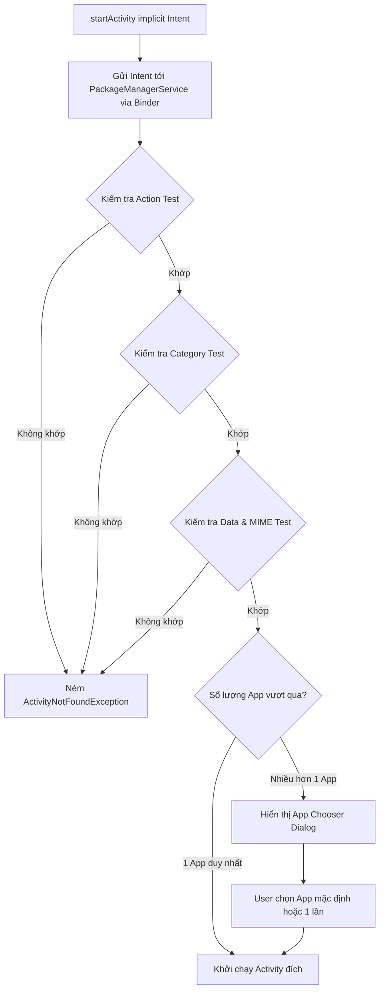
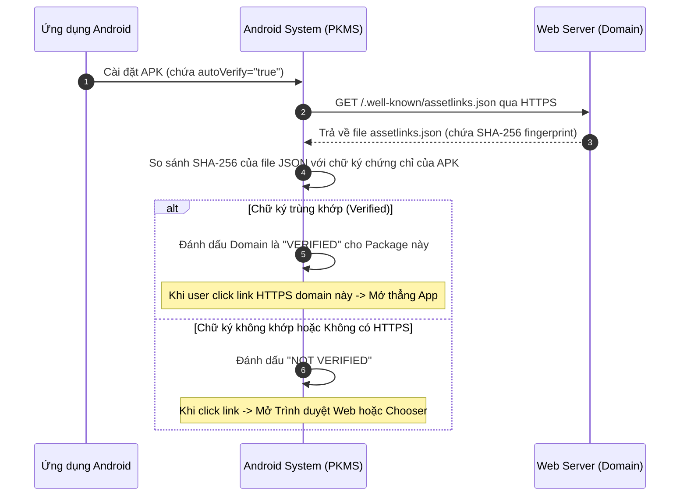

# Intent và Intent Filter

## 1. Tổng quan (What & Why)

### 1.1 Intent là gì?
`Intent` là một đối tượng truyền thông điệp bất đồng bộ (messaging object) đóng vai trò làm cầu nối kích hoạt các thành phần cốt lõi trong hệ sinh thái Android:
- Khởi động một `Activity` (hoặc nhận kết quả trở về).
- Khởi động một `Service` hoặc gửi lệnh tới background worker.
- Gửi thông điệp tới một hoặc nhiều `BroadcastReceiver`.

Về bản chất kiến trúc, `Intent` là một gói dữ liệu mô tả **Ý định** (Action cần làm, Data cần xử lý, Category phân loại, Flag điều khiển Task/Back Stack) được Android IPC Framework (thông qua Binder và `ActivityManagerService`) trung chuyển giữa các Process khác nhau hoặc trong nội bộ cùng một Process.

### 1.2 Phân loại Intent cốt lõi

```
┌────────────────────────────────────────────────────────────────────────┐
│                                INTENT                                  │
├───────────────────────────────────┬────────────────────────────────────┤
│          Explicit Intent          │          Implicit Intent           │
├───────────────────────────────────┼────────────────────────────────────┤
│ • Xác định đích danh Component    │ • Không chỉ định Component cụ thể  │
│ • Thường dùng nội bộ App          │ • Mô tả Action & Data muốn xử lý   │
│ • Tính bảo mật cao, chạy nhanh    │ • Hệ thống match qua Intent Filter │
│ • Ví dụ: Mở UserProfileActivity   │ • Ví dụ: Chụp ảnh, Gửi email, Mở web│
└───────────────────────────────────┴────────────────────────────────────┘
```

---

## 2. Cơ chế hoạt động bên trong (Internal Mechanism)

### 2.1 Explicit Intent vs Implicit Intent

#### Explicit Intent (Tường minh)
- Định danh rõ ràng component nhận thông qua `ComponentInfo` (tên Package và Fully-qualified Class Name).
- **Cơ chế:** Khi gọi `startActivity(intent)`, hệ thống bỏ qua bước tra cứu bộ lọc (filter matching) và gửi trực tiếp Intent tới Component đích thông qua Binder.
- **Tính an toàn:** Không sợ bị các ứng dụng độc hại bên ngoài đánh cắp thông tin (Intent Hijacking).
```kotlin
// Explicit: Chỉ định đích danh OrderDetailActivity
val intent = Intent(context, OrderDetailActivity::class.java).apply {
    putExtra("extra_order_id", 1024L)
}
context.startActivity(intent)
```

#### Implicit Intent (Ngầm định) & Cơ chế Intent Resolution
- Không chỉ định component. Thay vào đó, nó chứa các trường mô tả:
  - **Action:** Hành động muốn thực hiện (ví dụ: `Intent.ACTION_VIEW`, `Intent.ACTION_SEND`).
  - **Data (Uri):** Dữ liệu cần thao tác (ví dụ: `tel:0912345678`, `https://example.com/item/1`).
  - **Type (MIME type):** Kiểu dữ liệu (ví dụ: `image/png`, `text/plain`, `application/pdf`).
  - **Category:** Thông tin ngữ cảnh bổ sung (ví dụ: `CATEGORY_DEFAULT`, `CATEGORY_BROWSABLE`).
- **Cơ chế phân giải (Intent Resolution Process):**
  1. Client gửi Intent tới `PackageManagerService` (PKMS) qua Binder IPC.
  2. PKMS duyệt qua danh sách các `<intent-filter>` được khai báo trong `AndroidManifest.xml` của tất cả ứng dụng đã cài đặt trên thiết bị.
  3. PKMS thực hiện chấm điểm 3 bài kiểm tra: **Action Test**, **Category Test**, và **Data Test (Scheme + Host + Port + Path + MIME Type)**.
  4. **Kết quả:**
     - 0 match: Ném ngoại lệ `ActivityNotFoundException` nếu không kiểm tra trước!
     - 1 match: Khởi chạy ngay ứng dụng đó.
     - Nhiều matches: Hệ thống hiển thị **App Chooser / Disambiguation Dialog** để người dùng chọn ứng dụng ưa thích.

---

### 2.2 Intent Filter trong AndroidManifest.xml

Để một Component có thể nhận được Implicit Intent, nó phải khai báo `<intent-filter>`:

```xml
<activity
    android:name=".DeepLinkActivity"
    android:exported="true">
    
    <intent-filter>
        <!-- Action Test: Bắt buộc phải khớp -->
        <action android:name="android.intent.action.VIEW" />

        <!-- Category Test: Mọi implicit intent từ startActivity đều mặc định gắn CATEGORY_DEFAULT -->
        <category android:name="android.intent.category.DEFAULT" />
        <category android:name="android.intent.category.BROWSABLE" />

        <!-- Data Test: Khớp scheme và host -->
        <data
            android:scheme="https"
            android:host="shop.example.com"
            android:pathPrefix="/products" />
    </intent-filter>
</activity>
```

> **Quy tắc kiểm tra Intent Resolution:**
> 1. **Action:** Intent Filter phải chứa action được chỉ định trong Intent. (Nếu Intent không có action, nó tự pass nếu filter có bất kỳ action nào).
> 2. **Category:** Mọi category trong Intent **bắt buộc phải xuất hiện** trong filter. (Lưu ý: `startActivity()` luôn tự động ngầm gắn `CATEGORY_DEFAULT` vào Intent, do đó filter cho Activity bắt buộc phải có `<category android:name="android.intent.category.DEFAULT" />`).
> 3. **Data:** So sánh URI (Scheme, Host, Port, Path) và MIME type. Cả hai phải tương thích.

---

### 2.3 Deep Links vs Android App Links (Android 6.0+)

| Tiêu chí | Traditional Deep Link (Custom Scheme) | Web Deep Link (HTTP/HTTPS) | Android App Link (Verified HTTPS) |
|---|---|---|---|
| **Scheme** | Custom (ví dụ: `myapp://details/123`) | `http://` hoặc `https://` | `https://` (yêu cầu domain sở hữu) |
| **Xác thực domain** | ❌ Không thể xác thực | ❌ Không xác thực | ✅ Digital Asset Links (`assetlinks.json`) |
| **Hành vi người dùng** | Mở app nếu cài; lỗi hoặc không phản hồi nếu chưa cài | Mở App Chooser hỏi user (App hay Chrome) | **Mở trực tiếp App** ngay lập tức, không qua Chooser |
| **Bảo mật** | Thấp (App rác có thể đăng ký trùng scheme `myapp://`) | Trung bình | **Rất cao** (Chứng thực SHA-256 fingerprint) |
| **Yêu cầu hệ điều hành**| Mọi phiên bản Android | Mọi phiên bản Android | Android 6.0 (API 23) trở lên, `autoVerify="true"` |

#### Cơ chế chứng thực Android App Links:
1. Thêm `android:autoVerify="true"` vào thẻ `<intent-filter>`.
2. Tạo file `assetlinks.json` đặt tại đường dẫn: `https://yourdomain.com/.well-known/assetlinks.json`:
```json
[{
  "relation": ["delegate_permission/common.handle_all_urls"],
  "target": {
    "namespace": "android_app",
    "package_name": "com.example.shop",
    "sha256_cert_fingerprints":
    ["14:6D:E9:44:C5:1F:65:49:4E:97:26:CD:CC:2D:79:E7:40:E6:4B:99:4F:45:8E:81:D4:C8:4A:18:0E:85:38:B4"]
  }
}]
```
3. Khi app được cài đặt hoặc update, hệ điều hành Android sẽ tải file JSON này qua HTTPS từ server của bạn và đối chiếu chữ ký SHA-256 của APK. Nếu khớp, domain được verify và app luôn mở tự động khi click link.

---

### 2.4 Parcelable vs Serializable

Dữ liệu phức tạp truyền qua Intent Extra phải được tuần tự hóa (serialize). Android hỗ trợ cả hai:

```
┌───────────────────────────────────────┬───────────────────────────────────────┐
│              Serializable             │               Parcelable              │
├───────────────────────────────────────┼───────────────────────────────────────┤
│ • Java Standard Interface (Marker)    │ • Android-specific IPC Interface      │
│ • Hoạt động dựa trên Reflection       │ • Ghi trực tiếp nhị phân vào Parcel   │
│ • Chậm, tạo ra hàng ngàn object tạm   │ • Cực nhanh (optimized bằng C++ core) │
│ • Tiêu tốn Garbage Collector          │ • Gần như không overhead cấp phát RAM │
│ • Dùng cho lưu trữ file / network     │ • Dùng cho IPC / Intent / Bundle      │
└───────────────────────────────────────┴───────────────────────────────────────┘
```

#### Tại sao Parcelable lại nhanh gấp 10 lần Serializable?
- `Serializable` là marker interface của Java. Khi chạy, JVM sử dụng Reflection để quét toàn bộ cây thuộc tính, metadata của class, tạo vô số object trung gian, dẫn đến GC thrashing.
- `Parcelable` là thiết kế riêng cho Android IPC. Lập trình viên (hoặc Kotlin compiler qua `@Parcelize`) tự định nghĩa mã ghi trực tiếp từng byte/primitive vào một khối bộ nhớ đệm chia sẻ C++ (`Parcel`). Quá trình đọc/ghi hoàn toàn là tuần tự không qua reflection.

> [!WARNING]
> Không bao giờ dùng `Parcelable` để lưu trữ dữ liệu xuống Disk (như Database hay SharedPreferences/DataStore), bởi vì định dạng nhị phân nội bộ của `Parcel` có thể thay đổi giữa các phiên bản Android OS hoặc giữa các bản build của ứng dụng!

---

### 2.5 Giới hạn Binder Transaction Buffer (~1MB) & `TransactionTooLargeException`

Mọi dữ liệu truyền qua `Intent` extras (giữa 2 Activity, gửi tới Broadcast, hay gửi tới Service) đều phải đi qua **Binder Driver** của nhân Linux.

```
┌────────────────────────────────────────────────────────┐
│               Linux Kernel Binder Driver               │
│                                                        │
│  ┌──────────────────────────────────────────────────┐  │
│  │    Total Shared IPC Buffer: 1MB (Per Process)    │  │
│  │                                                  │  │
│  │  [Transaction A] [Transaction B] [Available Free]│  │
│  └──────────────────────────────────────────────────┘  │
└────────────────────────────────────────────────────────┘
```

#### Bản chất kiến trúc:
1. Mỗi tiến trình Android được cấp một bộ nhớ đệm IPC Binder giới hạn ở mức **1 MB** (chia sẻ chung cho tất cả các giao dịch Binder đang hoạt động đồng thời của tiến trình đó).
2. Khi gọi `startActivity(intent)` hoặc `onSaveInstanceState(bundle)`:
   - Toàn bộ Bundle được serialize thành nhị phân và đẩy vào Binder buffer.
   - Nếu tổng kích thước của giao dịch vượt quá giới hạn an toàn (thường là > 512KB - 1MB), hệ thống sẽ ném ra ngoại lệ:
     `android.os.TransactionTooLargeException`.
3. **Ứng dụng thực tế:**
   - **Tuyệt đối không:** Truyền `Bitmap`, byte array ảnh, danh sách hàng nghìn items JSON qua Intent Extras.
   - **Giải pháp chuẩn:** Lưu vào Room Database, lưu file tạm vào Disk và truyền `Uri` (kết hợp `FileProvider`), hoặc lưu vào in-memory repository cache và chỉ truyền ID dạng `String`/`Long`.

---

### 2.6 Intent Flags phổ biến và Cơ chế quản lý Task

Intent Flags điều khiển cách Activity được khởi chạy và quản lý trong Task Back Stack:

- **`FLAG_ACTIVITY_NEW_TASK`:** Khởi chạy Activity trong một Task mới. (Bắt buộc phải có khi gọi `startActivity` từ một non-Activity context như Application Context hay Service).
- **`FLAG_ACTIVITY_SINGLE_TOP`:** Nếu Activity đích đã nằm ở đỉnh của Task hiện tại (top of stack), hệ thống sẽ không tạo instance mới mà gọi callback `onNewIntent(intent)` trên instance hiện tại.
- **`FLAG_ACTIVITY_CLEAR_TOP`:** Nếu Activity đích đã tồn tại trong Task hiện tại, toàn bộ các Activity nằm phía trên nó sẽ bị destroy, đưa Activity đích lên đầu stack (thường kết hợp với `SINGLE_TOP` để tránh recreate).
- **`FLAG_ACTIVITY_CLEAR_TASK`:** Xóa sạch toàn bộ các Activity đang có trong Task hiện tại trước khi tạo Activity mới (thường dùng cho luồng Logout hoặc hoàn tất Order).
- **`FLAG_GRANT_READ_URI_PERMISSION` & `FLAG_GRANT_WRITE_URI_PERMISSION`:** Cấp quyền tạm thời cho component nhận để đọc/ghi vào `content://` Uri mà không cần cấp quyền lưu trữ toàn cục.

---

### 2.7 Vấn đề bảo mật (Security Considerations)

1. **`android:exported` (Bắt buộc từ Android 12 - API 31):**
   - Mọi component có `<intent-filter>` bắt buộc phải khai báo rõ `android:exported="true"` hoặc `"false"`.
   - Nếu để `exported="true"`, bất kỳ ứng dụng nào trên máy cũng có thể gọi Component của bạn. Nếu không cần bên ngoài gọi, luôn để `exported="false"`.
2. **Intent Hijacking / Spoofing:**
   - Khi gửi sensitive data qua Implicit Intent, ứng dụng độc hại có thể đăng ký intent-filter tương tự để đón và đọc trộm data.
   - Luôn sử dụng Explicit Intent cho dữ liệu nội bộ.
3. **Sanitize incoming Intent Data:**
   - Luôn validate cẩn thận các params nhận được từ deep links hoặc bên thứ ba để tránh SQL Injection, Command Injection hoặc Crash do NullPointerException.

---

## 3. Luồng hoạt động (Flow Diagram)

### 3.1 Quy trình phân giải Implicit Intent (Intent Resolution)



### 3.2 Cơ chế xác thực Android App Links



---

## 4. Real-world Use Case

Dưới đây là một implementation mẫu chuẩn Clean Architecture và Senior Best Practices:
1. Data Model dùng `@Parcelize` an toàn.
2. Quản lý Deep Link / App Link với trích xuất tham số an toàn.
3. Chia sẻ file an toàn bằng `FileProvider` và temporary URI permissions.

### 4.1 Parcelable Model & Safe Extraction

```kotlin
import android.os.Build
import android.os.Bundle
import android.os.Parcelable
import androidx.appcompat.app.AppCompatActivity
import kotlinx.parcelize.Parcelize

// 1. Data Model tối ưu bằng @Parcelize
@Parcelize
data class ProductParam(
    val productId: String,
    val category: String,
    val price: Double,
    val isFlashSale: Boolean = false
) : Parcelable

// 2. Activity nhận Intent an toàn
class ProductDetailActivity : AppCompatActivity() {

    override fun onCreate(savedInstanceState: Bundle?) {
        super.onCreate(savedInstanceState)

        // Type-safe Intent extra unparcelling (Tương thích Android 13+)
        val productParam = getSafeParcelableExtra(intent, EXTRA_PRODUCT, ProductParam::class.java)
        
        if (productParam == null) {
            // Xử lý fallback nếu mở từ Deep Link qua Intent Data
            val deepLinkUri = intent.data
            val productId = deepLinkUri?.getQueryParameter("id")
            if (productId.isNullOrBlank()) {
                finish() // Invalid intent -> đóng an toàn
                return
            }
            initProductWithId(productId)
        } else {
            bindProduct(productParam)
        }
    }

    private fun bindProduct(product: ProductParam) {
        // Render UI...
    }

    private fun initProductWithId(id: String) {
        // Fetch từ Repository bằng ID...
    }

    // Helper extension hỗ trợ backward compatible cho getParcelableExtra
    private fun <T : Parcelable> getSafeParcelableExtra(
        intent: android.content.Intent,
        key: String,
        clazz: Class<T>
    ): T? {
        return if (Build.VERSION.SDK_INT >= Build.VERSION_CODES.TIRAMISU) {
            intent.getParcelableExtra(key, clazz)
        } else {
            @Suppress("DEPRECATION")
            intent.getParcelableExtra(key)
        }
    }

    companion object {
        const val EXTRA_PRODUCT = "extra_product_param"
    }
}
```

### 4.2 Chia sẻ file an toàn qua FileProvider (Không truyền raw data qua Binder)

```kotlin
import android.content.Context
import android.content.Intent
import androidx.core.content.FileProvider
import java.io.File

object ShareHelper {

    fun shareExportedPdf(context: Context, pdfFile: File) {
        // ✅ 1. Lấy Content Uri thông qua FileProvider (Không truyền byteArray vào intent!)
        val contentUri = FileProvider.getUriForFile(
            context,
            "${context.packageName}.fileprovider",
            pdfFile
        )

        // ✅ 2. Tạo Send Intent với Temporary URI Permission
        val shareIntent = Intent(Intent.ACTION_SEND).apply {
            type = "application/pdf"
            putExtra(Intent.EXTRA_STREAM, contentUri)
            addFlags(Intent.FLAG_GRANT_READ_URI_PERMISSION) // Cấp quyền đọc tạm thời cho app nhận
        }

        // ✅ 3. Đảm bảo có ứng dụng nhận trước khi start, bọc trong Chooser
        val chooser = Intent.createChooser(shareIntent, "Chia sẻ báo cáo PDF qua:")
        if (shareIntent.resolveActivity(context.packageManager) != null || Build.VERSION.SDK_INT >= Build.VERSION_CODES.R) {
            context.startActivity(chooser)
        }
    }
}
```

---

## 5. Anti-Patterns & Pitfalls

### ❌ Anti-pattern 1: Gọi `startActivity(implicitIntent)` mà không check `resolveActivity`
```kotlin
// ❌ SAI:
val sendIntent = Intent(Intent.ACTION_SEND).apply { type = "text/plain" }
startActivity(sendIntent) 
// Nếu thiết bị không cài bất kỳ app nào nhận intent này -> CRASH ActivityNotFoundException!
```
```kotlin
// ✅ ĐÚNG:
if (sendIntent.resolveActivity(packageManager) != null) {
    startActivity(sendIntent)
} else {
    Toast.makeText(this, "Không tìm thấy ứng dụng phù hợp", Toast.LENGTH_SHORT).show()
}
// Lưu ý: Trên Android 11+ (API 30), cần khai báo thẻ <queries> trong AndroidManifest nếu dùng resolveActivity!
```

---

### ❌ Anti-pattern 2: Truyền dữ liệu lớn qua Intent Extra
```kotlin
// ❌ SAI LẦM NẶNG:
val intent = Intent(this, PreviewActivity::class.java).apply {
    putExtra("image_bitmap", capturedBitmap) // Bitmap 5MB
}
startActivity(intent) // -> CRASH TransactionTooLargeException!
```
- **Giải pháp:** Lưu Bitmap vào Cache directory (`context.cacheDir`), lấy File Uri và truyền Uri qua Intent, hoặc giữ id trong ViewModel / Repository cache.

---

### ❌ Anti-pattern 3: Dùng Serializable cho data models phức tạp trong Android
- **Hậu quả:** Làm chậm tốc độ mở màn hình mới từ 50ms - 200ms do Java Reflection phải scan field recursively và cấp phát nhiều object rác, gây giật lag (frame drop/jank).
- **Giải pháp:** Luôn sử dụng `@Parcelize` của Kotlin Parcelize plugin.

---

### ❌ Anti-pattern 4: Để `android:exported="true"` không có bảo vệ
- **Hậu quả:** Mọi app độc hại trên điện thoại đều có thể gửi Intent giả mạo (Intent Spoofing) tới Activity/Service nội bộ của bạn, bypass qua màn hình Login hoặc trigger thanh toán bất hợp pháp.
- **Giải pháp:** Component nội bộ luôn để `android:exported="false"`. Với component exported để nhận deep link, bắt buộc kiểm tra và sanitize kỹ tham số đầu vào.

---

## 6. Trade-offs & So sánh

### 6.1 So sánh cơ chế truyền dữ liệu giữa các màn hình

| Tiêu chí | Intent Extras (`@Parcelize`) | In-Memory Repository / Cache | Database (Room) / FileProvider |
|---|---|---|---|
| **Giới hạn dung lượng** | Rất nhỏ (< 512KB an toàn) | Dung lượng RAM khả dụng | Dung lượng ổ cứng lưu trữ |
| **Tốc độ truy xuất** | Cực nhanh | Nhanh nhất (chỉ đọc RAM) | Chậm hơn (Disk I/O) |
| **Sống sót qua Process Death**| ✅ Có (nằm trong saved state) | ❌ Mất khi app process bị kill | ✅ Vĩnh viễn (Persistent) |
| **Phù hợp cho** | ID, filter params, small data objects | Danh sách sản phẩm lớn trong session | File ảnh, PDF, Offline-first cache |

---

## 7. Senior-level Insights

### 7.1 Android 11+ Package Visibility (`<queries>`)
Từ Android 11 (API 30), vì lý do bảo mật quyền riêng tư của người dùng, Google chặn hành vi "quét toàn bộ ứng dụng cài trên máy".
- Khi bạn gọi `packageManager.queryIntentActivities()` hoặc `intent.resolveActivity()`, hệ thống sẽ trả về **rỗng** dù ứng dụng đó có cài trên máy!
- **Giải pháp:** Bắt buộc phải khai báo package hoặc action trong thẻ `<queries>` của `AndroidManifest.xml`:
```xml
<manifest>
    <queries>
        <!-- Khai báo cho phép app truy vấn các ứng dụng gửi email -->
        <intent>
            <action android:name="android.intent.action.SEND" />
            <data android:mimeType="message/rfc822" />
        </intent>
        <!-- Hoặc chỉ định rõ package đích -->
        <package android:name="com.facebook.katana" />
    </queries>
</manifest>
```

### 7.2 Cơ chế `onNewIntent(intent: Intent?)`
Khi một Activity sử dụng `launchMode="singleTop"` hoặc `FLAG_ACTIVITY_SINGLE_TOP`, nếu một Intent mới được gửi tới Activity đó khi nó đang ở top của stack:
- Hàm `onCreate()` **không** được gọi lại.
- Thay vào đó, hệ thống gọi `onNewIntent(newIntent)`.
- **Lưu ý tối quan trọng của Senior:** Bên trong `onNewIntent`, nếu gọi `intent` mặc định, bạn vẫn sẽ nhận về Intent **cũ ban đầu**! Bắt buộc phải gọi `setIntent(newIntent)` để cập nhật Intent hiện tại:
```kotlin
override fun onNewIntent(intent: Intent?) {
    super.onNewIntent(intent)
    setIntent(intent) // ✅ Cập nhật Intent mới nhất
    handleIntentData(intent)
}
```

---

## 8. Câu hỏi phỏng vấn (với gợi ý trả lời)

### Q1: Phân biệt Explicit Intent và Implicit Intent? Khi nào dùng cái nào?
> **Gợi ý trả lời:**
> - Explicit Intent chỉ định trực tiếp đích danh Component (qua Class hoặc Package). Nó được dùng chủ yếu cho điều hướng nội bộ trong ứng dụng (ví dụ: mở Activity con). Lợi thế là tốc độ nhanh, bỏ qua bước phân giải và bảo mật cao.
> - Implicit Intent chỉ mô tả Action, Data URI, Category hoặc Type mà không chỉ định trước component. Hệ thống sẽ phân giải thông qua PackageManager để tìm các app phù hợp. Dùng khi muốn tương tác với hệ điều hành hoặc các ứng dụng bên ngoài (gửi email, mở trình duyệt, chọn ảnh, chia sẻ mạng xã hội).

### Q2: Tại sao Binder Transaction lại bị giới hạn kích thước (~1MB)? Điều gì xảy ra nếu vượt quá?
> **Gợi ý trả lời:**
> Binder IPC sử dụng một vùng đệm bộ nhớ chia sẻ trong nhân Linux (shared memory buffer) được gán cố định cho mỗi tiến trình, có kích thước 1MB (được chia sẻ chung cho tất cả các giao dịch Binder đang hoạt động đồng thời của tiến trình đó). Giới hạn này được thiết kế để ngăn chặn một tiến trình chiếm dụng toàn bộ tài nguyên bộ nhớ nhân Linux và bảo vệ hệ thống khỏi việc các app gửi các cục dữ liệu khổng lồ làm nghẽn IPC. Nếu dữ liệu vượt quá giới hạn này, hệ thống sẽ ném ra ngoại lệ `TransactionTooLargeException` và có thể làm crash ứng dụng ngay lập tức.

### Q3: So sánh Parcelable và Serializable. Tại sao Android ưu tiên Parcelable?
> **Gợi ý trả lời:**
> - `Serializable` là interface đánh dấu của Java chuẩn, hoạt động dựa trên Java Reflection để tuần tự hóa toàn bộ cấu trúc object. Quá trình này chậm, tiêu tốn CPU và tạo ra nhiều object rác trong heap, làm tăng áp lực cho Garbage Collector.
> - `Parcelable` là interface đặc thù của Android, nơi dữ liệu được serialize thủ công (hoặc qua bytecode tối ưu từ `@Parcelize`) thành các khối nhị phân liên tục ghi trực tiếp vào bộ đệm bộ nhớ C++ native (`Parcel`). Nó không dùng reflection nên tốc độ xử lý nhanh gấp hơn 10 lần và tiết kiệm RAM tối đa.

### Q4: Deep Link và App Link khác nhau như thế nào? Cách triển khai App Link an toàn?
> **Gợi ý trả lời:**
> - Deep Link thông thường sử dụng custom scheme (như `myapp://`) hoặc HTTP link không xác thực. Khi người dùng click, hệ thống có thể mở App Chooser nếu có nhiều app đăng ký cùng scheme, và bất kỳ app độc hại nào cũng có thể fake scheme đó để đón link.
> - App Link là một dạng Deep Link đặc biệt trên Android 6.0+ chỉ sử dụng domain HTTPS và có cơ chế xác thực quyền sở hữu website tự động thông qua file `assetlinks.json` đặt trên domain (`/.well-known/assetlinks.json`). Khi được xác thực (`autoVerify="true"`), click vào link sẽ mở thẳng ứng dụng của bạn mà không bao giờ hiện App Chooser.

### Q5: Tại sao từ Android 11 (API 30), việc gọi `resolveActivity()` hoặc `queryIntentActivities()` có thể trả về rỗng dù app đích vẫn có trên máy?
> **Gợi ý trả lời:**
> Android 11 giới thiệu cơ chế **Package Visibility Filtering** để bảo vệ quyền riêng tư người dùng, ngăn các ứng dụng độc hại quét trộm danh sách các ứng dụng khác đã cài trên thiết bị. Mặc định, app của bạn chỉ "nhìn thấy" một số lượng hạn chế các ứng dụng hệ thống cốt lõi. Để truy vấn các ứng dụng khác thông qua Implicit Intent, lập trình viên bắt buộc phải khai báo các intent action, data MIME hoặc tên package cụ thể trong thẻ `<queries>` của file `AndroidManifest.xml`.

### Q6: `FLAG_ACTIVITY_CLEAR_TOP` khác gì so với `FLAG_ACTIVITY_CLEAR_TASK`?
> **Gợi ý trả lời:**
> - `FLAG_ACTIVITY_CLEAR_TOP`: Nếu Activity đích đã có sẵn trong task hiện tại, nó sẽ destroy tất cả các Activity nằm ở phía trên nó, đưa Activity đích lên đầu stack. Nếu không kết hợp với `FLAG_ACTIVITY_SINGLE_TOP`, chính Activity đích đó cũng sẽ bị destroy và tạo lại instance mới.
> - `FLAG_ACTIVITY_CLEAR_TASK`: Luôn xóa sạch toàn bộ tất cả Activity trong task hiện tại và tạo mới Activity đích làm root của task. Cờ này bắt buộc phải đi kèm với `FLAG_ACTIVITY_NEW_TASK`. Thường dùng cho các flow như Logout tài khoản.

---

## 9. Tài liệu tham khảo (References)
- [Android Developers - Intents and Intent Filters](https://developer.android.com/guide/components/intents-filters)
- [Android Developers - Handling Android App Links](https://developer.android.com/training/app-links)
- [Android Developers - Parcelable Implementation](https://developer.android.com/reference/android/os/Parcelable)
- [Android Developers - Package Visibility filtering in Android 11](https://developer.android.com/training/package-visibility)
- [Android Developers - Sharing Files Securely with FileProvider](https://developer.android.com/reference/androidx/core/content/FileProvider)
