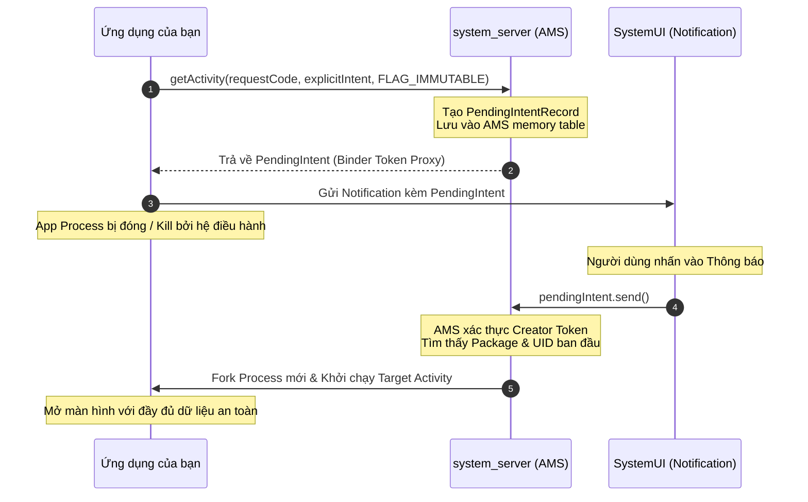
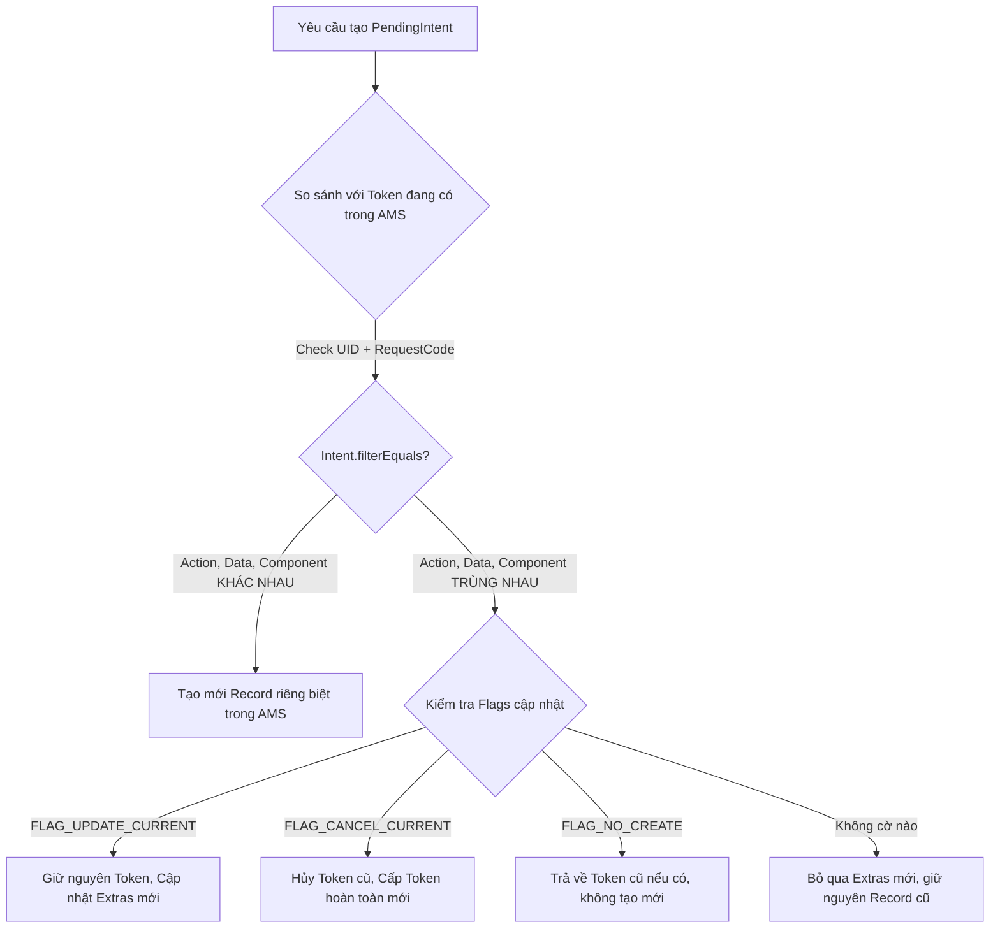

# PendingIntent

## 1. Tổng quan (What & Why)

### 1.1 PendingIntent là gì?
`PendingIntent` là một đối tượng ủy quyền (token wrapper) do Android framework cung cấp, cho phép ứng dụng của bạn trao quyền cho một tiến trình khác (hoặc chính hệ điều hành Android - `system_server`) thực thi một `Intent` đã được định nghĩa trước vào một thời điểm trong tương lai.

### 1.2 Đặc tính cốt lõi của PendingIntent
- **Ủy quyền đặc quyền (Privilege Delegation):** Khi ứng dụng khác (ví dụ: `SystemUI` khi nhấn Notification, hoặc `AlarmManager`) kích hoạt `pendingIntent.send()`, Intent sẽ được thực thi dưới **danh tính (UID/Identity)** và **quyền hạn (Permissions)** của **ứng dụng tạo ra nó**, chứ không phải của ứng dụng thực hiện kích hoạt.
- **Hoạt động xuyên suốt vòng đời tiến trình (Survive Process Death):** Ngay cả khi tiến trình ứng dụng của bạn đã bị người dùng vuốt tắt khỏi Recent Apps hoặc bị Android OS kill do thiếu RAM, `PendingIntent` vẫn tồn tại và có thể đánh thức ứng dụng dậy để xử lý công việc.
- **System-level Token:** Thực chất `PendingIntent` phía client chỉ là một wrapper mỏng nắm giữ tham chiếu Binder IPC tới một bản ghi `IIntentSender` nằm trong bộ nhớ của `ActivityManagerService` (AMS).

---

## 2. Cơ chế hoạt động bên trong (Internal Mechanism)

### 2.1 Bản chất System-Level Token trong `system_server`

```
┌────────────────────────────────────────────────────────────────────────┐
│ App Process (Client)                                                  │
│   val pi = PendingIntent.getActivity(context, reqCode, intent, flags)  │
│   pi: Wrapper nắm giữ Binder Proxy `IIntentSender`                     │
└───────────────────────────────────┬────────────────────────────────────┘
                                    │ IPC qua Binder
                                    ▼
┌────────────────────────────────────────────────────────────────────────┐
│ Android OS: system_server (ActivityManagerService / AMS)               │
│                                                                        │
│   Bảng băm lưu trữ Token: HashMap<PendingIntentRecord.Key, Record>     │
│   ┌────────────────────────────────────────────────────────────────┐   │
│   │ PendingIntentRecord:                                           │   │
│   │   - Creator UID / Package: com.example.myapp                   │   │
│   │   - Target Type: Activity / Broadcast / Service                │   │
│   │   - Intent Definition (Action, Data, Extras)                   │   │
│   │   - RequestCode & Flags                                        │   │
│   └────────────────────────────────────────────────────────────────┘   │
└───────────────────────────────────┬────────────────────────────────────┘
                                    │ Chuyển token cho
                                    ▼
┌────────────────────────────────────────────────────────────────────────┐
│ Foreign Process (Ví dụ: SystemUI Notification / AlarmManager)          │
│   User tap Notification ──► pendingIntent.send()                       │
│   (AMS lấy lại Record và kích hoạt Intent với quyền của com.example.myapp)│
└────────────────────────────────────────────────────────────────────────┘
```

#### Tại sao PendingIntent sống sót khi App Process bị Kill?
1. Khi app của bạn tạo ra một `PendingIntent`, đối tượng thực sự (`PendingIntentRecord`) được cấp phát và lưu trữ trong **bộ nhớ heap của tiến trình `system_server`**.
2. Khi app của bạn bị hệ thống kill (Process Death), tiến trình của bạn biến mất nhưng tiến trình `system_server` vẫn chạy liên tục.
3. Khi sự kiện xảy ra (báo thức reo, user chạm vào thông báo), `system_server` tìm kiếm `PendingIntentRecord` này.
4. Nếu app của bạn chưa chạy, hệ thống sẽ fork một tiến trình mới từ Zygote, khởi tạo lại app và đẩy Intent đến Component đích.

---

### 2.2 Các loại PendingIntent Factory Methods

| Phương thức | Component đích | Use Cases |
|---|---|---|
| `PendingIntent.getActivity()` | `Activity` | Click vào Notification mở màn hình chi tiết, AppWidget click |
| `PendingIntent.getActivities()`| Chuỗi nhiều `Activity` (Back Stack) | Mở màn hình sâu (Deep Nav) đồng thời tạo sẵn Back Stack phía sau |
| `PendingIntent.getBroadcast()` | `BroadcastReceiver` | Báo thức `AlarmManager`, Notification Action buttons (ví dụ: Mark as Read) |
| `PendingIntent.getService()` | `Service` (Background) | Kích hoạt tác vụ nền (chú ý giới hạn background từ Android 8.0+) |
| `PendingIntent.getForegroundService()` | `Foreground Service` (API 26+) | Chạy foreground service từ Notification / Alarm khi app đang ở background |

---

### 2.3 Khi nào hệ thống coi hai PendingIntent là "GIỐNG NHAU"?

Đây là cơ chế nội bộ cực kỳ quan trọng dẫn đến rất nhiều bug ngầm trong Android:

Hệ điều hành Android lưu các `PendingIntentRecord` trong một HashMap nội bộ tại `system_server`. Để kiểm tra xem một PendingIntent đã tồn tại hay chưa, hệ thống so sánh đối tượng `PendingIntentRecord.Key` dựa trên:
1. **Package Name** của ứng dụng tạo.
2. **Request Code** (số nguyên `requestCode`).
3. **Intent Definition thông qua hàm `Intent.filterEquals()`**.

#### `Intent.filterEquals()` so sánh những gì?
- ✅ So sánh: `Action`, `Data` (URI), `Type` (MIME), `Package / ComponentName`, `Categories`, và `Identifier` (từ Android 10+).
- ❌ **HOÀN TOÀN BỎ QUA EXTRAS (Bundle)!**

> [!CAUTION]
> Nếu bạn tạo 2 PendingIntent có cùng Action và Component nhưng truyền 2 giá trị ID khác nhau trong `putExtra("ID", 1)` và `putExtra("ID", 2)`:
> **Hệ thống vẫn coi hai PendingIntent này là MỘT!**
> Nếu không dùng `requestCode` khác nhau, cái thứ 2 sẽ ghi đè (hoặc bị bỏ qua) cái thứ 1, dẫn đến việc Alarm 1 không bao giờ kích hoạt hoặc Notification luôn mở sai ID!

---

### 2.4 Các cờ cập nhật (Update & Behavior Flags)

Khi tạo PendingIntent, bạn phải kết hợp các flags sau để điều khiển hành vi khi đã tồn tại token trùng khớp:

- **`FLAG_UPDATE_CURRENT`:** Nếu PendingIntent đã tồn tại, giữ nguyên đối tượng token đó nhưng **cập nhật lại dữ liệu extras** của Intent mới nhất. Đây là flag phổ biến nhất.
- **`FLAG_CANCEL_CURRENT`:** Nếu PendingIntent đã tồn tại, hủy bỏ hoàn toàn token cũ và tạo một token mới tinh. Bất kỳ component nào đang nắm giữ token cũ sẽ mất hiệu lực.
- **`FLAG_NO_CREATE`:** Không tạo mới token. Chỉ trả về PendingIntent nếu nó **đã tồn tại trước đó**, ngược lại trả về `null`. Rất hữu ích để kiểm tra xem một báo thức `AlarmManager` có đang được đặt hay không.
- **`FLAG_ONE_SHOT`:** PendingIntent này chỉ có thể kích hoạt một lần duy nhất (`send()` xong là token tự hủy).

---

### 2.5 Mutable vs Immutable (`FLAG_IMMUTABLE` vs `FLAG_MUTABLE`)

Bắt buộc từ **Android 12 (API 31)**: Mọi PendingIntent bắt buộc phải khai báo rõ ràng `FLAG_IMMUTABLE` hoặc `FLAG_MUTABLE`. Nếu không có một trong hai flag này, hệ thống sẽ ném ra ngoại lệ:
`IllegalArgumentException: Targeting S+ (version 31 and above) requires that one of FLAG_IMMUTABLE or FLAG_MUTABLE be specified`.

```
┌───────────────────────────────────────┬───────────────────────────────────────┐
│            FLAG_IMMUTABLE             │             FLAG_MUTABLE              │
├───────────────────────────────────────┼───────────────────────────────────────┤
│ • Không cho phép sửa đổi Intent gốc   │ • Cho phép tiến trình nhận điền thêm  │
│ • An toàn tuyệt đối (chống Hijacking) │   hoặc cập nhật extras vào Intent     │
│ • Dùng cho 95% trường hợp             │ • Chỉ dùng cho các trường hợp đặc biệt│
│ • Báo thức, Notification thông thường │ • RemoteInput (Inline Reply), Bubbles │
└───────────────────────────────────────┴───────────────────────────────────────┘
```

#### Khi nào bắt buộc phải dùng `FLAG_MUTABLE`?
1. **Notification Inline Reply (`RemoteInput`):** Khi người dùng gõ trả lời tin nhắn trực tiếp trên thanh thông báo, `SystemUI` cần điền đoạn text người dùng vừa gõ vào Intent Extra trước khi gọi `send()`.
2. **Notification Action cho Bubbles / Car App Library.**
3. **Geofencing API của Google Play Services:** Hệ thống cần nhét danh sách geofence bị kích hoạt và vị trí hiện tại vào intent trước khi gửi về app.

---

### 2.6 Hiểm họa Bảo mật: Intent Redirection & PendingIntent Hijacking

#### 1. Rủi ro Implicit Intent trong Mutable PendingIntent
Nếu bạn tạo một `PendingIntent` chứa một **Implicit Intent** và đánh dấu là `FLAG_MUTABLE`:
```kotlin
// ❌ CỰC KỲ NGUY HIỂM:
val badIntent = Intent("com.example.action.CUSTOM_ACTION") // Implicit Intent!
val pi = PendingIntent.getBroadcast(context, 0, badIntent, PendingIntent.FLAG_MUTABLE)
```
Một ứng dụng độc hại trên máy có thể bắt được PendingIntent này. Vì nó là **Mutable**, kẻ tấn công có thể ghi đè component đích thành một Activity/Service nhạy cảm trong app của bạn (hoặc app hệ thống):
```java
// Mã độc của bên thứ ba:
Intent maliciousIntent = new Intent();
maliciousIntent.setComponent(new ComponentName("com.example.myapp", "com.example.myapp.AdminActivity"));
pi.send(context, 0, maliciousIntent); // 💥 Thực thi với đầy đủ quyền của com.example.myapp!
```

#### 2. Nguyên tắc vàng về bảo mật của Senior Developer:
- **Nguyên tắc 1:** Luôn sử dụng **Explicit Intent** khi bọc trong `PendingIntent`.
- **Nguyên tắc 2:** Luôn mặc định sử dụng `PendingIntent.FLAG_IMMUTABLE`. Chỉ chuyển sang `FLAG_MUTABLE` khi có yêu cầu kiến trúc rõ ràng (`RemoteInput`).
- **Nguyên tắc 3:** Khi buộc phải dùng `FLAG_MUTABLE`, hãy thiết lập `component` hoặc `package` rõ ràng cho Intent để ngăn việc chuyển hướng mục tiêu (Redirection).

---

## 3. Luồng hoạt động (Flow Diagram)

### 3.1 Vòng đời và kiến trúc phân tán của PendingIntent



### 3.2 Cơ chế phân biệt và cập nhật PendingIntent của Hệ thống



---

## 4. Real-world Use Case

Dưới đây là 3 kịch bản thực tế phổ biến nhất trong các ứng dụng Enterprise:
1. Click Notification mở màn hình chi tiết với Back Stack đầy đủ (`TaskStackBuilder`).
2. Báo thức chính xác với `AlarmManager`.
3. Notification Inline Reply với `FLAG_MUTABLE` và `RemoteInput`.

### 4.1 Click Notification mở Deep Screen kèm TaskStackBuilder

```kotlin
import android.app.NotificationChannel
import android.app.NotificationManager
import android.app.PendingIntent
import android.content.Context
import android.content.Intent
import android.os.Build
import androidx.core.app.NotificationCompat
import androidx.core.app.TaskStackBuilder

object NotificationHelper {

    private const val CHANNEL_ID = "order_updates_channel"

    fun showOrderNotification(context: Context, orderId: String) {
        val notificationManager = context.getSystemService(Context.NOTIFICATION_SERVICE) as NotificationManager

        // 1. Tạo Explicit Intent đến màn hình chi tiết
        val detailIntent = Intent(context, OrderDetailActivity::class.java).apply {
            putExtra(OrderDetailActivity.EXTRA_ORDER_ID, orderId)
        }

        // 2. Dùng TaskStackBuilder để khi bấm Back trên màn hình Detail,
        // user quay về MainActivity thay vì văng ra Home Screen!
        val flags = if (Build.VERSION.SDK_INT >= Build.VERSION_CODES.M) {
            PendingIntent.FLAG_UPDATE_CURRENT or PendingIntent.FLAG_IMMUTABLE
        } else {
            PendingIntent.FLAG_UPDATE_CURRENT
        }

        val pendingIntent: PendingIntent = TaskStackBuilder.create(context).run {
            addNextIntentWithParentStack(detailIntent)
            getPendingIntent(orderId.hashCode(), flags)!!
        }

        // 3. Xây dựng Notification
        val notification = NotificationCompat.Builder(context, CHANNEL_ID)
            .setSmallIcon(R.drawable.ic_notification)
            .setContentTitle("Đơn hàng đã được xác nhận")
            .setContentText("Mã đơn: #$orderId đang được xử lý.")
            .setContentIntent(pendingIntent) // Gắn PendingIntent
            .setAutoCancel(true)
            .build()

        notificationManager.notify(orderId.hashCode(), notification)
    }
}
```

### 4.2 Lập lịch Báo thức chính xác với AlarmManager

```kotlin
import android.app.AlarmManager
import android.app.PendingIntent
import android.content.Context
import android.content.Intent
import android.os.Build

class ReminderScheduler(private val context: Context) {

    private val alarmManager = context.getSystemService(Context.ALARM_SERVICE) as AlarmManager

    fun scheduleReminder(reminderId: Int, triggerAtMillis: Long, reminderTitle: String) {
        // ✅ 1. Bắt buộc dùng Explicit Intent hướng tới Receiver nội bộ
        val intent = Intent(context, ReminderReceiver::class.java).apply {
            putExtra("EXTRA_REMINDER_ID", reminderId)
            putExtra("EXTRA_TITLE", reminderTitle)
        }

        // ✅ 2. Dùng reminderId làm requestCode để phân biệt nhiều báo thức khác nhau!
        val flags = if (Build.VERSION.SDK_INT >= Build.VERSION_CODES.M) {
            PendingIntent.FLAG_UPDATE_CURRENT or PendingIntent.FLAG_IMMUTABLE
        } else {
            PendingIntent.FLAG_UPDATE_CURRENT
        }

        val pendingIntent = PendingIntent.getBroadcast(
            context,
            reminderId, // RequestCode duy nhất
            intent,
            flags
        )

        // ✅ 3. Lập lịch Exact Alarm an toàn (Check quyền canScheduleExactAlarms trên Android 12+)
        if (Build.VERSION.SDK_INT >= Build.VERSION_CODES.S) {
            if (alarmManager.canScheduleExactAlarms()) {
                alarmManager.setExactAndAllowWhileIdle(AlarmManager.RTC_WAKEUP, triggerAtMillis, pendingIntent)
            } else {
                alarmManager.setAndAllowWhileIdle(AlarmManager.RTC_WAKEUP, triggerAtMillis, pendingIntent)
            }
        } else {
            alarmManager.setExactAndAllowWhileIdle(AlarmManager.RTC_WAKEUP, triggerAtMillis, pendingIntent)
        }
    }

    fun cancelReminder(reminderId: Int) {
        val intent = Intent(context, ReminderReceiver::class.java)
        // Dùng FLAG_NO_CREATE để kiểm tra xem đã từng tạo chưa trước khi cancel
        val existingIntent = PendingIntent.getBroadcast(
            context,
            reminderId,
            intent,
            PendingIntent.FLAG_NO_CREATE or PendingIntent.FLAG_IMMUTABLE
        )
        if (existingIntent != null) {
            alarmManager.cancel(existingIntent)
            existingIntent.cancel() // Hủy token trong AMS
        }
    }
}
```

### 4.3 Notification Inline Reply (Bắt buộc dùng `FLAG_MUTABLE`)

```kotlin
import android.app.NotificationManager
import android.app.PendingIntent
import android.content.Context
import android.content.Intent
import android.os.Build
import androidx.core.app.NotificationCompat
import androidx.core.app.RemoteInput

object DirectReplyHelper {
    const val KEY_TEXT_REPLY = "key_text_reply"

    fun showReplyNotification(context: Context, messageId: Int, senderName: String) {
        // 1. Tạo RemoteInput nhận text từ Notification UI
        val remoteInput = RemoteInput.Builder(KEY_TEXT_REPLY)
            .setLabel("Nhập tin nhắn trả lời...")
            .build()

        // 2. Explicit Intent tới Receiver
        val replyIntent = Intent(context, ReplyReceiver::class.java).apply {
            putExtra("MESSAGE_ID", messageId)
        }

        // ✅ 3. BẮT BUỘC dùng FLAG_MUTABLE vì SystemUI phải chèn text vào extras khi user bấm gửi!
        val flags = if (Build.VERSION.SDK_INT >= Build.VERSION_CODES.S) {
            PendingIntent.FLAG_UPDATE_CURRENT or PendingIntent.FLAG_MUTABLE
        } else {
            PendingIntent.FLAG_UPDATE_CURRENT
        }

        val replyPendingIntent = PendingIntent.getBroadcast(
            context,
            messageId,
            replyIntent,
            flags
        )

        // 4. Action có gắn RemoteInput
        val replyAction = NotificationCompat.Action.Builder(
            R.drawable.ic_send,
            "Trả lời",
            replyPendingIntent
        ).addRemoteInput(remoteInput).build()

        val notification = NotificationCompat.Builder(context, "chat_channel")
            .setSmallIcon(R.drawable.ic_chat)
            .setContentTitle(senderName)
            .setContentText("Bạn có một tin nhắn mới.")
            .addAction(replyAction)
            .build()

        val manager = context.getSystemService(Context.NOTIFICATION_SERVICE) as NotificationManager
        manager.notify(messageId, notification)
    }
}
```

---

## 5. Anti-Patterns & Pitfalls

### ❌ Anti-pattern 1: Dùng cùng RequestCode và Intent Action cho nhiều Item khác nhau
```kotlin
// ❌ SAI LẦM PHỔ BIẾN:
fun setAlarmForTask(task: Task) {
    val intent = Intent(context, AlarmReceiver::class.java).apply {
        putExtra("TASK_ID", task.id)
    }
    // Dùng cố định requestCode = 0:
    val pi = PendingIntent.getBroadcast(context, 0, intent, PendingIntent.FLAG_UPDATE_CURRENT)
    alarmManager.set(AlarmManager.RTC, task.time, pi)
}
// Hậu quả: Báo thức của Task 2 sẽ GHI ĐÈ báo thức của Task 1! Báo thức Task 1 biến mất vĩnh viễn!
```
- **Khắc phục:** Luôn truyền `task.id.hashCode()` vào `requestCode` của `PendingIntent.getBroadcast()`.

---

### ❌ Anti-pattern 2: Không chỉ định `FLAG_IMMUTABLE` hoặc `FLAG_MUTABLE` trên Android 12+
- **Hậu quả:** App lập tức bị Crash `Fatal Exception: java.lang.IllegalArgumentException` ngay khi gọi `getBroadcast/getActivity` trên các thiết bị chạy Android 12 trở lên.
- **Khắc phục:** Luôn gán cờ `FLAG_IMMUTABLE` (hoặc `FLAG_MUTABLE` khi dùng `RemoteInput`).

---

### ❌ Anti-pattern 3: Bọc Implicit Intent vào Mutable PendingIntent
- **Hậu quả:** Tạo ra lỗ hổng bảo mật nghiêm trọng (Intent Redirection / Privilege Escalation). Các ứng dụng độc hại cùng máy có thể chặn token, chèn `ComponentName` của các Component bảo mật trong app của bạn để vượt quyền truy cập dữ liệu cá nhân.
- **Khắc phục:** Luôn tạo `Intent(context, TargetClass::class.java)` tường minh khi đưa vào `PendingIntent`.

---

### ❌ Anti-pattern 4: Kỳ vọng `PendingIntent.getService()` chạy tốt trên Android 8.0+
- **Hậu quả:** Khi app đang ở Background, việc kích hoạt `PendingIntent.getService()` sẽ bị hệ thống chặn và ném ra `IllegalStateException: Not allowed to start service ... app is in background`.
- **Khắc phục:** Sử dụng `PendingIntent.getForegroundService()` nếu cần hiển thị notification ngay, hoặc dùng `PendingIntent.getBroadcast()` kết hợp `WorkManager` để enqueue công việc.

---

## 6. Trade-offs & So sánh

### 6.1 Bảng so sánh các Update Flags

| Cờ (Flag) | Khi Token đã tồn tại | Extras của Intent | Use Case phù hợp |
|---|---|---|---|
| `FLAG_UPDATE_CURRENT` | Tái sử dụng token cũ | ✅ Cập nhật bằng Extras mới | Hầu hết các Notification, Alarm update dữ liệu |
| `FLAG_CANCEL_CURRENT` | Hủy token cũ, tạo mới | ✅ Dùng Extras mới | Khi cần đảm bảo đối tượng đang giữ token cũ không còn quyền gửi |
| `FLAG_NO_CREATE` | Trả về token hiện có | Không thay đổi | Dùng để query kiểm tra xem Alarm/PendingIntent có đang hoạt động hay không |
| `FLAG_ONE_SHOT` | Dùng 1 lần duy nhất | Theo Intent ban đầu | Link xác thực OTP 1 lần, Action kích hoạt 1 lần duy nhất |

---

## 7. Senior-level Insights

### 7.1 Kiểm tra sự tồn tại của một Alarm mà không tạo mới
Để kiểm tra xem một báo thức với ID cụ thể đã được đặt hay chưa mà không vô tình tạo ra một token rỗng:
```kotlin
fun isAlarmActive(context: Context, reminderId: Int): Boolean {
    val intent = Intent(context, ReminderReceiver::class.java)
    val flags = if (Build.VERSION.SDK_INT >= Build.VERSION_CODES.M) {
        PendingIntent.FLAG_NO_CREATE or PendingIntent.FLAG_IMMUTABLE
    } else {
        PendingIntent.FLAG_NO_CREATE
    }
    // Trả về null nếu chưa từng được tạo trong AMS:
    val pi = PendingIntent.getBroadcast(context, reminderId, intent, flags)
    return pi != null
}
```

### 7.2 Quản lý Back Stack tự nhiên với `TaskStackBuilder`
Khi người dùng mở một màn hình sâu (Deep Link / Notification) bằng `getActivity(context, req, intent, flags)` thông thường, việc nhấn nút Back của hệ thống sẽ đưa người dùng thẳng về Màn hình chính (Home Launcher) của điện thoại, gây đứt gãy trải nghiệm.
- `TaskStackBuilder` phân tích cấu trúc cha-con được khai báo bằng thuộc tính `android:parentActivityName` trong `AndroidManifest.xml`.
- Nó tổng hợp một mảng các Intent và bọc vào `PendingIntent.getActivities()`.
- Khi người dùng chạm vào Notification, toàn bộ Task Back Stack được dựng lên. Người dùng nhấn nút Back sẽ lùi dần từng màn hình cha hợp lý theo đúng kỳ vọng.

---

## 8. Câu hỏi phỏng vấn (với gợi ý trả lời)

### Q1: PendingIntent là gì? Tại sao nó vẫn có thể kích hoạt sau khi tiến trình của ứng dụng đã bị tiêu diệt (Process Death)?
> **Gợi ý trả lời:**
> PendingIntent là một token ủy quyền do hệ điều hành Android quản lý. Khi client tạo PendingIntent, đối tượng thực sự (`PendingIntentRecord`) được lưu trong bộ nhớ heap của tiến trình hệ thống (`system_server` / `ActivityManagerService`). Đối tượng PendingIntent ở phía app chỉ là một Binder proxy token. Khi app process bị kill, bản ghi trong `system_server` vẫn tồn tại nguyên vẹn. Khi sự kiện xảy ra (user tap notification hoặc alarm reo), `system_server` sẽ kích hoạt Intent thay mặt app với UID và permissions ban đầu của app, tự động fork và khởi động lại tiến trình app nếu nó chưa chạy.

### Q2: Tại sao hai PendingIntent có cùng Action và Component nhưng khác nhau về Extras thì hệ thống vẫn coi là một? Làm sao giải quyết?
> **Gợi ý trả lời:**
> Hệ thống Android so sánh tính tương đương của hai PendingIntent bằng hàm `Intent.filterEquals()`. Hàm này chỉ so sánh các trường định tuyến cốt lõi bao gồm Action, Data URI, Type, Component và Categories, và **hoàn toàn bỏ qua trường Extras**. Do đó, nếu 2 Intent chỉ khác nhau về Extras, hệ thống sẽ coi chúng là một đối tượng token duy nhất trong cache của AMS.
> Để giải quyết, lập trình viên bắt buộc phải sử dụng các giá trị `requestCode` khác nhau khi gọi `getActivity` / `getBroadcast`, hoặc gán các giá trị phân biệt vào URI (`data`) hoặc `identifier` (từ Android 10+).

### Q3: Phân biệt `FLAG_IMMUTABLE` và `FLAG_MUTABLE`. Khi nào bắt buộc phải dùng `FLAG_MUTABLE`?
> **Gợi ý trả lời:**
> - `FLAG_IMMUTABLE`: Không cho phép tiến trình nhận (như SystemUI hay ứng dụng khác) thay đổi bất kỳ thuộc tính hoặc extras nào của Intent gốc. Đây là chuẩn an toàn mặc định từ Android 12 để ngăn chặn các cuộc tấn công Intent Hijacking.
> - `FLAG_MUTABLE`: Cho phép tiến trình nhận được quyền điền thêm hoặc ghi đè các tham số Intent khi gọi phương thức `send(context, code, fillInIntent)`.
> Bắt buộc dùng `FLAG_MUTABLE` trong các trường hợp mà hệ thống cần bổ sung dữ liệu người dùng tại thời điểm kích hoạt, điển hình nhất là **Inline Reply trên Notification** (`RemoteInput`) để SystemUI truyền đoạn text user vừa nhập vào Intent, hoặc các tính năng Bubbles và Geofencing.

### Q4: Sự khác nhau giữa `FLAG_UPDATE_CURRENT` và `FLAG_CANCEL_CURRENT`?
> **Gợi ý trả lời:**
> - `FLAG_UPDATE_CURRENT`: Nếu PendingIntent đã tồn tại trong cache của AMS, hệ thống sẽ giữ nguyên đối tượng token đó nhưng cập nhật lại nội dung extras của Intent mới nhất. Các component đang giữ reference tới token này vẫn kích hoạt bình thường với dữ liệu mới.
> - `FLAG_CANCEL_CURRENT`: Nếu PendingIntent đã tồn tại, hệ thống hủy bỏ vĩnh viễn token hiện có và tạo ra một token mới hoàn toàn. Nếu bất kỳ component nào bên ngoài đang giữ token cũ và cố gắng gọi `send()`, yêu cầu đó sẽ bị từ chối và vô hiệu hóa.

### Q5: Tại sao việc sử dụng Implicit Intent kết hợp với `FLAG_MUTABLE` trong PendingIntent lại là một lỗ hổng bảo mật nghiêm trọng?
> **Gợi ý trả lời:**
> Khi PendingIntent chứa một Implicit Intent và có cờ `FLAG_MUTABLE`, bất kỳ ứng dụng nào nhận được token này đều có thể sử dụng phương thức `fillInIntent` để ghi đè thuộc tính `component` hoặc `action` của Intent gốc. Bởi vì PendingIntent luôn được thực thi dưới danh tính và quyền hạn của ứng dụng tạo ra nó, kẻ tấn công có thể chuyển hướng Intent đó để gọi tới các Activity hoặc Service nội bộ không được export của ứng dụng bạn, từ đó thực hiện leo thang đặc quyền (Privilege Escalation), đánh cắp dữ liệu hoặc thực thi các thao tác nhạy cảm trái phép.

---

## 9. Tài liệu tham khảo (References)
- [Android Developers - PendingIntent Documentation](https://developer.android.com/reference/android/app/PendingIntent)
- [Android Developers - Safer Component Exporting and PendingIntents in Android 12](https://developer.android.com/about/versions/12/behavior-changes-12#pending-intent-mutability)
- [Android Security Internals - An In-Depth Guide to Android's Security Architecture](https://nostarch.com/androidsecurity)
- [Android Developers - TaskStackBuilder Documentation](https://developer.android.com/reference/androidx/core/app/TaskStackBuilder)
- [Android Developers - Schedule exact alarms](https://developer.android.com/training/scheduling/alarms)
