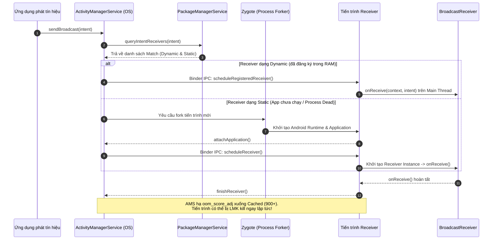
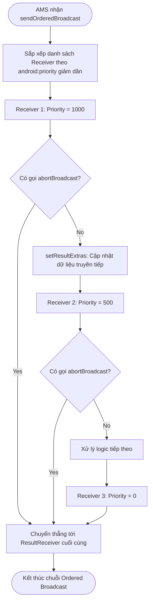

# BroadcastReceiver - Cơ chế Event-Driven, Background Execution Limits & Bảo Mật

## 1. Tổng quan (What & Why)

### 1.1 Khái niệm (What)
`BroadcastReceiver` là một trong bốn thành phần cốt lõi (Core Components) của Android (`Activity`, `Service`, `BroadcastReceiver`, `ContentProvider`). Về bản chất kiến trúc, `BroadcastReceiver` đóng vai trò là một **Event-Driven Entry Point** (điểm tiếp nhận sự kiện bất đồng bộ) cho phép ứng dụng đăng ký và phản hồi lại các thông điệp phát rộng (broadcast announcements) từ hệ điều hành (System) hoặc từ các ứng dụng khác (Inter-App Messaging).

Khác với `Activity` có giao diện trực quan hay `Service` được thiết kế để duy trì tác vụ nền, `BroadcastReceiver` có vòng đời cực ngắn: nó chỉ được đánh thức khi có sự kiện phù hợp, thực thi một đoạn xử lý logic nhanh gọn trong phương thức `onReceive()`, và hoàn tất nhiệm vụ ngay lập tức.

### 1.2 Tại sao cần BroadcastReceiver? (Why)
- **Hệ thống Publish-Subscribe lỏng lẻo (Decoupled Pub/Sub):** Cho phép OS phát tín hiệu trạng thái phần cứng/hệ thống (pin yếu, mất kết nối mạng, cắm sạc, reboot hoàn tất) tới tất cả các app quan tâm mà không cần biết app nào đang chạy.
- **Khởi động ứng dụng theo sự kiện (Event-driven wakeup):** Thông qua Manifest Receiver, hệ điều hành có thể tự động fork process và đánh thức một ứng dụng đã bị tắt hoàn toàn khi xuất hiện các sự kiện quan trọng (ví dụ: máy khởi động lại xong `ACTION_BOOT_COMPLETED`).
- **Giao tiếp liên tiến trình (IPC Broadcast):** Cho phép các ứng dụng thuộc cùng một tổ chức hoặc hệ sinh thái trao đổi trạng thái và trigger tác vụ của nhau mà không cần thiết lập kết nối RPC/Binder trực tiếp phức tạp như Bound Service.

---

## 2. Cơ chế hoạt động bên trong (Internal Mechanism)

### 2.1 Manifest-Declared (Static) vs Context-Registered (Dynamic) Receivers

| Tiêu chí | Manifest-Declared Receiver (Static) | Context-Registered Receiver (Dynamic) |
| :--- | :--- | :--- |
| **Khai báo** | Thẻ `<receiver>` trong `AndroidManifest.xml` | Gọi `context.registerReceiver()` tại runtime |
| **Vòng đời (Lifecycle)** | Độc lập với UI/Process. Nếu process chưa chạy, AMS sẽ fork process mới để thực thi `onReceive()`. | Phụ thuộc hoàn toàn vào lifecycle của component đăng ký nó (`Activity`, `Fragment`, `Service`, `Application`). |
| **Độ trễ & Overhead** | Tốn CPU/RAM vì OS phải fork process, khởi tạo `Application` object nếu process đang chết. | Rất nhanh, chỉ dispatch trực tiếp tới instance đã tồn tại trong bộ nhớ. |
| **Background Limits (API 26+)** | **Bị cấm gần như toàn bộ** đối với các Implicit Broadcasts (trừ whitelist). | Không bị ảnh hưởng bởi Background Execution Limits của API 26+. |
| **Android 14 (API 34)** | Bắt buộc khai báo rõ `android:exported`. | Bắt buộc truyền cờ `RECEIVER_EXPORTED` hoặc `RECEIVER_NOT_EXPORTED`. |

### 2.2 Phân loại Broadcast: Explicit vs Implicit vs Ordered

#### Explicit Broadcast (Phát sóng tường minh)
- Chỉ định đích danh component mục tiêu thông qua `setComponent()` hoặc `setClass(context, TargetReceiver::class.java)`, hoặc chỉ định `Intent.setPackage()`.
- **Cơ chế:** Activity Manager Service (AMS) định tuyến trực tiếp đến đúng app/receiver mục tiêu mà không cần duyệt toàn bộ bảng tra cứu `IntentFilter`.
- **Hiệu năng & Bảo mật:** Rất an toàn, không bị rò rỉ dữ liệu ra bên ngoài, không bị chặn bởi Background Execution Limits của Android 8.0+.

#### Implicit Broadcast (Phát sóng ẩn danh)
- Không chỉ định đích danh component hay package, chỉ khai báo một Action chung chung (ví dụ: `android.intent.action.BATTERY_LOW`).
- **Cơ chế:** AMS phải truy vấn Package Manager Service (PMS) để duyệt qua danh sách các `IntentFilter` đã đăng ký của toàn bộ hệ thống để tìm receiver khớp điều kiện.
- **Hạn chế:** Tiêu tốn nhiều tài nguyên của OS và là nguyên nhân chính dẫn đến **Thundering Herd Problem**.

#### Ordered Broadcast (`sendOrderedBroadcast`)
- Phát sóng tuần tự tới từng Receiver theo thứ tự giảm dần của độ ưu tiên (`android:priority` từ `-1000` đến `1000`).
- Các tính năng đặc biệt:
  - `abortBroadcast()`: Receiver có quyền hủy broadcast, ngăn không cho các receiver có độ ưu tiên thấp hơn nhận được tín hiệu.
  - `setResultExtras()` / `getResultExtras()`: Receiver phía trước có thể nhồi thêm dữ liệu hoặc ghi đè kết quả để truyền tiếp cho receiver phía sau.
  - Receiver cuối cùng (Result Receiver) luôn được chỉ định để tổng hợp kết quả cuối cùng kể cả khi broadcast bị abort giữa chừng.

### 2.3 Background Execution Limits (Android 8.0 - API 26+) & Thundering Herd Problem

Trước Android 8.0, hàng chục hoặc hàng trăm ứng dụng có thể cùng đăng ký Static Receiver trong Manifest cho các sự kiện hệ thống phổ biến như `CONNECTIVITY_CHANGE` hay `BOOT_COMPLETED`. Khi sự kiện xảy ra:
1. Hệ điều hành phải fork đồng loạt hàng chục tiến trình Java/Kotlin VM.
2. Dẫn đến hiện tượng **Thundering Herd** (đàn bò giẫm đạp): CPU chạm ngưỡng 100%, bộ nhớ RAM cạn kiệt, Low Memory Killer (LMK) phải liên tục dọn dẹp các app khác, gây giật lag nghiêm trọng cho thiết bị và tụt pin thảm hại.

> [!IMPORTANT]
> **Quy định từ Android 8.0 (API 26):**
> Các ứng dụng target API 26+ không thể đăng ký Manifest Receiver cho hầu hết các **Implicit Broadcasts**.
> 
> **Ngoại lệ (Whitelisted Broadcasts):** Một số broadcast thiết yếu vẫn được phép đăng ký trong Manifest:
> - `ACTION_BOOT_COMPLETED`
> - `ACTION_MY_PACKAGE_REPLACED`
> - `ACTION_LOCALE_CHANGED`
> - `ACTION_PACKAGE_FULLY_REMOVED`
> - Các broadcast riêng của nhà sản xuất hoặc ứng dụng hệ thống có quyền đặc biệt.

### 2.4 Quản lý vòng đời onReceive(), Low Memory Killer & goAsync()

Phương thức `onReceive(Context, Intent)` chạy trực tiếp trên **Main Thread (UI Thread)** của tiến trình.
- **ANR Timeout:** Hệ thống giới hạn thời gian thực thi của `onReceive()`:
  - **Foreground Receiver:** Khoảng **10 giây**.
  - **Background Receiver:** Khoảng **60 giây** (trước Android 14) hoặc 10-20 giây trên các phiên bản mới.
  - Nếu vượt quá ngưỡng này, AMS sẽ ném ra lỗi `ANR` (Application Not Responding).

#### Process Priority và Low Memory Killer (LMK)
Trong suốt thời gian `onReceive()` đang chạy, tiến trình chứa Receiver được hệ điều hành tạm thời nâng điểm ưu tiên `oom_score_adj` lên mức **Foreground Process** (hoặc `SERVICE_ADJ` ~ 0-200), giúp tiến trình không bị LMK tiêu diệt.

Tuy nhiên, **ngay khi `onReceive()` return**, nếu không còn Activity hay Service nào đang hiển thị, tiến trình lập tức bị hạ điểm `oom_score_adj` xuống mức **Cached/Empty Process (900 - 1000)**. Lúc này, OS có thể kill tiến trình bất cứ tích tắc nào để giải phóng RAM cho app khác! Do đó:
- **KHÔNG ĐƯỢC** khởi chạy bất kỳ Background Thread / Coroutine độc lập nào mà kỳ vọng nó sống sót qua `onReceive()`.
- **Cơ chế `goAsync()`:** Cho phép kéo dài thời gian sống của tiến trình sau khi `onReceive()` return bằng cách trả về một đối tượng `PendingResult`. Tuy nhiên:
  - `goAsync()` **không** vô hiệu hóa ANR timeout; bạn chỉ có tối đa khoảng 10-20 giây để hoàn thành công việc.
  - Phải luôn luôn gọi `pendingResult.finish()` trong khối `finally` để báo cho AMS biết tác vụ đã kết thúc, giải phóng wake lock nội bộ của hệ thống.

### 2.5 Security: Exported Receivers, Permissions & Android 14 Changes

#### 1. Rủi ro bảo mật
- **Intent Spoofing:** Kẻ tấn công gửi một Broadcast giả mạo tới Exported Receiver của bạn để kích hoạt trái phép các logic nhạy cảm.
- **Broadcast Eavesdropping:** Kẻ tấn công tạo Receiver đăng ký cùng IntentFilter để nghe lén các dữ liệu nhạy cảm truyền trong Intent Extras.

#### 2. Biện pháp phòng vệ
- **Khai báo `android:exported`:** Từ Android 12 (API 31), bắt buộc phải gán nhãn `android:exported="true"` hoặc `"false"` nếu có `<intent-filter>`. Luôn để `"false"` nếu chỉ dùng nội bộ.
- **Custom Signature Permission:** Khai báo permission với `android:protectionLevel="signature"`. Chỉ các app được ký cùng Keystore/Signing Key mới có thể gửi hoặc nhận broadcast.
- **Context-Registered Receiver trên Android 14 (API 34):** Bắt buộc phải truyền một trong hai cờ:
  - `Context.RECEIVER_EXPORTED`: Cho phép các app khác gửi broadcast tới receiver này.
  - `Context.RECEIVER_NOT_EXPORTED`: Chỉ cho phép nội bộ app hoặc System gửi broadcast tới receiver.

---

## 3. Luồng hoạt động (Flow Diagram - dùng mermaid)

### 3.1 Luồng phân phối Broadcast của hệ điều hành (Broadcast Dispatch Flow)



### 3.2 Luồng xử lý Ordered Broadcast và abortBroadcast()



---

## 4. Real-world Use Case

### 4.1 Lắng nghe BOOT_COMPLETED để Re-schedule tác vụ định kỳ qua WorkManager

Đây là kịch bản chuẩn mực nhất cho Static Receiver: Sau khi thiết bị reboot, toàn bộ AlarmManager dạng non-persistent và các lịch trình tạm thời bị xóa. Ứng dụng chỉ dùng BroadcastReceiver để hứng sự kiện và bàn giao ngay cho `WorkManager`.

```kotlin
// AndroidManifest.xml
/*
<receiver
    android:name=".boot.BootCompletedReceiver"
    android:enabled="true"
    android:exported="false">
    <intent-filter>
        <action android:name="android.intent.action.BOOT_COMPLETED" />
    </intent-filter>
</receiver>
*/

package com.example.core.receiver

import android.content.BroadcastReceiver
import android.content.Context
import android.content.Intent
import androidx.work.ExistingPeriodicWorkPolicy
import androidx.work.PeriodicWorkRequestBuilder
import androidx.work.WorkManager
import com.example.core.worker.SyncDataWorker
import java.util.concurrent.TimeUnit

class BootCompletedReceiver : BroadcastReceiver() {
    override fun onReceive(context: Context, intent: Intent) {
        if (intent.action == Intent.ACTION_BOOT_COMPLETED) {
            // Không thực thi logic nặng ở đây! Bàn giao ngay cho WorkManager
            val syncWorkRequest = PeriodicWorkRequestBuilder<SyncDataWorker>(
                repeatInterval = 12,
                repeatIntervalTimeUnit = TimeUnit.HOURS
            ).build()

            WorkManager.getInstance(context).enqueueUniquePeriodicWork(
                "PeriodicDataSyncWork",
                ExistingPeriodicWorkPolicy.KEEP,
                syncWorkRequest
            )
        }
    }
}
```

### 4.2 Dynamic Receiver an toàn theo Lifecycle & Android 14 Receiver Flags

Lắng nghe thay đổi trạng thái pin hoặc mạng khi màn hình đang hiển thị, tự động unregister trong `onStop` để ngăn rò rỉ bộ nhớ.

```kotlin
package com.example.core.receiver

import android.content.BroadcastReceiver
import android.content.Context
import android.content.Intent
import android.content.IntentFilter
import android.os.BatteryManager
import android.os.Build
import androidx.core.content.ContextCompat
import androidx.lifecycle.DefaultLifecycleObserver
import androidx.lifecycle.LifecycleOwner
import kotlinx.coroutines.flow.MutableStateFlow
import kotlinx.coroutines.flow.StateFlow
import kotlinx.coroutines.flow.asStateFlow

class BatteryStateMonitor(
    private val context: Context
) : DefaultLifecycleObserver {

    private val _batteryStatus = MutableStateFlow<Boolean>(false)
    val batteryStatus: StateFlow<Boolean> = _batteryStatus.asStateFlow()

    private val receiver = object : BroadcastReceiver() {
        override fun onReceive(ctx: Context, intent: Intent) {
            if (intent.action == Intent.ACTION_BATTERY_LOW) {
                _batteryStatus.value = true
            } else if (intent.action == Intent.ACTION_BATTERY_OKAY) {
                _batteryStatus.value = false
            }
        }
    }

    override fun onStart(owner: LifecycleOwner) {
        val filter = IntentFilter().apply {
            addAction(Intent.ACTION_BATTERY_LOW)
            addAction(Intent.ACTION_BATTERY_OKAY)
        }

        // Bắt buộc khai báo cờ RECEIVER_EXPORTED hoặc RECEIVER_NOT_EXPORTED từ Android 14 (API 34)
        // Dùng ContextCompat để tương thích ngược an toàn
        ContextCompat.registerReceiver(
            context,
            receiver,
            filter,
            ContextCompat.RECEIVER_NOT_EXPORTED
        )
    }

    override fun onStop(owner: LifecycleOwner) {
        try {
            context.unregisterReceiver(receiver)
        } catch (e: IllegalArgumentException) {
            // Tránh crash nếu receiver chưa được đăng ký
        }
    }
}
```

### 4.3 Xử lý I/O ngắn bằng goAsync() kết hợp Coroutines

Khi cần thực hiện một tác vụ I/O ngắn (dưới 10 giây) như đọc Room DB hoặc ghi log mã hóa trước khi tắt:

```kotlin
package com.example.core.receiver

import android.content.BroadcastReceiver
import android.content.Context
import android.content.Intent
import kotlinx.coroutines.CoroutineScope
import kotlinx.coroutines.Dispatchers
import kotlinx.coroutines.SupervisorJob
import kotlinx.coroutines.launch
import kotlinx.coroutines.withTimeoutOrNull

class QuickProcessingReceiver : BroadcastReceiver() {

    // Tạo CoroutineScope độc lập cho tác vụ nền của Receiver
    private val scope = CoroutineScope(SupervisorJob() + Dispatchers.IO)

    override fun onReceive(context: Context, intent: Intent) {
        // Kéo dài thời gian sống của process sau khi onReceive() return
        val pendingResult: PendingResult = goAsync()

        scope.launch {
            try {
                // Đặt timeout an toàn (ví dụ 8 giây) để tránh chạm ngưỡng ANR của OS
                withTimeoutOrNull(8000L) {
                    processQuickData(context, intent)
                }
            } catch (e: Exception) {
                e.printStackTrace()
            } finally {
                // BẮT BUỘC: Luôn giải phóng pendingResult để AMS hoàn tất broadcast transaction
                pendingResult.finish()
            }
        }
    }

    private suspend fun processQuickData(context: Context, intent: Intent) {
        // Thực thi tác vụ đọc/ghi I/O ngắn hạn tại Dispatchers.IO
    }
}
```

### 4.4 Bảo mật Broadcast với Custom Signature Permission

```xml
<!-- AndroidManifest.xml của App Gửi và App Nhận -->
<manifest xmlns:android="http://schemas.android.com/apk/res/android">
    <!-- 1. Khai báo Custom Permission cấp Signature -->
    <permission
        android:name="com.example.permission.PRIVATE_SECURE_EVENT"
        android:protectionLevel="signature" />

    <!-- 2. Khai báo quyền sử dụng permission này -->
    <uses-permission android:name="com.example.permission.PRIVATE_SECURE_EVENT" />

    <application>
        <!-- 3. Receiver được bảo vệ bằng permission -->
        <receiver
            android:name=".SecureDataReceiver"
            android:exported="true"
            android:permission="com.example.permission.PRIVATE_SECURE_EVENT">
            <intent-filter>
                <action android:name="com.example.action.INTERNAL_SYNC" />
            </intent-filter>
        </receiver>
    </application>
</manifest>
```

```kotlin
// Code phía Client gửi Broadcast được bảo vệ:
fun sendProtectedBroadcast(context: Context, payload: String) {
    val intent = Intent("com.example.action.INTERNAL_SYNC").apply {
        putExtra("EXTRA_PAYLOAD", payload)
        // Chỉ định package để tăng thêm 1 lớp bảo mật explicit
        setPackage("com.example.receiverapp")
    }
    // Chỉ app nào có permission signature mới nhận được broadcast này
    context.sendBroadcast(intent, "com.example.permission.PRIVATE_SECURE_EVENT")
}
```

---

## 5. Anti-Patterns & Pitfalls

### ❌ Anti-Pattern 1: Dùng BroadcastReceiver làm In-App EventBus nội bộ
- **Vấn đề:** Trước đây các dự án hay dùng `LocalBroadcastManager` hoặc hệ thống Broadcast thông thường để gửi sự kiện giữa các Activity/Fragment. Việc này tạo ra overhead IPC không đáng có, đóng gói Intent cồng kềnh, ép kiểu dữ liệu không type-safe và `LocalBroadcastManager` đã chính thức bị **Deprecated** bởi Google.
- **Giải pháp:** Sử dụng Kotlin Coroutines `SharedFlow` / `StateFlow` hoặc Reactive Streams kết hợp DI (Hilt Singleton EventBus) để giao tiếp nội bộ trong app.

### ❌ Anti-Pattern 2: Khởi chạy Coroutine không giám sát (Fire-and-forget Coroutine) trong onReceive()
```kotlin
// NGUY HIỂM CHẾT NGƯỜI
override fun onReceive(context: Context, intent: Intent) {
    CoroutineScope(Dispatchers.IO).launch {
        apiService.uploadTelemetry() // Process có thể bị LMK kill ngay lập tức!
    }
}
```
- **Vấn đề:** Ngay khi `onReceive()` trả về, AMS coi như Receiver đã chạy xong. Điểm `oom_score_adj` tụt xuống nhóm Cached. Khi bộ nhớ thấp, OS dọn sạch process mà không đợi Coroutine hoàn tất.
- **Giải pháp:** Nếu là tác vụ ngắn (< 10s), dùng `goAsync()`. Nếu là tác vụ dài hoặc quan trọng (Upload, Sync), hãy enqueue vào `WorkManager`.

### ❌ Anti-Pattern 3: Quên Unregister Dynamic Receiver
- **Vấn đề:** Đăng ký receiver trong `Activity.onCreate()` hoặc `Fragment.onViewCreated()` nhưng không gọi `unregisterReceiver()` trong `onDestroy()`.
- **Hậu quả:** `Receiver` giữ tham chiếu ngầm đến Context (`Activity`), dẫn đến **Memory Leak** nghiêm trọng (`Activity` không được Garbage Collector thu hồi). Nếu broadcast bắn tới sau khi Activity đã bị destroy, app có thể bị crash vì truy cập View đã chết.

### ❌ Anti-Pattern 4: Quên cờ android:exported trên Android 12+ hoặc cờ Runtime trên Android 14+
- **Vấn đề:** Không khai báo cờ dẫn đến việc hệ thống từ chối cài đặt app (Android 12) hoặc ném `SecurityException` ngay khi gọi `registerReceiver()` tại runtime (Android 14).

---

## 6. Trade-offs & So sánh

### BroadcastReceiver vs WorkManager vs Service vs Coroutines Flow

| Tiêu chí | BroadcastReceiver | WorkManager | Foreground Service | Coroutines Flow |
| :--- | :--- | :--- | :--- | :--- |
| **Mục đích chính** | Đón nhận sự kiện phân tán từ OS hoặc liên tiến trình | Xử lý tác vụ nền đảm bảo (guaranteed), bền vững (persistent) | Tác vụ dài hạn mà người dùng nhận biết trực tiếp | Giao tiếp luồng dữ liệu nội bộ trong cùng tiến trình |
| **Phạm vi (Scope)** | Toàn hệ thống (System-wide / Inter-App) | App nội bộ (Persisted qua Room) | App nội bộ | Single Process / Single App |
| **Sống sót qua Reboot** | Chỉ khi kết hợp Manifest `BOOT_COMPLETED` | **Có** (Tự động tái lập lịch sau reboot) | Không (Trừ khi tự khởi động lại) | **Không** |
| **Chạy trên Thread nào** | Main Thread (`onReceive`) | Background Thread (Worker Pool) | Main Thread (Phải tự tạo thread) | Tùy chọn theo Dispatcher |
| **Giới hạn thời gian** | 10s - 20s (Nguy cơ ANR) | Không giới hạn thời gian (Hệ điều hành quản lý) | Vô hạn (miễn là notification hiển thị) | Gắn với CoroutineScope |

---

## 7. Senior-level Insights

### 7.1 Cơ chế phân loại Process Priority (oom_score_adj) khi nhận Broadcast
Hệ điều hành Android quản lý tiến trình thông qua chỉ số `oom_score_adj` (từ -1000 đến 1000):
1. **Khi Intent đến:** AMS tìm thấy tiến trình mục tiêu. Điểm của tiến trình được kéo ngay về ngưỡng **Foreground / Service (~0 đến 200)**. Hệ điều hành cấp phát một WakeLock ngầm để giữ CPU không ngủ trong quá trình dispatch.
2. **Khi onReceive() return:** AMS nhận callback `finishReceiver()`, lập tức gỡ bỏ WakeLock và đẩy tiến trình về trạng thái **Cached Process (oom_score_adj = 900 - 1000)**.
3. **Ý nghĩa kiến trúc:** Đừng bao giờ tin tưởng bất kỳ background thread nào được kích hoạt từ `onReceive()` mà không có sự bảo hộ của `goAsync()` hoặc `WorkManager`.

### 7.2 Thay đổi hành vi Context-Registered Receiver trên Android 14 (API 34)
Trên Android 14:
- Khi ứng dụng rơi vào trạng thái `Cached` (người dùng nhấn Home hoặc chuyển app), hệ thống sẽ **đóng băng (freeze)** việc phân phối các broadcast gửi tới Context-Registered Receivers để tối ưu pin.
- Các broadcast này không bị mất mà được xếp vào hàng đợi (**queued/cached**). Chỉ khi ứng dụng quay trở lại trạng thái `Visible` hoặc `Foreground`, hệ thống mới giải phóng hàng đợi và chuyển tiếp toàn bộ các broadcast dồn ứ tới receiver.
- **Ngoại lệ:** Các broadcast cực kỳ khẩn cấp của hệ thống sẽ làm tan băng app ngay lập tức.

### 7.3 Giải pháp cho bài toán Inter-Process Communication (IPC) Broadcast an toàn
Khi 2 app thuộc cùng 1 công ty cần truyền dữ liệu nhạy cảm qua Broadcast:
1. **Tuyệt đối không dùng Implicit Broadcast không bảo vệ.**
2. **Khai báo `android:protectionLevel="signature"`:** Đảm bảo chỉ app do công ty bạn phát hành mới nhận và gửi được tín hiệu.
3. **Kết hợp Explicit Intent (`intent.setPackage("com.company.receiver")`):** Tránh mọi nguy cơ Intent Interception từ các app độc hại có cùng permission (nếu sơ suất trong quản lý chứng chỉ).

---

## 8. Câu hỏi phỏng vấn (với gợi ý trả lời)

### Q1: BroadcastReceiver chạy trên thread nào? Có thể thực hiện Network Request trực tiếp trong onReceive() không? Tại sao?
> **Gợi ý trả lời:**
> `BroadcastReceiver.onReceive()` luôn được thực thi trên **Main Thread (UI Thread)** của tiến trình.
> Do đó, **tuyệt đối không được thực hiện Network Request** hoặc tác vụ I/O nặng trong `onReceive()`:
> 1. Hệ điều hành sẽ ném `NetworkOnMainThreadException` ngay lập tức nếu thực hiện network trên Main Thread.
> 2. `onReceive()` bị giới hạn thời gian thực thi (khoảng 10s đối với foreground broadcast). Việc block Main Thread sẽ kích hoạt hộp thoại **ANR** (Application Not Responding).
> Nếu cần xử lý tác vụ nền, phải dùng `goAsync()` cho tác vụ I/O cực ngắn (< 10s) hoặc ủy quyền cho `WorkManager` đối với các tác vụ dài.

### Q2: goAsync() hoạt động như thế nào bên dưới hệ thống? Nó có loại bỏ hoàn toàn nguy cơ bị ANR không?
> **Gợi ý trả lời:**
> `goAsync()` trả về một đối tượng `PendingResult`. Khi `onReceive()` kết thúc, AMS nhận biết rằng receiver chưa hoàn tất công việc và tiếp tục duy trì trạng thái ưu tiên cho tiến trình thay vì hạ ngay xuống cached process.
> Tuy nhiên, **`goAsync()` KHÔNG loại bỏ nguy cơ ANR**. AMS vẫn duy trì một timer giám sát. Nếu bạn không gọi `pendingResult.finish()` trước khi hết thời gian timeout quy định của hệ thống (thường là 10 - 20s), hệ thống vẫn sẽ kích hoạt ANR và coi như receiver bị treo.

### Q3: Tại sao Android 8.0 (API 26) lại cấm phần lớn Implicit Broadcasts trong AndroidManifest? Hệ thống giải quyết vấn đề gì?
> **Gợi ý trả lời:**
> Google đưa ra lệnh cấm này nhằm giải quyết **Thundering Herd Problem** và tình trạng cạn kiệt pin, RAM:
> - Trước API 26, hàng trăm ứng dụng cùng đăng ký static receiver cho các sự kiện như `CONNECTIVITY_CHANGE`. Khi mạng thay đổi, OS buộc phải fork hàng trăm process đồng loạt, khởi tạo runtime và object `Application` cho từng app.
> - Điều này khiến CPU quá tải, pin tụt nhanh và LMK phải liên tục kill app trong background.
> - Bằng cách cấm implicit broadcast trong Manifest, OS đảm bảo chỉ những app đang mở (đã register dynamic receiver) hoặc các app sử dụng cơ chế có kiểm soát như `JobScheduler`/`WorkManager` mới được kích hoạt.

### Q4: Sự khác biệt bản chất giữa Context.RECEIVER_EXPORTED và Context.RECEIVER_NOT_EXPORTED trên Android 14 là gì?
> **Gợi ý trả lời:**
> Bắt đầu từ Android 14 (API 34), mọi dynamic receiver khi gọi `registerReceiver()` đều bắt buộc phải chỉ định cờ xuất xưởng:
> - `RECEIVER_EXPORTED`: Cho phép bất kỳ ứng dụng nào khác trên thiết bị gửi broadcast tới receiver này. Dùng khi bạn thiết kế API/cổng giao tiếp cho bên thứ ba.
> - `RECEIVER_NOT_EXPORTED`: Chỉ cho phép chính ứng dụng đó hoặc các tiến trình hệ thống có quyền root/system gửi broadcast tới. Ngăn chặn triệt để việc tấn công tiêm nhiễm Intent giả mạo (Intent Spoofing) từ các ứng dụng độc hại cùng máy.

### Q5: Chuyện gì xảy ra với các dynamic receivers đã đăng ký khi ứng dụng bị rơi vào trạng thái Cached trên Android 14?
> **Gợi ý trả lời:**
> Trên Android 14, để tiết kiệm năng lượng, các tiến trình ở trạng thái Cached sẽ bị hệ thống **đóng băng (freeze)**. Nếu có một broadcast được gửi tới một dynamic receiver của app đang bị đóng băng, hệ thống sẽ **tạm hoãn (delay/queue)** việc phân phối broadcast đó.
> Tín hiệu sẽ không bị hủy; ngay khi người dùng đưa ứng dụng trở lại foreground hoặc app chuyển sang trạng thái active, hệ thống mới giải phóng hàng đợi và gọi `onReceive()` cho các broadcast tích lũy.

### Q6: Ordered Broadcast là gì? Phân tích use case thực tế và cách một Receiver có thể chặn các Receiver khác?
> **Gợi ý trả lời:**
> `Ordered Broadcast` là dạng phát sóng tuần tự tới danh sách các receiver được sắp xếp theo độ ưu tiên `android:priority` (từ cao xuống thấp).
> - Mỗi receiver có thể đọc kết quả từ receiver trước qua `getResultExtras()`, bổ sung dữ liệu qua `setResultExtras()`.
> - Một receiver có thể gọi `abortBroadcast()` để hủy chuỗi phát sóng. Khi đó, các receiver có độ ưu tiên thấp hơn sẽ hoàn toàn không nhận được intent.
> - **Use case thực tế:** Ứng dụng lọc cuộc gọi rác hoặc bảo mật SMS (trước các phiên bản giới hạn Default SMS app). Một receiver bảo mật có priority cao kiểm tra nội dung SMS, nếu phát hiện lừa đảo thì gọi `abortBroadcast()` để ngăn ứng dụng tin nhắn mặc định nhận và hiển thị thông báo tới người dùng.

### Q7: Tại sao không nên khởi tạo một CoroutineScope độc lập dạng `CoroutineScope(Dispatchers.IO).launch` bên trong `onReceive()` để download data?
> **Gợi ý trả lời:**
> Đây là một lỗi anti-pattern kinh điển liên quan đến **Process Lifecycle**:
> 1. Khi `onReceive()` trả về, AMS coi như nhiệm vụ của BroadcastReceiver đã kết thúc.
> 2. Điểm `oom_score_adj` của tiến trình ngay lập tức bị đẩy xuống nhóm `Cached Process (900+)`.
> 3. Hệ điều hành Android coi tiến trình cached là "có thể bị giết bất cứ lúc nào" khi cần giải phóng RAM. Coroutine chạy ngầm trên background thread sẽ bị hủy ngang giữa chừng mà không có cơ hội xử lý ngoại lệ hay rollback dữ liệu.
> Cách giải quyết đúng đắn: Đẩy tác vụ download vào `WorkManager` để được đảm bảo thực thi độc lập và có cơ chế retry tự động.

---

## 9. Tài liệu tham khảo
- [Android Developers - Broadcasts Overview](https://developer.android.com/develop/background-work/background-tasks/broadcasts)
- [Android Developers - Background Execution Limits (Android 8.0)](https://developer.android.com/about/versions/oreo/background)
- [Android Developers - Context-registered receiver behavior in Android 14](https://developer.android.com/about/versions/14/behavior-changes-all#context-registered-broadcasts)
- [Android Open Source Project - ActivityManagerService Broadcast Queue Architecture](https://cs.android.com/android/platform/superproject/+/main:frameworks/base/services/core/java/com/android/server/am/BroadcastQueue.java)
