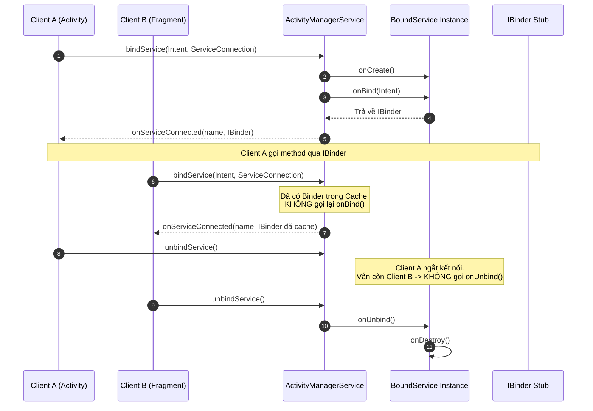

# Service & Foreground Service - Architecture, Lifecycle, IPC & Background Restrictions

## 1. Tổng quan (What & Why)

### 1.1 Khái niệm (What)
`Service` là một trong bốn thành phần cốt lõi của Android, được thiết kế để thực thi các tác vụ chạy nền dài hạn (long-running background operations) **hoàn toàn không có giao diện người dùng (no UI)**. 

> [!CAUTION]
> **Hiểu lầm kinh điển:** `Service` **KHÔNG PHẢI** là một Background Thread riêng biệt.
> Mặc định, một Service chạy hoàn toàn trên **Main Thread (UI Thread)** của tiến trình lưu trữ nó (Hosting Process). Nếu thực thi tác vụ nặng tính toán (CPU-bound) hoặc chặn I/O trong Service mà không điều hướng sang Worker Thread, ứng dụng sẽ ngay lập tức bị đơ và kích hoạt lỗi **ANR (Application Not Responding)**.

### 1.2 Tại sao cần Service? (Why)
- **Duy trì tác vụ khi người dùng không tương tác với UI:** Phát nhạc (Media Playback), ghi âm (Audio Recording), dẫn đường bằng giọng nói (GPS Navigation Turn-by-Turn).
- **Client-Server Architecture nội bộ / IPC:** Cho phép nhiều Activity, Fragment hoặc thậm chí các ứng dụng khác kết nối (bind) vào một điểm dịch vụ duy nhất để thực thi lệnh (RPC), theo dõi dữ liệu trạng thái thông qua `IBinder` / `AIDL`.
- **Nâng cao độ ưu tiên của tiến trình (Process Priority):** Khi một tiến trình chứa một Foreground Service đang hoạt động, Android gán cho nó điểm ưu tiên tiến trình rất cao, bảo vệ nó khỏi việc bị **Low Memory Killer (LMK)** dọn dẹp khi RAM thiếu hụt.

---

## 2. Cơ chế hoạt động bên trong (Internal Mechanism)

### 2.1 Ba mô hình hoạt động của Service

```
                    ┌────────────────────────────────────────────────────────┐
                    │                    Android Service                     │
                    └────────────────────────────────────────────────────────┘
                               /                 |                 \
                              /                  |                  \
                             ▼                   ▼                   ▼
                  ┌──────────────────┐ ┌──────────────────┐ ┌──────────────────┐
                  │ Started Service  │ │  Bound Service   │ │Foreground Service│
                  │ (startService)   │ │  (bindService)   │ │(startForeground) │
                  └──────────────────┘ └──────────────────┘ └──────────────────┘
```

#### 1. Started Service (`startService` / `startForegroundService`)
- Được kích hoạt bởi một component khác thông qua lời gọi `startService(Intent)`.
- Khi đã khởi chạy, nó có thể chạy **vô thời hạn** trong nền ngay cả khi component kích hoạt nó đã bị hủy.
- Service chỉ dừng lại khi chính nó gọi `stopSelf()` / `stopSelf(startId)` hoặc một component khác gọi `stopService(Intent)`.
- **Cơ chế return flags trong `onStartCommand()`**:

| Return Flag | Hành vi của hệ điều hành khi Service bị Kill do cạn kiệt RAM | Use case điển hình |
| :--- | :--- | :--- |
| `START_NOT_STICKY` | OS **không** tự động tạo lại Service trừ khi có Intent mới được gửi đến tường minh. | Các tác vụ định kỳ có thể chờ lần trigger tiếp theo, không quan trọng dữ liệu dở dang (ví dụ: Polling data). |
| `START_STICKY` | OS tái tạo lại Service, gọi lại `onCreate()` và `onStartCommand()`, nhưng tham số **`Intent` truyền vào sẽ là `null`** (trừ khi có Pending Intent đang chờ). | Trình phát nhạc nền (Media Player) duy trì trạng thái chờ người dùng điều khiển tiếp. |
| `START_REDELIVER_INTENT` | OS tái tạo Service, gọi `onStartCommand()` và **chuyển lại chính xác Intent cuối cùng** chưa xử lý xong. | Tác vụ xử lý đơn hàng, upload file dở dang cần dữ liệu nguyên vẹn của Intent. |

#### 2. Bound Service (`bindService`)
- Hoạt động theo mô hình Client-Server. Client kết nối tới Service thông qua `bindService()`.
- Service chỉ tồn tại chừng nào còn **ít nhất một Client** đang liên kết với nó. Khi tất cả client gọi `unbindService()`, Service sẽ tự động bị hủy (`onDestroy()`).
- **Giao tiếp qua `IBinder`**:
  - **Local Binder Pattern:** Khi Client và Service cùng chạy trong **một tiến trình**, Service trả về một instance mở rộng từ `Binder` class, cho phép Client gọi trực tiếp các public methods của Service một cách an toàn và có hiệu năng cao nhất.
  - **Messenger:** Sử dụng `Handler` để truyền nhận các đối tượng `Message` giữa các tiến trình khác nhau (single-thread queue).
  - **AIDL (Android Interface Definition Language):** Sử dụng IPC Binder cấp thấp để hỗ trợ giao tiếp đa luồng (multi-threaded IPC) giữa các ứng dụng khác nhau.
- **Quy tắc Multiple Clients Binding:**
  - Khi Client đầu tiên bind: OS gọi `onCreate()` -> `onBind()` và trả về đối tượng `IBinder`.
  - Khi Client thứ hai trở đi bind vào cùng một Service: OS **KHÔNG GỌI LẠI `onBind()`**, mà trực tiếp chuyển tiếp đối tượng `IBinder` đã cache trong RAM cho các client tiếp theo.
  - Khi một Client unbind: OS gọi `ServiceConnection.onServiceDisconnected()` cho client đó.
  - Khi **Client cuối cùng** unbind: OS gọi `onUnbind()`. Nếu trả về `true`, hệ thống sẽ kích hoạt `onRebind()` khi có client mới kết nối trong tương lai; nếu trả về `false`, hệ thống gọi tiếp `onDestroy()`.

#### 3. Foreground Service
- Là một Service đang thực hiện một tác vụ mà người dùng **nhận biết trực tiếp (actively aware)**.
- **Bắt buộc hiển thị Ongoing Notification:** Notification này không thể vuốt để tắt (non-dismissible) khi service đang chạy.
- **Foreground Service Types (Android 10+ và bắt buộc từ Android 14):**
  - Android 14 (API 34) yêu cầu mọi Foreground Service phải khai báo loại cụ thể (`foregroundServiceType`) trong Manifest và cấp quyền Runtime tương ứng.
  - Các types: `camera`, `connectedDevice`, `dataSync`, `health`, `location`, `mediaPlayback`, `mediaProjection`, `microphone`, `phoneCall`, `remoteMessaging`, `shortService`, `specialUse`, `systemExempted`.
  - **Giới hạn thời gian (Timeout):** Ví dụ loại `dataSync` trên Android 14 bị giới hạn thời gian chạy tối đa là **6 giờ**. Quá thời gian này, hệ thống sẽ ném lỗi `TimeoutException`.

### 2.2 Background Execution Restrictions (Android 8.0+, 12+, 14+)

#### Android 8.0 (API 26) - Background Service Limits
- Một ứng dụng ở chế độ background **không được phép gọi `startService()`**. Nếu gọi sẽ bị ném lỗi `IllegalStateException`.
- Muốn chạy Service, ứng dụng phải gọi `startForegroundService(intent)` và trong vòng **5 giây**, Service đó bắt buộc phải gọi `startForeground(id, notification)`. Nếu không, hệ thống sẽ kích hoạt ANR.

#### Android 12 (API 31) - Lệnh cấm khởi chạy Foreground Service từ Background
- Ứng dụng khi đang ở chế độ Background **KHÔNG THỂ** khởi động một Foreground Service thông qua `startForegroundService()`.
- Vi phạm sẽ dẫn đến ngoại lệ nghiêm trọng: `ForegroundServiceStartNotAllowedException`.
- **Các ngoại lệ (Exemptions):**
  - Nhận được High-Priority Push Notification từ Firebase Cloud Messaging (FCM).
  - Được kích hoạt từ BroadcastReceiver nhận các sự kiện hệ thống (ví dụ: `BOOT_COMPLETED`).
  - Được kích hoạt từ một `PendingIntent` xuất phát từ Widget hoặc Notification Action.
  - Ứng dụng nắm giữ quyền đặc biệt như Device Owner / Companion Device Manager.

### 2.3 Tại sao Foreground Service vẫn có thể bị Kill?

Nhiều kỹ sư lầm tưởng rằng `Foreground Service` là "bất tử" (immortal). Điều này hoàn toàn sai lầm về mặt kiến trúc hệ điều hành:
1. **Low Memory Killer (LMK) Score:**
   - Ứng dụng Foreground tương tác trực tiếp: `oom_score_adj` = `0` (Foreground App).
   - Ứng dụng chứa Foreground Service: `oom_score_adj` = `200` (Perceptible / Visible App).
   - Ứng dụng trong background: `oom_score_adj` = `700 - 1000` (Cached / Empty App).
2. **Kịch bản bị Kill:**
   - Khi thiết bị rơi vào tình trạng thiếu hụt bộ nhớ nghiêm trọng (**Extreme Low Memory Pressure**), LMK sau khi dọn sạch toàn bộ các ứng dụng nhóm Cached sẽ bắt đầu tiêu diệt các tiến trình ở nhóm có điểm cao hơn, bao gồm cả các ứng dụng có `oom_score_adj` = 200 chứa Foreground Service.
   - Các dòng máy OEM (Xiaomi, Huawei, Samsung) áp dụng cơ chế quản lý pin cực đoan (Aggressive Battery Optimization / Doze mode riêng) có thể kill tiến trình nếu CPU hoạt động liên tục mà màn hình tắt.

### 2.4 Race Condition: stopSelf() vs stopSelf(startId)

Khi Service xử lý đồng thời nhiều Intent được gửi tới qua `startService()`:
- Mỗi khi `startService()` được gọi, `onStartCommand()` nhận một định danh duy nhất là `startId` tăng dần (1, 2, 3...).
- Nếu bạn gọi `stopSelf()` không tham số ngay khi Request #1 hoàn tất, bạn sẽ **vô tình giết chết Service** trong khi Request #2 và Request #3 vừa được gửi đến và đang chờ xử lý!
- **Giải pháp chuẩn:** Luôn gọi `stopSelf(startId)`. Phương thức này kiểm tra xem `startId` truyền vào có phải là ID mới nhất của Service hay không. Nếu có request mới hơn đang đến, hệ thống sẽ từ chối dừng Service.

---

## 3. Luồng hoạt động (Flow Diagram - dùng mermaid)

### 3.1 Vòng đời của Started Service & Quản lý Process Priority

```mermaid
flowchart TD
    Client[Client gọi startForegroundService] --> AMS[ActivityManagerService]
    AMS --> CheckBg{App ở Background?}
    CheckBg -- Yes (Android 12+) --> ExCheck{Nằm trong danh sách Exemption?}
    ExCheck -- No --> Crash[Ném ForegroundServiceStartNotAllowedException]
    ExCheck -- Yes --> Fork[Khởi động / Nâng điểm Process]
    CheckBg -- No --> Fork
    
    Fork --> Create[onCreate: Khởi tạo Service]
    Create --> StartCmd[onStartCommand: Nhận Intent & startId]
    StartCmd --> Timer{startForeground được gọi trong 5s?}
    Timer -- No --> ANR[Kích hoạt ANR Timeout]
    Timer -- Yes --> Running[Foreground Service Running<br/>oom_score_adj = 200]
    
    Running --> Work[Thực thi tác vụ trên Coroutine Scope]
    Work --> StopCheck{stopSelf(startId)}
    StopCheck -- startId cũ --> KeepRunning[Tiếp tục chạy request mới]
    StopCheck -- startId mới nhất --> Destroy[onDestroy: Giải phóng Resource & Scope]
```

### 3.2 Luồng Binding và IPC của Bound Service



---

## 4. Real-world Use Case

### 4.1 Production-Ready Foreground Service với Notification & Coroutines

Xây dựng một Media Audio Streamer hoặc Location Tracker hoàn chỉnh, xử lý crash permissions của Android 14 và cancel structured concurrency an toàn:

```kotlin
package com.example.core.service

import android.app.Notification
import android.app.NotificationChannel
import android.app.NotificationManager
import android.app.PendingIntent
import android.content.Context
import android.content.Intent
import android.content.pm.ServiceInfo
import android.os.Build
import androidx.core.app.NotificationCompat
import androidx.core.app.ServiceCompat
import androidx.lifecycle.LifecycleService
import androidx.lifecycle.lifecycleScope
import kotlinx.coroutines.Dispatchers
import kotlinx.coroutines.Job
import kotlinx.coroutines.delay
import kotlinx.coroutines.isActive
import kotlinx.coroutines.launch

class TrackingForegroundService : LifecycleService() {

    private var trackingJob: Job? = null

    override fun onCreate() {
        super.onCreate()
        createNotificationChannel()
    }

    override fun onStartCommand(intent: Intent?, flags: Int, startId: Int): Int {
        super.onStartCommand(intent, flags, startId)

        when (intent?.action) {
            ACTION_START -> startTracking(startId)
            ACTION_STOP -> stopTracking(startId)
        }

        // Tự động khôi phục và gửi lại Intent nếu bị OS kill bất ngờ
        return START_REDELIVER_INTENT
    }

    private fun startTracking(startId: Int) {
        val notification = createNotification("Đang ghi nhận vị trí GPS...")

        // Android 14 yêu cầu chỉ định foregroundServiceType khi gọi startForeground
        if (Build.VERSION.SDK_INT >= Build.VERSION_CODES.Q) {
            ServiceCompat.startForeground(
                this,
                NOTIFICATION_ID,
                notification,
                ServiceInfo.FOREGROUND_SERVICE_TYPE_LOCATION
            )
        } else {
            startForeground(NOTIFICATION_ID, notification)
        }

        // Sử dụng lifecycleScope của LifecycleService để tự động cancel khi onDestroy
        trackingJob?.cancel()
        trackingJob = lifecycleScope.launch(Dispatchers.Default) {
            var counter = 0
            while (isActive) {
                // Giả lập đọc tọa độ GPS và gửi lên server
                delay(5000L)
                counter++
                updateNotification("Đã gửi $counter điểm định vị lên máy chủ")
            }
        }
    }

    private fun stopTracking(startId: Int) {
        trackingJob?.cancel()
        ServiceCompat.stopForeground(this, ServiceCompat.STOP_FOREGROUND_REMOVE)
        // Tránh race condition khi có nhiều intent
        stopSelf(startId)
    }

    private fun createNotification(content: String): Notification {
        val stopIntent = Intent(this, TrackingForegroundService::class.java).apply {
            action = ACTION_STOP
        }
        val stopPendingIntent = PendingIntent.getService(
            this, 0, stopIntent, PendingIntent.FLAG_IMMUTABLE
        )

        return NotificationCompat.Builder(this, CHANNEL_ID)
            .setContentTitle("Dịch vụ Định vị Doanh Nghiệp")
            .setContentText(content)
            .setSmallIcon(android.R.drawable.ic_menu_mylocation)
            .setOngoing(true)
            .addAction(android.R.drawable.ic_media_pause, "Dừng lại", stopPendingIntent)
            .build()
    }

    private fun updateNotification(content: String) {
        val notificationManager = getSystemService(Context.NOTIFICATION_SERVICE) as NotificationManager
        notificationManager.notify(NOTIFICATION_ID, createNotification(content))
    }

    private fun createNotificationChannel() {
        if (Build.VERSION.SDK_INT >= Build.VERSION_CODES.O) {
            val channel = NotificationChannel(
                CHANNEL_ID,
                "Kênh Giám Sát Vị Trí",
                NotificationManager.IMPORTANCE_LOW
            ).apply {
                description = "Hiển thị thông báo trạng thái GPS đang chạy ngầm"
            }
            val manager = getSystemService(NotificationManager::class.java)
            manager.createNotificationChannel(channel)
        }
    }

    companion object {
        const val CHANNEL_ID = "tracking_channel"
        const val NOTIFICATION_ID = 1001
        const val ACTION_START = "ACTION_START"
        const val ACTION_STOP = "ACTION_STOP"
    }
}
```

```xml
<!-- Khai báo trong AndroidManifest.xml (Android 14 Compatible) -->
<manifest xmlns:android="http://schemas.android.com/apk/res/android">
    <uses-permission android:name="android.permission.FOREGROUND_SERVICE" />
    <uses-permission android:name="android.permission.FOREGROUND_SERVICE_LOCATION" />
    <uses-permission android:name="android.permission.ACCESS_FINE_LOCATION" />

    <application>
        <service
            android:name=".TrackingForegroundService"
            android:exported="false"
            android:foregroundServiceType="location" />
    </application>
</manifest>
```

### 4.2 Bound Service theo Reactive Pattern (StateFlow & Local Binder)

Triển khai Bound Service cung cấp luồng dữ liệu thời gian thực cho Client thông qua Kotlin `StateFlow`:

```kotlin
package com.example.core.service

import android.app.Service
import android.content.Intent
import android.os.Binder
import android.os.IBinder
import kotlinx.coroutines.CoroutineScope
import kotlinx.coroutines.Dispatchers
import kotlinx.coroutines.SupervisorJob
import kotlinx.coroutines.cancel
import kotlinx.coroutines.delay
import kotlinx.coroutines.flow.MutableStateFlow
import kotlinx.coroutines.flow.StateFlow
import kotlinx.coroutines.flow.asStateFlow
import kotlinx.coroutines.launch

class ConnectionMonitorService : Service() {

    private val serviceScope = CoroutineScope(SupervisorJob() + Dispatchers.Default)
    private val binder = LocalBinder()

    private val _connectionStatus = MutableStateFlow("Disconnected")
    val connectionStatus: StateFlow<String> = _connectionStatus.asStateFlow()

    inner class LocalBinder : Binder() {
        fun getService(): ConnectionMonitorService = this@ConnectionMonitorService
    }

    override fun onCreate() {
        super.onCreate()
        // Giả lập lắng nghe socket trạng thái
        serviceScope.launch {
            val states = listOf("Connecting...", "Connected (Latency: 20ms)", "Syncing Data")
            var idx = 0
            while (true) {
                delay(3000L)
                _connectionStatus.value = states[idx % states.size]
                idx++
            }
        }
    }

    override fun onBind(intent: Intent?): IBinder {
        return binder
    }

    override fun onUnbind(intent: Intent?): Boolean {
        // Cho phép onRebind nếu có client kết nối lại sau này
        return true
    }

    override fun onDestroy() {
        super.onDestroy()
        serviceScope.cancel() // Dọn dẹp tài nguyên coroutine
    }
}
```

```kotlin
// Phía UI Client (Activity / ViewModel) kết nối an toàn:
class ConnectionClient(private val context: Context) {
    private var service: ConnectionMonitorService? = null
    private var isBound = false

    private val connection = object : android.content.ServiceConnection {
        override fun onServiceConnected(name: android.content.ComponentName?, binder: IBinder?) {
            val localBinder = binder as ConnectionMonitorService.LocalBinder
            service = localBinder.getService()
            isBound = true
        }

        override fun onServiceDisconnected(name: android.content.ComponentName?) {
            service = null
            isBound = false
        }
    }

    fun bind() {
        val intent = Intent(context, ConnectionMonitorService::class.java)
        context.bindService(intent, connection, Context.BIND_AUTO_CREATE)
    }

    fun unbind() {
        if (isBound) {
            context.unbindService(connection)
            isBound = false
        }
    }
}
```

---

## 5. Anti-Patterns & Pitfalls

### ❌ Anti-Pattern 1: Chạy tác vụ tính toán hoặc I/O trực tiếp trong onStartCommand()
- **Nguyên nhân:** Lầm tưởng Service là thread riêng.
- **Hậu quả:** Gây đơ toàn bộ UI của App, người dùng chạm vào màn hình không phản hồi và bị OS bắn lỗi **ANR sau 20 giây** (đối với Foreground Service) hoặc **200 giây** (đối với Background Service).
- **Khắc phục:** Luôn dispatch tác vụ sang `Dispatchers.IO` hoặc `Dispatchers.Default` bằng Coroutines.

### ❌ Anti-Pattern 2: Gọi stopSelf() không tham số khi xử lý đa luồng Intent
- **Nguyên nhân:** Không kiểm soát được thứ tự hoàn thành của các request gửi đến service.
- **Hậu quả:** Task A xong sớm gọi `stopSelf()`, vô tình kết liễu luôn Task B vừa mới được kích hoạt, dẫn đến mất dữ liệu người dùng.
- **Khắc phục:** Luôn sử dụng `stopSelf(startId)`.

### ❌ Anti-Pattern 3: Dùng Background Service để tải file hoặc đồng bộ dữ liệu
- **Nguyên nhân:** Thói quen viết code từ thời Android 7.0 trở về trước.
- **Hậu quả:** Từ Android 8.0+, Background Service bị kill chỉ sau vài phút khi app vào nền. Nếu dùng `startService()` khi đang ở background sẽ crash `IllegalStateException`.
- **Khắc phục:** Sử dụng **WorkManager** để có cơ chế retry tự động và đảm bảo hoàn thành (Guaranteed Execution).

### ❌ Anti-Pattern 4: Quên huỷ CoroutineScope trong onDestroy()
- **Nguyên nhân:** Khởi tạo CoroutineScope toàn cục hoặc không gắn kết với vòng đời Service.
- **Hậu quả:** Service đã bị hủy (`onDestroy`) nhưng các background coroutine vẫn chạy ngầm, giữ tham chiếu đến Service instance và Context, gây rò rỉ bộ nhớ (Memory Leak) và hao pin.
- **Khắc phục:** Kế thừa `LifecycleService` để tận dụng `lifecycleScope` hoặc chủ động gọi `scope.cancel()` trong `onDestroy()`.

---

## 6. Trade-offs & So sánh

### Service vs Foreground Service vs WorkManager vs Thread Pool

| Tiêu chí | Standard Started Service | Foreground Service | WorkManager | Coroutine / ThreadPool |
| :--- | :--- | :--- | :--- | :--- |
| **Giao diện thông báo** | Không | **Bắt buộc Notification** | Không | Không |
| **Độ ưu tiên tiến trình** | Thấp (`oom_adj` ~ 700) | **Rất cao (`oom_adj` ~ 200)** | Tùy thuộc vào thời điểm chạy | Phụ thuộc vào UI Activity |
| **Thời gian tồn tại** | Bị giới hạn nghiêm ngặt từ API 26+ | Tồn tại lâu dài (liên tục) | Chạy theo lịch & constraints | Chết ngay khi Process bị kill |
| **Sống sót qua Reboot** | Phụ thuộc `START_STICKY` (kém tin cậy) | Cần tái khởi động lại | **Đảm bảo 100% (Room DB)** | Không |
| **Phù hợp nhất cho** | KHÔNG NÊN DÙNG NỮA | Media Player, GPS Navigation, VOIP | Upload File, Sync DB, Backup | Tác vụ ngắn hạn khi app đang mở |

---

## 7. Senior-level Insights

### 7.1 Cơ chế LMK Scoring và ANR Timeout của Service
- **ANR Timeout Limits:**
  - Foreground Service: **20 giây** không hoàn thành `onStartCommand` hoặc block Main Thread.
  - Background Service: **200 giây**.
- **Binder Buffer Transaction Limit (1MB):**
  - Khi thực hiện IPC qua AIDL hoặc Bound Service, dữ liệu truyền trong `Bundle` / `Parcelable` phải đi qua **Binder Memory Buffer**.
  - Buffer này có kích thước cố định là **1MB chia sẻ chung cho toàn bộ tiến trình**.
  - Nếu bạn cố tình serialize một file ảnh hoặc danh sách dữ liệu quá lớn qua Binder, ứng dụng sẽ ném lỗi `TransactionTooLargeException` làm crash app ngay lập tức. Hãy sử dụng file descriptor (`ParcelFileDescriptor`) hoặc `ContentProvider` cho dữ liệu lớn.

### 7.2 Quản lý Thread Pool trong AIDL / IPC
- Khi client gọi một phương thức thông qua AIDL interface, code phía server (Service) **KHÔNG CHẠY TRÊN MAIN THREAD**.
- Android Binder Driver duy trì một **IPC Thread Pool gồm tối đa 16 thread** cho mỗi tiến trình.
- Mỗi request đến từ một tiến trình khác sẽ được thực thi trên một thread ngẫu nhiên trong pool này. Do đó, toàn bộ code phía trong phương thức AIDL của Service **phải an toàn tuyệt đối về mặt đa luồng (Thread-safe)**, sử dụng `Atomic`, `ConcurrentHashMap` hoặc `Mutex`.

### 7.3 Android 14+ Short Service Type
- Android 14 giới thiệu `foregroundServiceType="shortService"` cho các tác vụ ngắn hạn cần quyền ưu tiên nhưng không muốn dùng WorkManager.
- Thời gian chạy tối đa: **3 phút**.
- Nếu sau 3 phút ứng dụng không gọi `stopSelf()`, hệ thống sẽ gọi callback `onTimeout(startId)` cho bạn thêm vài giây để dọn dẹp trước khi ném lỗi `ForegroundServiceDidNotStopInTimeException` và tiêu diệt app.

---

## 8. Câu hỏi phỏng vấn (với gợi ý trả lời)

### Q1: Service chạy trên thread nào? Có thể render UI hay thực hiện network call trong Service không?
> **Gợi ý trả lời:**
> Service mặc định chạy trên **Main Thread (UI Thread)** của tiến trình lưu trữ nó.
> - Service không có UI trực tiếp nên không render view, nhưng vì chạy trên Main Thread nên nó có thể tương tác với Notification hoặc gửi broadcast/Flow về UI.
> - **Tuyệt đối không thực hiện Network Call trực tiếp** trong Service vì sẽ ném `NetworkOnMainThreadException` và nguy cơ kích hoạt hộp thoại ANR nếu block thread quá 20s. Bắt buộc phải offload sang background thread (dùng Kotlin Coroutines với `Dispatchers.IO`).

### Q2: Sự khác nhau bản chất giữa START_STICKY, START_NOT_STICKY và START_REDELIVER_INTENT trong onStartCommand() là gì?
> **Gợi ý trả lời:**
> Đây là các cờ báo hiệu cho hệ điều hành cách khôi phục Service nếu nó bị LMK tiêu diệt do thiếu RAM:
> 1. `START_NOT_STICKY`: OS không tự động tạo lại Service. Phù hợp cho các tác vụ không quan trọng, có thể đợi lần kích hoạt tiếp theo.
> 2. `START_STICKY`: OS tái tạo Service, gọi `onCreate()` và `onStartCommand()`, nhưng tham số `intent` truyền vào là `null`. Phù hợp cho Music Player duy trì trạng thái chờ.
> 3. `START_REDELIVER_INTENT`: OS tái tạo Service và chuyển lại chính xác Intent cuối cùng cùng đầy đủ Extras. Phù hợp cho tác vụ ghi chép dữ liệu hoặc xử lý transaction quan trọng không được bỏ sót.

### Q3: Khi nhiều Client cùng bind vào một Bound Service, phương thức onBind() và onUnbind() được gọi như thế nào?
> **Gợi ý trả lời:**
> - `onBind()` chỉ được gọi **đúng một lần duy nhất** khi Client đầu tiên liên kết tới Service. Các client tiếp theo khi gọi `bindService()` sẽ nhận trực tiếp tham chiếu tới đối tượng `IBinder` đã được cache trong bộ nhớ mà không kích hoạt lại `onBind()`.
> - `onUnbind()` chỉ được gọi khi **Client cuối cùng** thực hiện gọi `unbindService()`. Nếu client đó trả về `false`, Service sẽ bị hủy qua `onDestroy()`. Nếu trả về `true`, hệ thống sẽ kích hoạt `onRebind()` khi có client mới kết nối lại trong tương lai.

### Q4: Tại sao Android 12 lại cấm khởi chạy Foreground Service từ Background? Có những trường hợp ngoại lệ nào?
> **Gợi ý trả lời:**
> Để ngăn chặn các nhà phát triển lạm dụng Foreground Service nhằm giữ app chạy ngầm liên tục, gây tiêu hao pin và phiền nhiễu cho người dùng bằng các thông báo bất thình lình. Từ Android 12, gọi `startForegroundService()` từ background sẽ bị ném `ForegroundServiceStartNotAllowedException`.
> **Các trường hợp ngoại lệ (Exemptions):**
> - Nhận tin nhắn Push FCM dạng High-Priority.
> - Kích hoạt từ Notification Action hoặc App Widget.
> - BroadcastReceiver nhận sự kiện hệ thống khẩn cấp (`BOOT_COMPLETED`, thay đổi SIM/mạng).
> - Ứng dụng thuộc nhóm quyền đặc biệt (Device Admin, Companion Device).

### Q5: Foreground Service có hoàn toàn không bao giờ bị hệ thống kill không? Giải thích cơ chế Low Memory Killer (LMK).
> **Gợi ý trả lời:**
> Foreground Service **vẫn có thể bị kill**. Nó không hề "bất tử".
> - Hệ thống Android quản lý mức độ ưu tiên qua điểm `oom_score_adj`. Foreground App có điểm là 0, còn Foreground Service có điểm là khoảng 200 (Perceptible / Visible state).
> - Khi bộ nhớ RAM rơi vào tình trạng cạn kiệt cùng cực (**Extreme Low Memory Pressure**), sau khi đã dọn dẹp toàn bộ nhóm Cached Process (điểm 900-1000), LMK sẽ buộc phải hy sinh các tiến trình ở nhóm điểm cao hơn, bao gồm cả các app chứa Foreground Service để giữ cho hệ thống không bị panic/sập nguồn.

### Q6: stopSelf() và stopSelf(startId) khác nhau như thế nào? Tại sao không dùng stopSelf(startId) có thể gây race condition nghiêm trọng?
> **Gợi ý trả lời:**
> - `stopSelf()` không tham số sẽ ra lệnh cho Service dừng lại ngay lập tức bất kể còn intent nào khác đang chờ hay không.
> - `stopSelf(startId)` sẽ kiểm tra xem `startId` được truyền vào có phải là ID của request mới nhất được gửi tới `onStartCommand()` hay không. Nếu có một intent mới vừa đến (ví dụ ID 2 đến trong khi ID 1 đang xử lý), hệ thống sẽ từ chối lệnh dừng.
> - Nếu chỉ gọi `stopSelf()`, khi có 2 request đến gần như đồng thời, request đầu tiên xử lý xong sẽ vô tình kill luôn cả Service khi request thứ hai chưa kịp chạy xong, dẫn đến mất dữ liệu hoặc lỗi trạng thái.

### Q7: Tại sao Google khuyến nghị chuyển đổi hầu hết các Background Services truyền thống sang WorkManager?
> **Gợi ý trả lời:**
> 1. **Khả năng bền vững (Persistence):** WorkManager lưu trạng thái tác vụ vào cơ sở dữ liệu Room SQLite. Nếu thiết bị sập nguồn, restart hoặc app bị crash, tác vụ tự động được tái lập lịch trình. Background Service truyền thống sẽ chết vĩnh viễn.
> 2. **Tôn trọng hạn chế hệ thống:** WorkManager tương thích hoàn hảo với Doze mode, App Standby Buckets và các quy định Background Limits từ Android 8 đến 14+.
> 3. **Cơ chế Constraints thông minh:** Cho phép chỉ thực thi khi thỏa mãn điều kiện phần cứng (có kết nối Wifi, đang cắm sạc, pin không yếu, bộ nhớ đủ).
> 4. **Quản lý Retry & Backoff:** Tự động tính toán thời gian retry theo cấp số nhân (Exponential Backoff) khi gặp lỗi mạng.

---

## 9. Tài liệu tham khảo
- [Android Developers - Services Overview](https://developer.android.com/develop/background-work/services)
- [Android Developers - Foreground Services & Types (Android 14)](https://developer.android.com/develop/background-work/services/foreground-services)
- [Android Developers - Foreground service launch restrictions](https://developer.android.com/about/versions/12/behavior-changes-12#foreground-service-launch-restrictions)
- [Android Open Source Project - Binder IPC Architecture](https://source.android.com/docs/core/architecture/hidl/binder-ipc)
