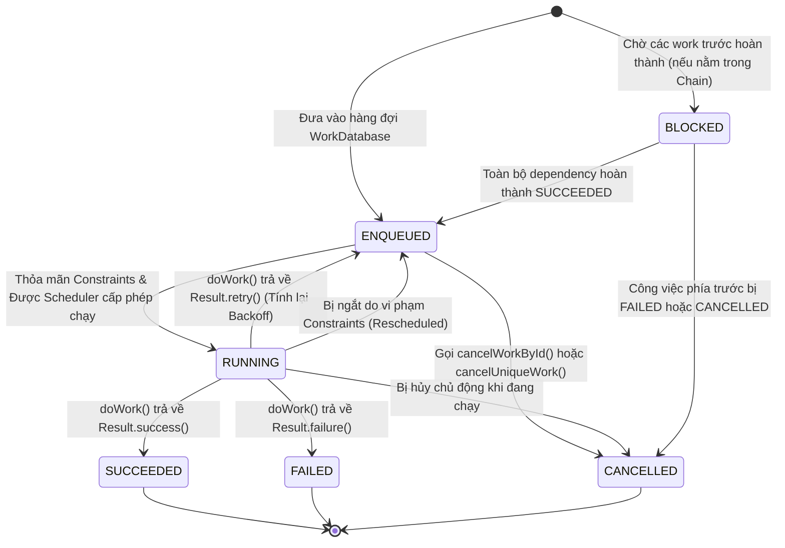
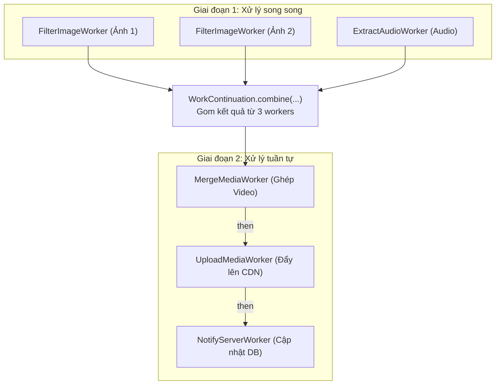

# WorkManager - Guaranteed Background Processing, Internal Mechanics & Architecture

## 1. Tổng quan (What & Why)

### 1.1 Khái niệm (What)
`WorkManager` là thư viện tiêu chuẩn thuộc bộ công cụ **Android Jetpack** được thiết kế để quản lý và thực thi các tác vụ chạy nền có tính chất:
- **Đảm bảo thực thi (Guaranteed Execution):** Tác vụ sẽ luôn được chạy ngay cả khi người dùng tắt ứng dụng (kill process) hoặc thiết bị khởi động lại (device reboot).
- **Có thể trì hoãn (Deferrable Work):** Tác vụ không nhất thiết phải chạy ngay lập tức mà có thể chờ đến khi thiết bị thỏa mãn các điều kiện tối ưu về phần cứng (có kết nối Wifi, đang cắm sạc, pin đầy).
- **Ràng buộc phần cứng (Constraint-Aware):** Tự động tạm dừng hoặc tiếp tục dựa trên trạng thái thời gian thực của pin, mạng, bộ nhớ và chế độ nghỉ (Doze mode).

> [!NOTE]
> **Guaranteed Execution != Immediate Execution:**
> WorkManager đảm bảo tác vụ *chắc chắn sẽ được thực thi*, nhưng **không cam kết** tác vụ sẽ chạy *ngay lập tức trong tích tắc* trừ khi bạn sử dụng cơ chế **Expedited Work**. Hệ thống sẽ cân đối thời điểm chạy dựa trên App Standby Buckets và Doze Mode của Android để tối ưu thời lượng pin.

### 1.2 Khi nào nên sử dụng WorkManager? (Why)
- **Đồng bộ hóa dữ liệu (Data Synchronization):** Gửi các bản ghi thay đổi từ local database lên Cloud server khi có mạng.
- **Tải lên/Tải xuống tệp tin dung lượng lớn (Upload/Download):** Upload hàng loạt ảnh/video sau khi người dùng tạo nội dung, hỗ trợ retry theo cấp số nhân nếu đứt kết nối mạng.
- **Xử lý tác vụ định kỳ (Periodic Cleanup):** Dọn dẹp cache rác, tổng hợp log phân tích định kỳ mỗi 24 giờ.
- **Thực thi chuỗi công việc phức tạp (Chained Work):** Chuỗi gồm: Tải ảnh gốc -> Giải mã & nén ảnh (Thumbnail) -> Ghi vào Room DB -> Đẩy ảnh đã nén lên Cloud.

---

## 2. Cơ chế hoạt động bên trong (Internal Mechanism)

### 2.1 Cấu trúc bên trong của WorkManager (Internal Architecture)

Bên dưới lớp vỏ bọc API cấp cao, WorkManager được xây dựng từ một hệ thống nhiều tầng phối hợp chặt chẽ:

```
┌────────────────────────────────────────────────────────────────────────┐
│                        WorkManager Public API                          │
│     (OneTimeWorkRequest, PeriodicWorkRequest, WorkContinuation)        │
└───────────────────────────────────┬────────────────────────────────────┘
                                    │ enqueue()
                                    ▼
┌────────────────────────────────────────────────────────────────────────┐
│                 WorkDatabase (Room / SQLite Persistence)               │
│         Bảng: WorkSpec, WorkTag, WorkName, Dependency, SystemId        │
└───────┬────────────────────────────────────────────────────────┬───────┘
        │ Persisted                                              │ Persisted
        ▼                                                        ▼
┌──────────────────────────────┐        ┌────────────────────────────────┐
│       GreedyScheduler        │        │        System Schedulers       │
│ (Chạy ngay nếu App đang mở) │        │ (Lập lịch với Hệ điều hành)    │
└──────────────────────────────┘        └────────────────┬───────────────┘
                                                         │
                                    ┌────────────────────┴───────────────┐
                                    │ API 23+: JobScheduler             │
                                    │ API < 23: AlarmManager + Broadcast │
                                    └────────────────────────────────────┘
```

1. **WorkDatabase (Room DB Persistence):**
   - Khi bạn gọi `WorkManager.enqueue()`, bước đầu tiên là toàn bộ thông tin tác vụ (`WorkSpec`), các cờ ràng buộc (`Constraints`), dữ liệu đầu vào (`Input Data`), thẻ nhận diện (`WorkTag`) và phụ thuộc (`Dependency`) đều được ghi ngay vào cơ sở dữ liệu SQLite cục bộ (`androidx.work.workdb`).
   - Nhờ bước ghi đĩa này, WorkManager có khả năng sống sót vĩnh viễn qua mọi cú crash, process death hay reboot.
2. **System Schedulers:**
   - **JobScheduler (API 23+):** WorkManager chuyển giao các ràng buộc cho JobScheduler của Android OS. Chính OS sẽ là người theo dõi mạng, pin và đánh thức ứng dụng.
   - **AlarmManager + BroadcastReceiver (API < 23):** Giải pháp fallback cho các phiên bản cũ trước Android Marshmallow.
   - **RescheduleReceiver:** Một static BroadcastReceiver lắng nghe `ACTION_BOOT_COMPLETED` và `ACTION_MY_PACKAGE_REPLACED`. Khi máy reboot, receiver này được đánh thức, đọc `WorkDatabase` và tự động re-schedule toàn bộ các work chưa hoàn tất với `JobScheduler`.
3. **GreedyScheduler:**
   - Khi ứng dụng đang ở Foreground, `GreedyScheduler` sẽ trực tiếp khởi chạy worker ngay lập tức nếu các constraints đã thỏa mãn mà không cần chờ chu kỳ đánh thức của `JobScheduler`, giúp giảm thiểu tối đa độ trễ.

### 2.2 Phân loại WorkRequest

#### 1. OneTimeWorkRequest
- Thực thi một lần duy nhất.
- Cho phép thiết lập `setInitialDelay()`, áp dụng `Constraints`, và tham gia vào chuỗi công việc (`WorkContinuation`).
- Hỗ trợ **Expedited Work** qua `setExpedited()`.

#### 2. PeriodicWorkRequest
- Thực thi lặp lại theo chu kỳ định sẵn.
- **Giới hạn chu kỳ tối thiểu (Minimum Interval):** **15 phút** (`PeriodicWorkRequest.MIN_PERIODIC_INTERVAL_MILLIS`). Nếu bạn truyền giá trị nhỏ hơn 15 phút, WorkManager sẽ tự động làm tròn lên 15 phút.
- **Flex Interval:** Cho phép định nghĩa một "cửa sổ linh hoạt" (Flex Window) ở cuối chu kỳ mà tác vụ được phép chạy (tối thiểu là **5 phút**), giúp hệ điều hành gom nhóm (batch) các tác vụ với các app khác để tiết kiệm pin.
- **Lưu ý:** `PeriodicWorkRequest` không thể tham gia vào chuỗi công việc (`then()` chaining).

### 2.3 Quản lý Ràng buộc phần cứng (Constraints)
WorkManager hỗ trợ các điều kiện phần cứng cực kỳ linh hoạt:
- `setRequiredNetworkType(NetworkType)`:
  - `CONNECTED`: Có bất kỳ kết nối mạng nào.
  - `UNMETERED`: Mạng không giới hạn lưu lượng (Wifi, Ethernet).
  - `NOT_ROAMING`: Không phải mạng chuyển vùng (Roaming) để tránh tốn cước phí.
  - `METERED`: Mạng 3G/4G/5G tính phí.
- `setRequiresCharging(true)`: Chỉ chạy khi thiết bị đang cắm sạc.
- `setRequiresBatteryNotLow(true)`: Không chạy khi pin yếu (< 15-20%).
- `setRequiresStorageNotLow(true)`: Dung lượng bộ nhớ trống không ở mức báo động.
- `setRequiresDeviceIdle(true)`: Thiết bị đang không được tương tác trực tiếp (màn hình tắt, CPU rảnh - API 23+).

### 2.4 Dữ liệu Input / Output và Giới hạn 10KB
Dữ liệu truyền vào (`setInputData`) và kết quả trả về (`Result.success(outputData)`) được đóng gói qua `Data.Builder`:
- **Giới hạn dung lượng nghiêm ngặt:** Tổng dung lượng của một đối tượng `Data` **KHÔNG ĐƯỢC VƯỢT QUÁ 10KB** (`Data.MAX_DATA_BYTES = 10 * 1024`).
- **Lý do:** Toàn bộ payload của `Data` được serialize thành mảng byte và lưu trực tiếp vào một cột `BLOB` của bảng `WorkSpec` trong SQLite. Nếu lưu trữ file hoặc ảnh lớn sẽ làm phình to DB, chậm query và ném ra ngoại lệ `IllegalStateException: Data cannot occupy more than 10240 bytes`.
- **Best Practice:** Chỉ truyền URI, file path, ID bản ghi hoặc khóa tham chiếu (Primitive types / Strings) qua `Data`.

### 2.5 Unique Work: Ngăn chặn Duplicate Work

Để tránh việc người dùng nhấn nút nhiều lần tạo ra hàng loạt tác vụ trùng lặp, ta sử dụng `enqueueUniqueWork()` (cho OneTime) hoặc `enqueueUniquePeriodicWork()` (cho Periodic) với tên định danh duy nhất (`uniqueWorkName`) và chính sách giải quyết xung đột `ExistingWorkPolicy`:

| ExistingWorkPolicy | Hành vi khi đã có tác vụ cùng tên đang chạy hoặc đang chờ |
| :--- | :--- |
| `KEEP` | **Giữ nguyên tác vụ cũ.** Bỏ qua tác vụ mới được yêu cầu. Phù hợp cho Sync định kỳ. |
| `REPLACE` | **Hủy và thay thế tác vụ cũ.** Hủy tác vụ đang chạy/đang chờ và đưa tác vụ mới vào hàng đợi. Phù hợp khi có cấu hình/bộ lọc mới từ người dùng. |
| `APPEND` | Nối tác vụ mới vào sau chuỗi của tác vụ cũ. Tác vụ mới sẽ chỉ chạy khi tác vụ cũ chạy thành công (nếu cũ FAILED thì mới FAILED theo). |
| `APPEND_OR_REPLACE` | Tương tự APPEND, nhưng nếu tác vụ cũ trước đó bị FAILED hoặc CANCELLED, tác vụ mới vẫn được chạy như một chuỗi mới độc lập. |

### 2.6 Retry, Exponential Backoff & Idempotency

#### 1. Retry và Backoff Policy
Khi một worker gặp sự cố tạm thời (ví dụ: máy chủ trả về HTTP 503, rớt mạng giữa chừng), phương thức `doWork()` có thể trả về `Result.retry()`.
- **Cấu hình Backoff:**
  - `BackoffPolicy.LINEAR`: Thời gian chờ tăng tuyến tính ($T \times n$).
  - `BackoffPolicy.EXPONENTIAL`: Thời gian chờ tăng theo cấp số nhân ($T \times 2^{n-1}$).
  - Thời gian backoff tối thiểu là **10 giây**.
- **Số lần thử lại (`runAttemptCount`):** Worker có thể kiểm tra biến `runAttemptCount` để quyết định khi nào nên từ bỏ và trả về `Result.failure()`.

#### 2. Tại sao Worker PHẢI Idempotent (Bất biến lũy thừa)?
> [!IMPORTANT]
> **Quy tắc vàng của WorkManager:**
> Hệ thống chỉ đảm bảo ngữ nghĩa **At-least-once execution** (thực thi ít nhất một lần), **KHÔNG CAM KẾT** *Exactly-once execution* (chính xác một lần duy nhất).

**Các kịch bản Worker bị gọi lại nhiều lần:**
1. Worker đang ghi dữ liệu vào Server thì mất mạng -> Worker trả về `Result.retry()`. Nhưng trên thực tế server đã kịp lưu bản ghi trước khi đường truyền bị đứt!
2. Người dùng ngắt sạc hoặc tắt mạng khi Worker đang chạy dở -> Hệ thống gửi tín hiệu dừng (`CancellationException`), sau đó tự động reschedule lại Worker khi có sạc/mạng trở lại.
3. Tiến trình của app bị OS kill đột ngột giữa chừng.

**Cách thiết kế Worker Idempotent:**
- Sử dụng **Unique Request ID / Idempotency Key (UUID/UUID v4)** gửi kèm trong API Header. Phía Backend kiểm tra nếu đã xử lý ID này thì chỉ trả về kết quả thành công mà không trừ tiền hay insert đúp.
- Ở Local Database, sử dụng cơ chế `INSERT OR REPLACE` hoặc kiểm tra trạng thái cờ `status == PENDING` trước khi xử lý tiếp.

### 2.7 Expedited Work (Android 12+)
- Thay thế hoàn toàn cho `IntentService` và Background Service truyền thống cho các tác vụ cần chạy khẩn cấp (trong vòng vài giây sau yêu cầu).
- **Cơ chế:**
  - Trên **Android 12 (API 31)+**: Chạy trực tiếp dưới sự điều phối ưu tiên của `JobScheduler` mà không bị cản bởi Doze Mode hay App Standby.
  - Trên **Android < 12**: Tự động chuyển đổi thành một **Foreground Service** tạm thời và hiển thị thông báo notification cho người dùng.
- Bắt buộc phải override phương thức `getForegroundInfo()` trong Worker để cung cấp Notification cho các máy Android đời cũ.

---

## 3. Luồng hoạt động (Flow Diagram - dùng mermaid)

### 3.1 Vòng đời trạng thái của một WorkRequest (Work Lifecycle State Machine)



### 3.2 Luồng thực thi Work Chaining phức tạp (Parallel -> Combine -> Serial)



---

## 4. Real-world Use Case

### 4.1 Production-Ready CoroutineWorker với Expedited Work & Progress Reporting

Xây dựng một Worker tải file và xử lý nén dữ liệu, hỗ trợ hiển thị Notification trên Android cũ, cập nhật tiến trình % qua `setProgress()`, và xử lý hủy tác vụ an toàn:

```kotlin
package com.example.core.worker

import android.app.Notification
import android.app.NotificationChannel
import android.app.NotificationManager
import android.content.Context
import android.content.pm.ServiceInfo
import android.os.Build
import androidx.core.app.NotificationCompat
import androidx.work.CoroutineWorker
import androidx.work.ForegroundInfo
import androidx.work.WorkerParameters
import androidx.work.workDataOf
import kotlinx.coroutines.CancellationException
import kotlinx.coroutines.Dispatchers
import kotlinx.coroutines.delay
import kotlinx.coroutines.withContext

class MediaProcessingWorker(
    appContext: Context,
    params: WorkerParameters
) : CoroutineWorker(appContext, params) {

    override suspend fun doWork(): Result = withContext(Dispatchers.IO) {
        val inputFilePath = inputData.getString(KEY_INPUT_FILE)
            ?: return@withContext Result.failure(workDataOf(KEY_ERROR to "Missing input file path"))

        val totalSteps = 100

        try {
            // Giả lập xử lý nén file từng phần với khả năng cập nhật tiến trình
            for (progress in 1..totalSteps) {
                // Kiểm tra xem hệ thống hoặc người dùng có gửi tín hiệu hủy Worker hay không
                if (isStopped) {
                    return@withContext Result.retry()
                }

                delay(100L) // Giả lập công việc tốn CPU / I/O

                // Cập nhật tiến trình cho UI lắng nghe thông qua LiveData/Flow
                setProgress(workDataOf(KEY_PROGRESS to progress))
            }

            val outputFilePath = "/storage/emulated/0/Download/compressed_file.mp4"
            val outputData = workDataOf(KEY_OUTPUT_FILE to outputFilePath)

            Result.success(outputData)
        } catch (e: CancellationException) {
            // Worker bị hủy do vi phạm ràng buộc (mất sạc, mất mạng)
            Result.retry()
        } catch (e: Exception) {
            if (runAttemptCount < 3) {
                Result.retry()
            } else {
                Result.failure(workDataOf(KEY_ERROR to e.localizedMessage))
            }
        }
    }

    // Bắt buộc override để hỗ trợ Expedited Work trên Android < 12
    override suspend fun getForegroundInfo(): ForegroundInfo {
        val notification = createNotification("Đang xử lý nén tệp tin đa phương tiện...")
        return if (Build.VERSION.SDK_INT >= Build.VERSION_CODES.Q) {
            ForegroundInfo(
                NOTIFICATION_ID,
                notification,
                ServiceInfo.FOREGROUND_SERVICE_TYPE_DATA_SYNC
            )
        } else {
            ForegroundInfo(NOTIFICATION_ID, notification)
        }
    }

    private fun createNotification(message: String): Notification {
        createChannelIfNeeded()
        return NotificationCompat.Builder(applicationContext, CHANNEL_ID)
            .setContentTitle("Xử lý dữ liệu nền")
            .setContentText(message)
            .setSmallIcon(android.R.drawable.stat_notify_sync)
            .setOngoing(true)
            .build()
    }

    private fun createChannelIfNeeded() {
        if (Build.VERSION.SDK_INT >= Build.VERSION_CODES.O) {
            val channel = NotificationChannel(
                CHANNEL_ID,
                "Media Processing Channel",
                NotificationManager.IMPORTANCE_LOW
            )
            val manager = applicationContext.getSystemService(NotificationManager::class.java)
            manager.createNotificationChannel(channel)
        }
    }

    companion object {
        const val KEY_INPUT_FILE = "KEY_INPUT_FILE"
        const val KEY_OUTPUT_FILE = "KEY_OUTPUT_FILE"
        const val KEY_PROGRESS = "KEY_PROGRESS"
        const val KEY_ERROR = "KEY_ERROR"
        const val CHANNEL_ID = "media_worker_channel"
        const val NOTIFICATION_ID = 2002
    }
}
```

### 4.2 Thiết lập Chuỗi công việc Chaining, Unique Work & Constraints

```kotlin
package com.example.core.manager

import android.content.Context
import androidx.lifecycle.asFlow
import androidx.work.BackoffPolicy
import androidx.work.Constraints
import androidx.work.ExistingWorkPolicy
import androidx.work.NetworkType
import androidx.work.OneTimeWorkRequestBuilder
import androidx.work.OutOfQuotaPolicy
import androidx.work.WorkInfo
import androidx.work.WorkManager
import androidx.work.workDataOf
import com.example.core.worker.MediaProcessingWorker
import kotlinx.coroutines.flow.Flow
import java.util.concurrent.TimeUnit

class BackgroundWorkScheduler(private val context: Context) {

    private val workManager = WorkManager.getInstance(context)

    fun scheduleMediaUploadChain(filePath: String): Flow<WorkInfo> {
        // 1. Ràng buộc phần cứng: Cần Wifi và Pin không yếu
        val uploadConstraints = Constraints.Builder()
            .setRequiredNetworkType(NetworkType.UNMETERED)
            .setRequiresBatteryNotLow(true)
            .build()

        // 2. Worker 1: Xử lý tệp khẩn cấp (Expedited Work)
        val processRequest = OneTimeWorkRequestBuilder<MediaProcessingWorker>()
            .setInputData(workDataOf(MediaProcessingWorker.KEY_INPUT_FILE to filePath))
            .setExpedited(OutOfQuotaPolicy.RUN_AS_NON_EXPEDITED_WORK_REQUEST)
            .setBackoffCriteria(
                BackoffPolicy.EXPONENTIAL,
                15, TimeUnit.SECONDS
            )
            .build()

        // 3. Worker 2: Upload dữ liệu (Chờ sau khi Worker 1 hoàn thành)
        val uploadRequest = OneTimeWorkRequestBuilder<MediaProcessingWorker>()
            .setConstraints(uploadConstraints)
            .setBackoffCriteria(
                BackoffPolicy.EXPONENTIAL,
                30, TimeUnit.SECONDS
            )
            .build()

        // 4. Kích hoạt Unique Work Chaining (Chống spam duplicate)
        workManager.beginUniqueWork(
            "MEDIA_UPLOAD_CHAIN",
            ExistingWorkPolicy.REPLACE, // Người dùng chọn file mới thì hủy chuỗi cũ
            processRequest
        ).then(uploadRequest)
            .enqueue()

        // Trả về Flow theo dõi trạng thái của worker cuối cùng
        return workManager.getWorkInfoByIdLiveData(uploadRequest.id).asFlow()
    }
}
```

### 4.3 Tích hợp Dependency Injection với Hilt (@HiltWorker)

Khi Worker cần inject các Repository, Database Dao hoặc Retrofit ApiService:

```kotlin
package com.example.core.worker

import android.content.Context
import androidx.hilt.work.HiltWorker
import androidx.work.CoroutineWorker
import androidx.work.WorkerParameters
import com.example.core.repository.UserRepository
import dagger.assisted.Assisted
import dagger.assisted.AssistedInject
import kotlinx.coroutines.Dispatchers
import kotlinx.coroutines.withContext

@HiltWorker
class SyncUserProfileWorker @AssistedInject constructor(
    @Assisted appContext: Context,
    @Assisted workerParams: WorkerParameters,
    private val userRepository: UserRepository // Injected bởi Hilt
) : CoroutineWorker(appContext, workerParams) {

    override suspend fun doWork(): Result = withContext(Dispatchers.IO) {
        return@withContext try {
            val success = userRepository.syncProfilesWithServer()
            if (success) Result.success() else Result.retry()
        } catch (e: Exception) {
            Result.failure()
        }
    }
}
```

```kotlin
// Trong Application class:
@HiltAndroidApp
class MainApplication : Application(), Configuration.Provider {

    @Inject
    lateinit var workerFactory: HiltWorkerFactory

    override val workManagerConfiguration: Configuration
        get() = Configuration.Builder()
            .setWorkerFactory(workerFactory)
            .build()
}
```

---

## 5. Anti-Patterns & Pitfalls

### ❌ Anti-Pattern 1: Lưu trữ dữ liệu lớn trong Input / Output Data
- **Sai lầm:** Nhồi nhét mảng byte ảnh, JSON String dài hoặc Bitmap vào `Data.Builder`.
- **Hậu quả:** Ném `IllegalStateException` làm crash app vì vượt quá giới hạn **10KB**.
- **Giải pháp:** Lưu file vào Local Disk hoặc Cache Directory, chỉ truyền đường dẫn file `filePath` hoặc `URI` trong `Data`.

### ❌ Anti-Pattern 2: Worker không đảm bảo tính Idempotent (Bất biến lũy thừa)
- **Sai lầm:** Viết logic trừ tiền ví điện tử hoặc gọi API đặt hàng mà không có mã định danh giao dịch duy nhất.
- **Hậu quả:** Khi mạng chập chờn, WorkManager tự động kích hoạt `retry()`, dẫn đến việc người dùng bị trừ tiền hai lần hoặc tạo hai đơn hàng trùng lặp.
- **Giải pháp:** Sử dụng **Idempotency Key** sinh từ UUID gắn vào Header API, kết hợp cơ chế kiểm tra trạng thái trong Local DB.

### ❌ Anti-Pattern 3: Cấu hình PeriodicWorkRequest với chu kỳ dưới 15 phút
- **Sai lầm:** Đặt `PeriodicWorkRequestBuilder<MyWorker>(5, TimeUnit.MINUTES)`.
- **Hậu quả:** Không có lỗi ném ra tại runtime nhưng WorkManager sẽ **tự động ép chu kỳ về 15 phút** (`PeriodicWorkRequest.MIN_PERIODIC_INTERVAL_MILLIS`). Mọi kỳ vọng chạy mỗi 5 phút của bạn đều bị phá vỡ.
- **Giải pháp:** Nếu cần chu kỳ ngắn dưới 15 phút và có UI tương tác, dùng Foreground Service hoặc Coroutines `flow` với `delay`.

### ❌ Anti-Pattern 4: Block Thread trực tiếp trong CoroutineWorker mà không chuyển Dispatcher
- **Sai lầm:** Thực thi logic nén file hoặc I/O trực tiếp trong `doWork()` mà không bọc trong `withContext(Dispatchers.IO)`.
- **Hậu quả:** Mặc định CoroutineWorker chạy trên `Dispatchers.Default` (tối ưu tính toán CPU). Nếu bị nghẽn I/O sẽ làm tắc nghẽn thread pool của ứng dụng.

---

## 6. Trade-offs & So sánh

### WorkManager vs JobScheduler vs AlarmManager vs Foreground Service

| Tiêu chí | WorkManager | JobScheduler | AlarmManager | Foreground Service |
| :--- | :--- | :--- | :--- | :--- |
| **API Cấp thấp hay Cao** | Cấp cao (Jetpack wrapper) | Hệ điều hành (API 21+) | Hệ điều hành (API 1+) | Cốt lõi Android Component |
| **Độ chính xác thời gian** | Xấp xỉ (Inexact / Batching) | Xấp xỉ (Inexact) | **Chính xác từng ms (Exact Alarm)** | Ngay lập tức |
| **Bảo lưu qua Reboot** | **Tự động (Room DB)** | Tự động (`setPersisted`) | Mất sạch (Cần tự re-schedule) | Không |
| **Hỗ trợ Ràng buộc** | Rất mạnh mẽ | Mạnh mẽ | Không hỗ trợ | Không hỗ trợ |
| **Thông báo Notification** | Không (Trừ khi Expedited trên Android cũ) | Không | Không | **Bắt buộc hiển thị** |
| **Use case chuẩn** | Sync dữ liệu, Upload file, Cleanup | Không khuyến khích dùng trực tiếp | Báo thức, Đồng hồ hẹn giờ | Chơi nhạc, Dẫn đường GPS |

---

## 7. Senior-level Insights

### 7.1 Cơ chế Reschedule sau Reboot hoạt động như thế nào bên dưới?
1. Khi máy khởi động lại, `JobScheduler` của OS kích hoạt các job có gắn cờ `PERSISTED`.
2. Đồng thời, `RescheduleReceiver` của WorkManager lắng nghe sự kiện `BOOT_COMPLETED`.
3. WorkManager khởi tạo một transaction trong `WorkDatabase`.
4. Toàn bộ các WorkRequest có trạng thái `RUNNING` tại thời điểm máy bị tắt nguồn sẽ được chuyển ngược về trạng thái `ENQUEUED` với số lần retry tăng thêm 1.
5. Schedulers tiếp tục theo dõi các điều kiện phần cứng và kích hoạt lại Worker vào thời điểm phù hợp nhất.

### 7.2 Ảnh hưởng của Doze Mode và App Standby Buckets tới WorkManager
Hệ điều hành Android phân loại ứng dụng vào các nhóm **App Standby Buckets**:
- **Active:** App đang mở -> WorkManager chạy gần như tức thì thông qua `GreedyScheduler`.
- **Working Set:** App được mở thường xuyên -> Chậm trễ vài phút.
- **Frequent / Rare:** App ít khi mở -> Hệ điều hành hạn chế cấp mạng và CPU, các Job của WorkManager có thể bị hoãn lại từ vài giờ đến cả ngày cho đến khi thiết bị cắm sạc hoặc người dùng mở app.
- **Doze Mode (Chế độ ngủ sâu):** Thiết bị rút sạc, tắt màn hình, để yên không di chuyển. Mọi network và background job bị đình chỉ hoàn toàn, chỉ được xả lũ thực thi trong các **Maintenance Windows** ngắn ngủi do hệ điều hành mở ra.

### 7.3 Chiến lược thiết kế Worker Idempotent trong Hệ thống Thanh toán / Đồng bộ
Để thiết kế một Worker an toàn 100% trước hiện tượng thực thi lặp lại:
1. **Client-side State Machine:** Trước khi gọi API thanh toán, ghi bản ghi vào Room DB với trạng thái `TRANSACTION_PENDING` cùng một chuỗi `transaction_uuid = UUID.randomUUID().toString()`.
2. **Idempotency Key trong API Call:** Gửi `X-Idempotency-Key: transaction_uuid` lên Server.
3. **Database Transaction:** Khi API trả về kết quả, thực thi việc cập nhật trạng thái `TRANSACTION_COMPLETED` trong một Room `@Transaction`.
4. **Retry Resilience:** Nếu Worker bị kill và chạy lại, nó kiểm tra DB thấy `transaction_uuid` đã ở trạng thái `COMPLETED` thì trả về ngay `Result.success()` mà không gọi lại API lần thứ hai.

---

## 8. Câu hỏi phỏng vấn (với gợi ý trả lời)

### Q1: WorkManager là gì? Tại sao nói WorkManager đảm bảo thực thi nhưng không đảm bảo chạy ngay lập tức?
> **Gợi ý trả lời:**
> WorkManager là thư viện Jetpack quản lý các tác vụ chạy nền có tính chất hoãn lại (deferrable) và cần đảm bảo (guaranteed).
> - **Đảm bảo thực thi (Guaranteed):** Bởi vì WorkManager lưu trữ toàn bộ trạng thái công việc vào cơ sở dữ liệu Room SQLite trên đĩa (`WorkDatabase`). Dù process bị kill hay thiết bị khởi động lại, công việc vẫn được lưu giữ và tái lập lịch tự động.
> - **Không chạy ngay lập tức:** Bởi vì WorkManager tôn trọng triệt để cơ chế tối ưu năng lượng của OS (Doze Mode, App Standby Buckets). Hệ thống có thể gom nhóm các tác vụ để chờ đến khi có kết nối Wifi hoặc đang cắm sạc mới kích hoạt, trừ khi ta cấu hình **Expedited Work**.

### Q2: Sự khác biệt bản chất giữa OneTimeWorkRequest và PeriodicWorkRequest là gì? Chu kỳ tối thiểu của PeriodicWorkRequest là bao nhiêu?
> **Gợi ý trả lời:**
> - `OneTimeWorkRequest`: Chỉ chạy một lần duy nhất, có thể thiết lập độ trễ ban đầu (`setInitialDelay`), có thể liên kết chuỗi (`WorkContinuation`), và có thể cấu hình Expedited.
> - `PeriodicWorkRequest`: Chạy lặp đi lặp lại theo chu kỳ định sẵn. Nó không thể tham gia vào chuỗi công việc (`then()`).
> - **Chu kỳ tối thiểu:** **15 phút**. Nếu developer cấu hình chu kỳ thấp hơn (ví dụ 5 phút), WorkManager sẽ tự động điều chỉnh về 15 phút tại runtime để bảo vệ thời lượng pin của thiết bị.

### Q3: WorkManager lưu trữ trạng thái ở đâu? Điều gì xảy ra khi người dùng Force Stop ứng dụng?
> **Gợi ý trả lời:**
> WorkManager lưu trữ toàn bộ thông tin tác vụ trong cơ sở dữ liệu **Room SQLite** cục bộ nằm trong thư mục dữ liệu nội bộ của ứng dụng.
> - Khi người dùng **Force Stop** ứng dụng từ App Settings: Hệ điều hành Android sẽ đưa ứng dụng vào trạng thái `Stopped State`. Tại trạng thái này, mọi Alarm, JobScheduler và BroadcastReceiver đều bị vô hiệu hóa hoàn toàn.
> - Toàn bộ các Worker đã lên lịch sẽ **không được kích hoạt** chừng nào người dùng chưa chủ động mở lại ứng dụng bằng tay.

### Q4: Tại sao Worker PHẢI Idempotent? Cho ví dụ về lỗi xảy ra nếu Worker không Idempotent?
> **Gợi ý trả lời:**
> Worker phải có tính chất Idempotent vì WorkManager hoạt động theo nguyên lý **At-least-once execution** (thực thi ít nhất một lần). Hệ thống có thể tái thực thi lại Worker nếu xảy ra các sự cố: rớt mạng giữa chừng, mất sạc khiến vi phạm ràng buộc, hoặc tiến trình bị hệ thống dọn dẹp.
> - **Ví dụ lỗi:** Một Worker thực hiện logic trừ 50.000đ từ tài khoản người dùng để mua vé xem phim. Nếu Worker trừ tiền thành công trên server nhưng đường truyền mạng bị ngắt trước khi nhận được phản hồi, Worker sẽ trả về `Result.retry()`. Lần chạy tiếp theo, nếu logic không idempotent, tài khoản người dùng sẽ bị trừ thêm 50.000đ lần thứ hai (thành 100.000đ).

### Q5: Phân biệt các chính sách ExistingWorkPolicy: KEEP, REPLACE, APPEND và APPEND_OR_REPLACE?
> **Gợi ý trả lời:**
> Khi gọi `enqueueUniqueWork()` với một tên duy nhất:
> 1. `KEEP`: Giữ nguyên công việc hiện tại đang chạy/đang chờ, bỏ qua hoàn toàn yêu cầu công việc mới.
> 2. `REPLACE`: Hủy bỏ công việc hiện tại và thay thế bằng công việc mới.
> 3. `APPEND`: Nối công việc mới vào cuối chuỗi công việc hiện tại. Công việc mới phụ thuộc vào việc công việc cũ kết thúc thành công (`SUCCEEDED`). Nếu công việc cũ thất bại, công việc mới sẽ bị hủy theo.
> 4. `APPEND_OR_REPLACE`: Tương tự APPEND, nhưng nếu công việc cũ bị `FAILED` hoặc `CANCELLED`, công việc mới vẫn tiếp tục được thực thi như một chuỗi độc lập mới thay vì bị chết theo.

### Q6: Expedited Work là gì? Nó hoạt động như thế nào trên Android 12 trở lên so với các phiên bản Android cũ hơn?
> **Gợi ý trả lời:**
> Expedited Work là cơ chế của WorkManager cho phép thực thi tác vụ khẩn cấp gần như ngay lập tức, vượt qua các rào cản của Doze mode và App Standby.
> - **Trên Android 12 (API 31)+:** Hệ thống sử dụng trực tiếp các tác vụ khẩn cấp của `JobScheduler` (Expedited Jobs), không cần hiển thị notification nếu không muốn.
> - **Trên Android < 12:** WorkManager tự động kích hoạt một **Foreground Service** truyền thống để đảm bảo tiến trình không bị kill. Do đó, Worker bắt buộc phải cài đặt phương thức `getForegroundInfo()` để cung cấp Notification cho hệ thống.

### Q7: Giới hạn dung lượng của Data truyền trong WorkRequest là bao nhiêu? Tại sao lại có giới hạn này?
> **Gợi ý trả lời:**
> Giới hạn tối đa là **10KB** (`Data.MAX_DATA_BYTES`).
> **Lý do kiến trúc:**
> Đối tượng `Data` được serialize thành một mảng byte và lưu trực tiếp vào một cột `BLOB` của bảng `WorkSpec` trong cơ sở dữ liệu SQLite của WorkManager. Việc lưu trữ dữ liệu quá lớn trong SQLite sẽ làm suy giảm nghiêm trọng hiệu năng đọc/ghi của database và có nguy cơ gây tràn Transaction Buffer. WorkManager được thiết kế để truyền tải cờ điều khiển và tham số cấu hình, không phải kênh trung chuyển tệp dữ liệu dung lượng lớn.

---

## 9. Tài liệu tham khảo
- [Android Developers - WorkManager Architecture & Concepts](https://developer.android.com/develop/background-work/background-tasks/persistent)
- [Android Developers - Threading in WorkManager (CoroutineWorker)](https://developer.android.com/develop/background-work/background-tasks/persistent/threading/coroutineworker)
- [Android Developers - Support for Expedited Work](https://developer.android.com/develop/background-work/background-tasks/persistent/how-to/expedited-work)
- [Android Jetpack Source Code - WorkDatabase & Schedulers Implementation](https://cs.android.com/androidx/platform/frameworks/support/+/androidx-main:work/work-runtime/src/main/java/androidx/work/impl/)
